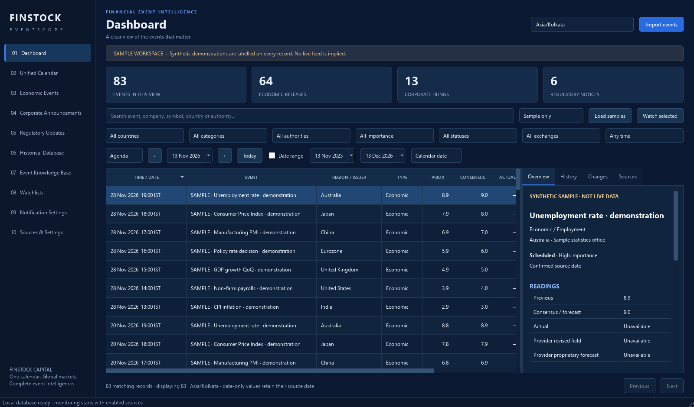

# Finstock EventScope

**Finstock Capital — One Calendar. Global Markets. Complete Event Intelligence.**

A Python / PySide6 Windows desktop application for economic releases, Indian corporate announcements and regulatory notices. Local SQLite history, original source references, timezone conversion and configurable reminders form the core. No paid AI API is required.



## Run the Windows Application (No Python Required)

1. Extract the full `FinstockEventScope-Windows.zip` archive into any folder (e.g. Desktop).
2. **Important:** Do **not** run `FinstockEventScope.exe` from inside the unextracted ZIP preview. Always extract the folder first so the adjacent `_internal/` runtime folder is present.
3. Double-click `FinstockEventScope.exe` to launch the terminal immediately with full offline access.
4. Normal application use requires zero Python commands or background services.

## API Configuration & Google Gemini AI (Bring-Your-Own-Key)

* **100% Functional Without Any API Key:** All 2,787 live financial events, Unified Calendar, macroeconomic indicators (RBI MPC, MoSPI, US Fed FOMC, ECB), NSE corporate earnings, and SEBI regulatory circulars are stored in the local SQLite database and are completely accessible offline without any API key or subscription.
* **Optional Google Gemini AI Integration:** For real-time, generative AI event intelligence and deep market impact analysis:
  1. Generate your own free Gemini API key from [Google AI Studio](https://aistudio.google.com/) (takes 30 seconds; free tier available with no credit card required).
  2. In the terminal, click the **`🔑 API / AI`** button in the top navigation bar.
  3. Paste your key and click **Save**.
  4. Keys are stored securely in your local Windows Credential Vault (`Finstock.EventScope`) and are never shared or transmitted to external third-party servers.
* **Data Security & Privacy:** Following institutional cybersecurity guidelines, this repository bundles zero private API keys or personal credentials.

## Features

- Dashboard; unified, economic, corporate, regulatory and historical views.
- Daily, weekly, monthly and agenda calendars; search and structured filters.
- CSV/JSON import using pandas, deterministic validation and individual rejection logs.
- Separate publication, scheduled, effective, deadline, record and ex-dates; date-only preservation.
- Previous, consensus, actual, revised and provider forecast fields without fabricated missing values.
- Persistent revisions, multiple source references and conservative cross-exchange matching.
- Educational pages with source references and compatible-series history charts.
- Worldwide IANA timezone selector with DST support.
- Watchlists and editable country/company/category/authority/importance notification rules.
- Persistent reminders, detection alerts, duplicate suppression, cancellation/rescheduling and history.
- Official RSS adapters for SEBI, RBI press releases/notifications and NSE announcements/circulars.
- Trading Economics calendar adapter configurable with the user's own licensed credential.
- BSE and Indian statistical/fiscal events through authorized file imports.
- Per-source intervals, retries, throttling, checkpoints, last-success and health status.
- Synthetic offline dataset and a working ten-second reminder simulation.
- Consistent local backup, migrations, logs, tests and reproducible Windows packaging.

## Development setup

Python **3.12 x64** is the tested build runtime. Use an isolated environment. Windows notification wheels may lag newer Python releases; Python 3.15 is not the tested notification/build target.

```powershell
python -m venv .venv
.\.venv\Scripts\python.exe -m pip install -r requirements-dev.txt
.\.venv\Scripts\python.exe launch.py
```

`requirements-lock.txt` records the exact Windows/Python 3.12 environment used for delivery. For that platform, install it instead of the range-based development requirements when reproducing the build. There is no automatic `.env` loader; `.env.example` documents optional process environment variables. The credential settings screen uses Windows Credential Manager.

```powershell
.\.venv\Scripts\python.exe -m pytest -q
.\scripts\build_windows.ps1
```

The build script runs tests before PyInstaller. The `.spec` bundles resources and the required Windows notification projections, and excludes unused Qt web/chart components. If PowerShell policy does not permit the script, run its documented individual Python commands; do not change system security policy.

## Documentation

- [User manual](docs/USER_MANUAL.md)
- [Import schema](docs/IMPORT_FORMAT.md)
- [Source configuration and limitations](docs/SOURCE_GUIDE.md)
- [Architecture and schema](docs/ARCHITECTURE.md)
- [Testing and acceptance](docs/TESTING.md)
- [Capstone demonstration](docs/CAPSTONE.md)
- [Dependency notices](docs/THIRD_PARTY_NOTICES.md)

## Coverage and limitations

This is a functioning Phase 1 desktop application. Worldwide live calendar coverage depends on your provider entitlement. A documented, mock-tested API adapter is not an authenticated integration test. Official RSS feeds can be truncated, omit exact times/filing links, or be unavailable. Connected indicates a successful validated check, not exhaustive market coverage.

NSE/BSE-equivalent filings are automatically grouped only with matching supplied ISIN, category, period and document digest. Possible matches without that evidence remain separate. Revisions are preserved; complete history before capture requires an authorized historical dataset. The application does not download full linked documents or calculate corporate-action valuations.

Notifications depend on the running Windows user session and OS notification settings. Submitted does not prove visible delivery. The distribution is not code-signed; signing and a clean machine/organization deployment pilot remain distribution tasks. Do not bypass Windows security warnings. No cloud synchronization, multi-user server, trading execution, dividend/buyback analytics or AI market-impact prediction is included.

Do not commit local databases, private credentials, logs or restricted datasets. The source distribution deliberately omits `.venv`, `qa-data`, `build`, `dist` and user data. GitHub publication is a separate user action; no repository has been published automatically.

## Project structure

```text
app/
  database/        SQLite migrations, repositories and provenance
  data_sources/    Official RSS and licensed calendar adapters
  knowledge/       Original source-referenced educational text
  models/          Event types and material-change fingerprints
  notifications/   Persistent jobs and native Windows delivery
  services/        Validation, import and synthetic demonstration
  ui/              PySide6 window, calendars, details and settings
  utils/           Timezones and resource/data paths
migrations/        Versioned SQL schema
sample_data/       Disclosed synthetic CSV/JSON fixtures
tests/             Deterministic unit, integration and GUI tests
scripts/           Build, source probes and documentation captures
docs/              Guides, architecture, evidence and screenshots
assets/            Original Finstock icon
```

Source ownership and any commercial release licence should be decided by Finstock Capital. No third-party market data is licensed for redistribution by this repository.

