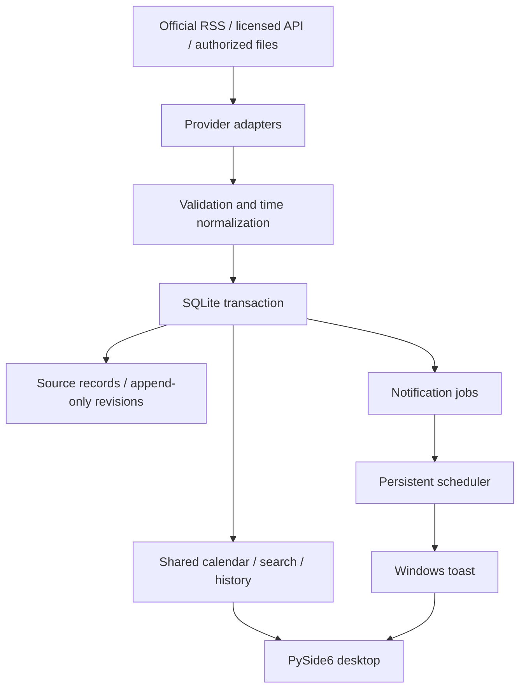

# Architecture and database

## Boundaries

The PySide6 main thread owns widgets and native toast dispatch. A QThread executes source/import work so networking does not freeze browsing. Each database operation opens its own SQLite connection with foreign keys and a busy timeout. BEGIN IMMEDIATE serializes writers; WAL permits concurrent readers. Data lives outside the packaged application. QLockFile prevents two app instances using the same user-data folder.

Models and validation contain no GUI dependency. Adapters return canonical candidate dictionaries, not UI rows. EventRepository commits the validated current record, source reference, typed subtype, observation snapshots and revision. Notification intents for eligible live changes are inserted in that same transaction. Bulk/backfill modes suppress new-publication alerts.

## Schema and relationships

The executable schema is migrations/001_initial.sql; schema_migrations records applied files. Migration scripts are transactional.

| Entity | Relationships / purpose |
|---|---|
| data_sources | Config, source rights references, intervals, status, checkpoints and last success |
| event_definitions | Reusable event/category identity; parent of events |
| economic_indicators | Definition-specific indicator/series metadata |
| events | Queryable current occurrence, separate date fields, stable UUID, revision and validated snapshot |
| companies / exchange_listings | Issuer and exchange identities |
| source_records | Unique (source, external ID), canonical event, provenance and latest supplied payload |
| event_revisions | Unique (event, revision), append-only payload and changed fields |
| economic_observations | Per-event/revision values by role, original text and optional exact decimal |
| corporate_announcements | Company relation and supplied document hash |
| regulatory_notices | Notice number and source-supplied supersession reference |
| original_documents | External document references; no automatic content download |
| duplicate_candidates | Potential issuer/title matches retained separately for inspection |
| knowledge_articles | Original educational summaries, references and review date |
| watchlists / watchlist_members | Local named selections |
| user_settings | Local view, timezone and tray preferences |
| notification_rules | Filters, offsets, triggers, enabled/sample flags and grace period |
| notification_jobs / attempts | Durable work and delivery audit trail |
| ingestion_logs / errors | Import counts, completion state and rejected rows |

SQL indexes cover schedules, publication dates, type/country/category, issuer identity, series and pending notifications. The JSON snapshots preserve source-specific fields and revisions alongside normalized relational query fields. They are not a separate calendar store.

## Event identity and precision

Stable provider external IDs map to internal UUIDs. Source timestamp-only changes do not create material revisions. Source identities remain scoped to their provider. Exact cross-exchange grouping requires supplied matching ISIN, category, period and document digest; both source references survive. Similar titles alone never merge records.

Exact instants are normalized to UTC with original strings retained. Date-only values stay YYYY-MM-DD. Missing numbers remain null; decimals and source text preserve zero and units. Compatible-history charts filter series, units and sample/source class. Importers must include methodology/basis in series_key when relevant.

## Notification state

Rules use OR within a dimension and AND across dimensions. Company identifiers and selected watchlist members form one allowed-issuer set. Overlapping rules share a unique logical job for (event, trigger, schedule generation, offset). Schedule changes cancel obsolete work. Date-only, tentative, postponed and cancelled events are not assigned exact countdown reminders.

Dispatch claims jobs before OS submission, then records the result. A restart with an in-flight Dispatching job changes it to Uncertain rather than replaying an ambiguous toast. Windows acceptance is not proof of visible delivery. Failed jobs remain in history; the application does not guarantee exactly-once visible delivery or cold activation after complete exit.

## Security and packaging

HTTP clients verify TLS and use timeouts; API error messages omit credential-bearing request URLs. Source/document links require HTTP(S) and reject embedded credentials. Imported HTML is escaped in the detail panel. No downloaded code is executed. API credentials use Windows Credential Manager. Qt DLLs remain separate in the onedir build; dependency licences and Qt module choices must be reviewed for a commercial distribution.

Future phases can replace a repository/adapter behind these boundaries. No cloud database, server, mobile API or trading execution is introduced in Phase 1.
