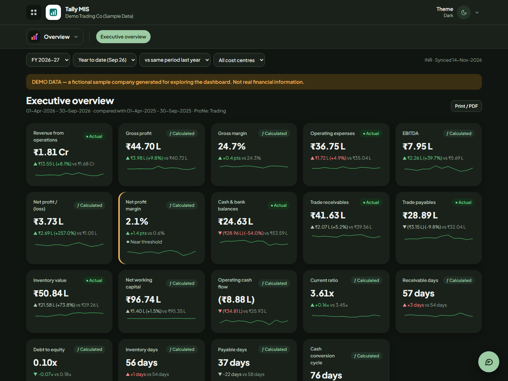
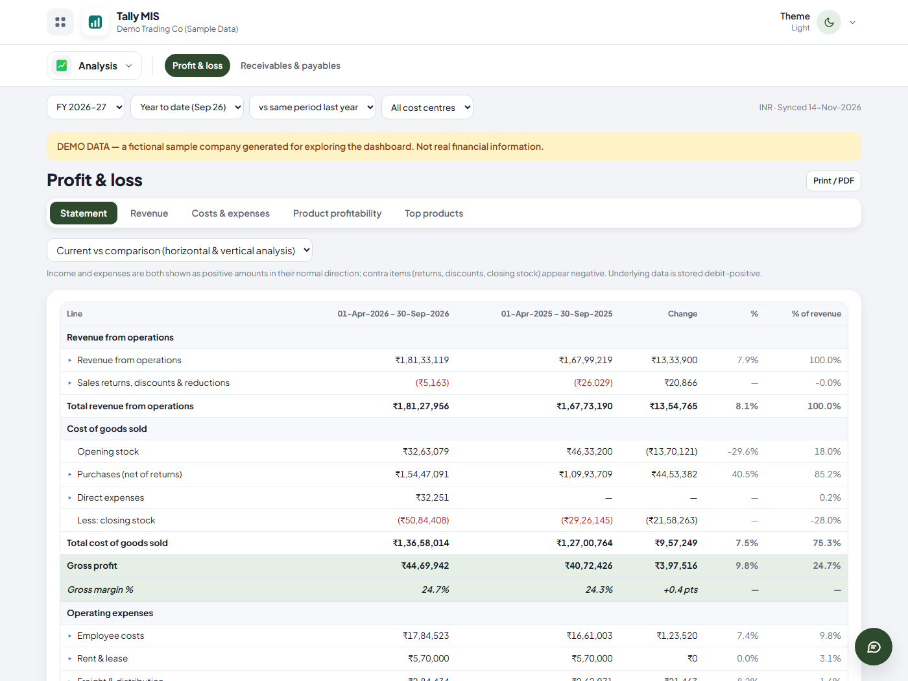

# Tally MIS — offline dashboard for TallyPrime (Python)

An AICA Level 2 (ICAI) capstone project. It is a **Windows desktop app** that reads a company from **TallyPrime**
(or from exported XML files), shows an MIS dashboard — overview, profit & loss, receivables & payables — and has a floating
**assistant** that explains the figures using a language model running on your own PC.

* Works **offline**. Nothing is sent to the internet. The only network traffic is to TallyPrime and LM Studio on the same PC.
* Company data lives **in memory only**. Closing the app removes it; no database or file is ever written.
* The **calculations are done by Python code, never by the AI.** The AI only puts finished figures into words, and every
  number in its reply is checked against the calculated figures.
* Only **fictional demo data** is included. No real client data, keys or passwords are in this project.



## What it does

| Screen / feature | What you get |
|---|---|
| **Data sources & sync** | Find the company open in TallyPrime, **tick the months you want** (or all of them), and sync month by month with progress and cancel. Or import a Tally XML export. Or load the built-in fictional demo company. |
| **Executive overview** | 16 KPI cards with comparison and 12-month trends, charts, cost and revenue breakdowns, receivables and payables exposure. |
| **Profit & loss** | Statement (compare / monthly / quarterly), revenue analysis, cost analysis, product profitability. Click any line to see the ledger and its vouchers. |
| **Balance sheet** | Statement with comparison, then Liquidity, Solvency & capital, Asset quality & returns, Risk & integrity checks and Cash flow tabs, each with KPI cards and month-end trends. |
| **Receivables & payables** | Bill-wise ageing by due date, overdue list, collection priority, notes, trend. |
| **5 colour themes** | Light, Dark, Ocean, Warm, High contrast (menu top-right, or Settings). |
| **Assistant** (round button, bottom right) | Ask "Explain the net profit", "Who owes us the most?" …. Answers only about the open company by default; a Settings switch allows general questions, which are then labelled *General knowledge — not from your company data*. |

Not in this version (shown as "coming in a later version"): inventory, insights & alerts, data-quality
screens, custom KPI formulas, ledger-mapping editor, CSV/Excel export.



## Install and run

### Option A — the EXE (easiest)
1. Use the ready-made `dist/TallyMIS.exe` (68 MB, included in this repository), or build it yourself (see *Build the EXE* below).
   SHA-256 of the included file: `0B5B4DB82A5A986C1DCE3C8E51F0CF7ED1B8B29173CCBAB9234DEEB9285BC783`. Windows SmartScreen may warn because the file is not code-signed: choose *More info → Run anyway*.
2. Double-click `TallyMIS.exe`. A window opens. Needs **Windows 10/11 with the Edge WebView2 runtime** (already on Windows 11).
3. **Data sources → Load demo company** to explore immediately, or keep TallyPrime open and use **Sync from Tally**.

### Option B — from source
Requires **Python 3.15** (and Node 20+ only if you want to rebuild the screens).

```powershell
py -3.15 -m venv .venv
.\.venv\Scripts\python.exe -m pip install -r requirements.txt
.\.venv\Scripts\python.exe tally_mis.py
```

The built screens are already in `app/static`, so Node is not needed to run. Useful options:
`tally_mis.py --no-window` (server only, prints the address) and `--port 8765`.

## Sample companies for TallyPrime
Two fictional companies you can import into a new, empty TallyPrime company to test Tally MIS against real Tally. Both use only the 1st, 2nd and 31st
as voucher dates, so they import in TallyPrime Educational mode too, and each comes with the correct figures to check against.

| Folder | What it is |
|---|---|
| `sample_tally_data_full/` | **4½ years (Apr 2021 – Sep 2025), 6,094 vouchers, with stock**: 30 items, 2 godowns, sales/purchases/returns, GST, 2 cost centres, 25 customers and 12 suppliers (bill-wise), loans, fixed assets and depreciation, tax provisions. Exercises every screen. Steps: [HOW_TO_OPEN_IN_TALLY.md](sample_tally_data_full/HOW_TO_OPEN_IN_TALLY.md) |
| `sample_tally_data/` | A small accounts-only company (421 vouchers, 18 months) for a quick first test. Steps: [HOW_TO_OPEN_IN_TALLY.md](sample_tally_data/HOW_TO_OPEN_IN_TALLY.md) |

Regenerate them with `tools/make_tally_sample.py` (small) and `tools/node/make-full-sample.ts` (full; needs the original Node project, see the notes in that file).

## Connecting to TallyPrime
1. In TallyPrime open your company, then **F1 (Help) → Settings → Connectivity** and set *TallyPrime acts as* **Server**
   (or **Both**) on port **9000** (any port 9000–9010 works).
2. In Tally MIS go to **Data sources & sync**. It finds Tally and lists the open company. Tick the months and press **Sync**.
3. The app **only reads** from Tally. It never creates, changes or deletes anything in Tally.

*Educational mode of TallyPrime only returns dates on the 1st, 2nd and 31st; the app syncs whole months, so this works.*

## The assistant (LM Studio)
1. Install [LM Studio](https://lmstudio.ai), download the model **`google/gemma-4-e2b`**, load it, and start its local server
   (Developer tab, default `http://localhost:1234`).
2. Open **Settings → Appearance & assistant**: it shows whether LM Studio and the model are found.
3. Click the round chat button and ask. *Figures used* shows exactly what the AI was given.

How it stays honest:
* The app calculates the figures (same engine as the screens) and gives the model only a short list of them.
* The model is told never to calculate and to copy numbers exactly. Temperature is 0.
* After the reply, **every number is checked** against that list. If one does not match, the reply is withheld and the
  verified figures are shown instead.
* The app **refuses any address that is not this PC**, so figures cannot be sent elsewhere.
* Thinking mode is switched off for the request (`reasoning_effort: none`) so a reasoning model such as Gemma 4 answers in about 10–30 seconds instead of timing out.
* Default = company questions only. Turning on *Allow general questions* labels those replies as general knowledge.

## How it was built and checked (the capstone story)
The design reuses an earlier Node/React project: its **screens** are reused (copied and edited in `web/`), and its **server
logic was re-written in Python**. Each phase was checked against the original:

| Phase | Result |
|---|---|
| 1 Tally reader | Same records as Node on 63 MB of data; request messages byte-identical; Python uses about half the memory. [docs/PHASE1_RESULTS.md](docs/PHASE1_RESULTS.md) |
| 2 In-memory model | 40,271 database values identical to Node; nothing written to disk; wipe verified. [docs/PHASE2_RESULTS.md](docs/PHASE2_RESULTS.md) |
| 3 Calculations | 25–33 report answers in each of 3 scenarios identical to Node, 70,000+ values, 0 differences. [docs/PHASE3_RESULTS.md](docs/PHASE3_RESULTS.md) |
| 4–5 Server and window | FastAPI on 127.0.0.1 with host and header guards; pywebview window; closing wipes data. |
| 6 Themes | 5 themes. |
| 7 Assistant | LM Studio client, figure checker, scope switch; tested with a pretend LM Studio, then with the real one. |
| 8 EXE | One file, about 71 MB. |

Architecture and decisions: [docs/ARCHITECTURE.md](docs/ARCHITECTURE.md).

## Tests
```powershell
.\.venv\Scripts\python.exe -m pytest
```
67 tests: Tally reader edge cases, in-memory model and wipe, **Python-vs-Node answer comparison**, API, assistant, the 4½-year sample company, licensing.
The Node comparison uses saved answers in `tests/golden/` (made from fictional data), so Node is not needed to run the tests.

## Build the EXE
```powershell
.\.venv\Scripts\python.exe -m pip install pyinstaller
powershell -File tools\build_exe.ps1     # creates dist\TallyMIS.exe
```
To rebuild the screens first: `cd web; npm install; npm run build` (writes to `app/static`).

## Licence (non-commercial use only)
Tally MIS is for learning and evaluation. See [LICENSE](LICENSE). The app has an **offline licence check** (`app/licensing.py`):

| Mode | What you get |
|---|---|
| **Evaluation** (no key) | The fictional demo company is unlimited. Real data: one company, 3 months per Tally sync, 3 MB per imported file. A banner says so. |
| **Licensed** (key entered in *Settings → Licence*) | No limits, or the limits written in the key: **one specific PC** (machine fingerprint), an **expiry date**, a **number of companies**. |

Keys are signed with the author's private key (Ed25519). The app holds only the public key, so it can check a key but nobody can make one. No internet, no account.
The private key is never in this project. The author issues keys with `tools/make_license.py`.
*Honest note: the source is public, so this deters casual and commercial reuse but cannot stop a determined programmer; the LICENSE file is the legal protection.*

## Privacy and safety
* Server listens on `127.0.0.1` only, on a random free port; requests from other host names are refused (DNS-rebinding guard);
  changes need an app-only header.
* Tally and LM Studio addresses are restricted to this PC.
* Company data is held in DuckDB `:memory:` with spill-to-disk and file access switched off. The window's storage keeps only your theme choice.
* Assistant preferences (switch, model name) are saved in `%APPDATA%\TallyMIS\settings.json` — no company data.

## Known limits
* Live sync was tested against a **mock Tally server** with fictional data and the original project's recorded Tally behaviour;
  it has not been run against a large real company here. Try it on a small company first.
* A separate inventory screen, insights and data-quality screens are not ported yet (stock appears in the overview, balance sheet and product profitability).
* The assistant's quality depends on the small local model; the number check keeps wrong figures out, but its wording can be plain.
* The assistant was tested with the real LM Studio (`google/gemma-4-e2b`) against the full sample company in TallyPrime.
* In TallyPrime **Educational mode** only the 1st, 2nd and 31st are valid report dates, so stock valuations for month-ends on the 30th (Apr, Jun, Sep, Nov) come back as the latest valuation. Year-end figures are right; mid-year stock comparisons are only reliable with a licensed TallyPrime.

## Folder guide
```
app/            Python program: api/ (server), engine/ (calculations), model/ (in-memory data), tally/ (reader),
                assistant/ (LM Studio), sync.py, main.py, static/ (built screens), demo_data/ (fictional company)
web/            Screen source (React). Copied from the Node project and edited.
tests/          Tests, fictional test data, saved Node answers (golden)
sample_tally_data/, sample_tally_data_full/  Fictional companies to import into TallyPrime, each with a how-to and the expected figures
tools/          Benchmarks, comparison tools, Node scripts used to make the golden answers, EXE build script
docs/           Phase results, architecture, screenshots
```

*Fictional demo data only. Based on an earlier Node/React MIS project by the same author.*
