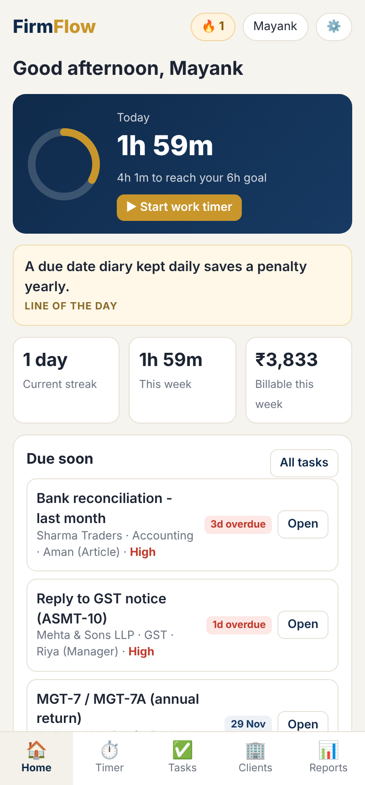
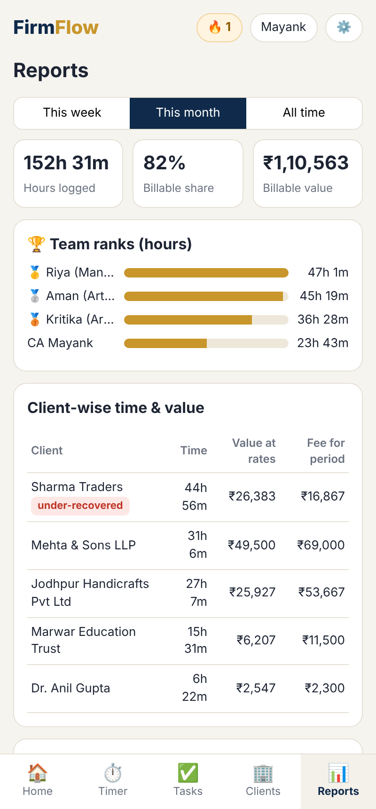
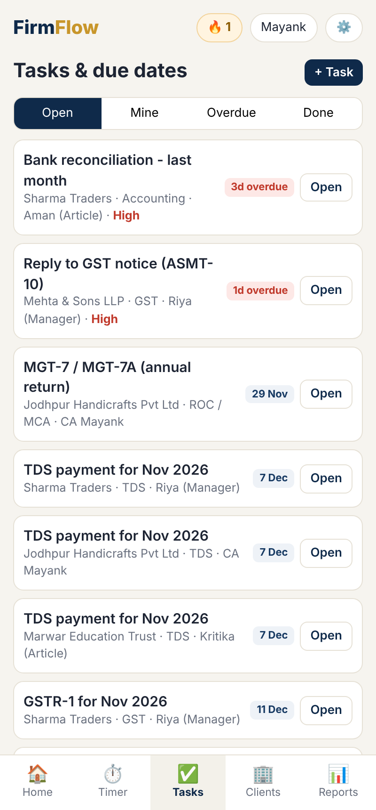

# FirmFlow: Focus & Time Tracker for CA Firms

**AICA Level 2 Capstone Project**
Batch 122 (Jodhpur) · CA Mayank Katariya (M. No. 439139) · M/s Mayank Katariya & Associates, Jodhpur

FirmFlow is an installable web app (PWA) for Chartered Accountant firms. Partners, managers and article assistants can use it to:

- run a **focus timer** against each client and task, so time is recorded while the work happens and not reconstructed on Friday evening
- see the firm's **statutory due dates**, which are created automatically for every client from the services the firm provides
- know which clients take more time than their fee covers (**under-recovery**)
- get an **AI plan for the day**, an **AI weekly review** for the partner, and **AI-drafted document reminder emails** to clients

It is built in the style of FocusFlow, the study tracker I run for CA students on charteredteam.com, applied to the problem every small CA firm has: billing and planning without time data.

---

## The problem

Most small and mid-size CA firms in India:

1. do not record time client-wise, so fees are fixed by guesswork and loss-making clients go unnoticed
2. track due dates for GST, TDS, ITR, tax audit and ROC in diaries or Excel, which leads to late fees (section 234E, GST late fee) and interest (section 201(1A), sections 234A/B/C)
3. have no simple view of which staff member or article assistant is overloaded and which one is free
4. spend partner time chasing clients for documents

## The solution

| Module | What it does |
|---|---|
| **Home** | Today's hours against a daily goal (progress ring), daily streak 🔥, line of the day, due-soon list with overdue alerts |
| **Work timer** | Start, pause and stop against client and task, billable flag, optional 50-minute focus block with a break notification, manual entries |
| **Quick log (AI-style parser)** | Type "2.5h GSTR-3B for Sharma Traders" and it logs the hours, picks the client, finds the work type (GST) and links the nearest open GST task |
| **Tasks** | All compliance and work tasks with due date, assignee, priority, estimate and time spent. Filters for Open, Mine, Overdue and Done |
| **Clients** | Client master with PAN and GSTIN validation (format check, and the PAN inside the GSTIN must match the PAN), monthly fee, engagement in charge and services. Saving a client creates its due-date tasks for the next 90 days |
| **Compliance calendar** | GSTR-1 (11th), GSTR-3B (20th), TDS payment (7th, 30 April for March), TDS returns (31 Jul / 31 Oct / 31 Jan / 31 May), advance tax (15 Jun / Sep / Dec / Mar), ITR (31 Jul, or 31 Oct for audit cases), tax audit report (30 Sep), AOC-4 and MGT-7 |
| **Reports** | Hours, billable share and billable value (hours × charge-out rate) for the week, the month or all time. Team ranks, client-wise time and value against the fee with an **under-recovered** flag, work-type split, last 7 days. CSV export of the time log for Excel or billing |
| **🤖 Plan my day** | Orders open tasks by overdue status, penalty or interest risk, due date and estimate, and fits them into the time left today |
| **🤖 AI weekly review** | A partner-level review: where the time went, under-recovered clients, staff load, overdue compliance risk, and three actions for next week |
| **🤖 Draft client reminder** | Writes a polite email listing the documents needed for the task, with the late fee or interest risk |
| **Team** | Multiple team members with role and charge-out rate. Switch user on a shared office PC |
| **PWA** | Installs on phone or desktop and works offline (service worker) |

## AI design: privacy first

Client data is confidential under the ICAI Code of Ethics, so FirmFlow is built for that:

- **All data stays in the browser** (localStorage) on the firm's own device. There is no server and no login to a third party.
- AI uses **Google Gemini** through the firm's own API key (a free key from Google AI Studio). The key is stored only in that browser and is never included in the backup file.
- **Client names are masked** ("Client A", "Client B") before anything is sent to the AI, and this is on by default. PAN and GSTIN are never sent.
- With no API key, every AI feature still works through **built-in rules**, so the app is useful offline and at no cost.

## Tech stack

- HTML, CSS and plain JavaScript in one file (`index.html`), with no framework and no build step
- PWA: `manifest.json` and a service worker (`sw.js`) for install and offline use
- Google Gemini API (`gemini-2.5-flash`, can be changed in Settings) for the AI features
- Built with AI-assisted coding (prompting an AI coding assistant), the method taught in AICA Level 2. Prompts are in `PROMPTS.md`

## How to run

**Option 1: just open it.** Download this folder and double-click `index.html`. It opens in Chrome or Edge.

**Option 2: as an installable app.** Serve the folder (for example `python -m http.server 8000` and open `http://localhost:8000`) or host it on GitHub Pages, Netlify or the firm's website. Chrome then shows an **Install** button.

**First run:** enter the firm name and your name, or click **Try with demo firm** to load a sample CA firm with 4 team members, 5 clients and 2 weeks of time entries.

**AI (optional):** ⚙️ Settings → paste a Gemini API key from https://aistudio.google.com → Save.

## Files

| File | Purpose |
|---|---|
| `index.html` | The full app (UI, logic, compliance calendar, AI layer) |
| `manifest.json` | PWA manifest (name, icons, colours) |
| `sw.js` | Service worker for offline use |
| `icon.svg`, `icon-192.png`, `icon-512.png` | App icons |
| `PROMPTS.md` | The prompts used to build the app and the prompts the app sends to AI |
| `screenshots/` | Screenshots of the app |

## Screenshots

| Home | Reports | Tasks |
|---|---|---|
|  |  |  |

## Notes and limits

- Due dates are the standard statutory dates. Always check for CBIC, CBDT or MCA extensions and edit the task if a date is extended.
- Data lives on one device. Use **Backup (JSON)** and **Restore backup** to move it. A shared cloud database for multi-office firms is the next step (see below).
- Charge-out rates and fees are the firm's own inputs. The billable value is for internal review, not an invoice.

## Roadmap

- Cloud sync (Firebase or Supabase) with partner and staff logins, so the whole team shares one dashboard
- WhatsApp and email reminders to clients straight from the task
- Import of the client list from Tally or Excel, and the GST return status from the GST portal
- Invoice generation from billable time

---

*Developed by CA Mayank Katariya for the AICA Level 2 Certificate Course, ICAI. The project is original work and is submitted under the course declaration.*
