> **AICA Level 2 Capstone Project submission**
>
> | | |
> |---|---|
> | Participant | CA Harshika Rujul Vora |
> | ICAI membership no. | 178886 |
> | Batch | AICA Level 2, Batch 109, Gandhinagar |
> | Live web app | https://ca-practice-manager-y2w8zcbhcmecmjcxc44uha.streamlit.app |
> | Main repository | https://github.com/Harshika156/ca-practice-manager |
> | Windows installer | https://github.com/Harshika156/ca-practice-manager/releases/latest/download/CAPracticeManager-Setup.exe |
> | Project report | `Project_Report.pdf` in this folder |

# CA Practice Manager

**A live, multi-user practice management system for Indian Chartered Accountant firms**, covering GST, Income Tax, TDS and Audit work.
Built as the AICA Level 2 capstone project, using only free and open-source tools.

**Live demo:** https://ca-practice-manager-y2w8zcbhcmecmjcxc44uha.streamlit.app · **Windows installer:** [CAPracticeManager-Setup.exe](https://github.com/Harshika156/ca-practice-manager/releases/latest/download/CAPracticeManager-Setup.exe)

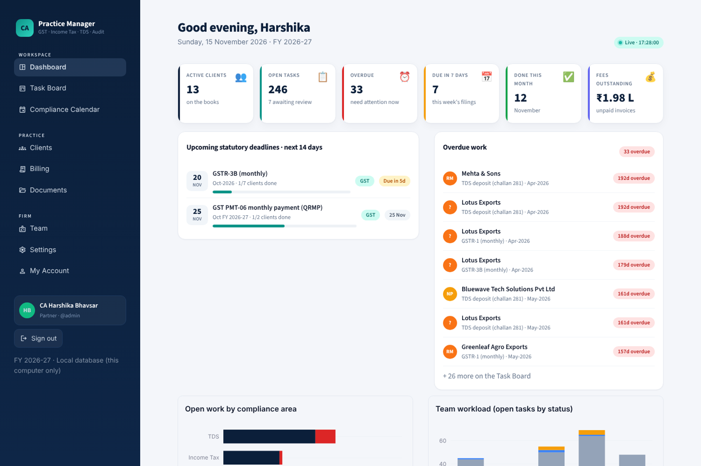

## The problem

A typical CA firm handles dozens of clients, each with 20–50 recurring statutory compliances a year. Deadlines live in diaries and Excel sheets, work is chased on WhatsApp, partners can't see who is doing what, invoices are typed by hand, and client documents are scattered. Missed due dates mean late fees and interest for clients and reputational damage for the firm.

## The solution

| Module | What it does |
|---|---|
| **Statutory due-date engine** | Adding a client with services ticked (GST monthly/QRMP, TDS, ITR, tax audit) automatically creates every compliance task for the financial year: GSTR-1, GSTR-3B, PMT-06, GSTR-9, TDS deposits and returns, Form 16, advance tax, ITR and tax audit. QRMP GSTR-3B uses the 22nd or 24th depending on the client's state. |
| **Live due-date updates** | When CBIC/CBDT extend a date, the partner records it once (in the app, or in `due_dates.json` on GitHub) and every pending task moves automatically. All extensions are kept on record with the notification reference. |
| **Kanban task board** | To Do → In Progress → Under Review → Done, with filters, bulk updates and a full history on every task. **Maker-checker control**: staff can only send work for review; only a partner or manager can mark it Done. |
| **Real-time team view** | Dashboards refresh every 30 seconds from the shared database, so a partner sees a staff member's update without reloading. Each person's workload, overdue items, work in review and completions are shown with an activity feed. |
| **Compliance calendar** | A month view of every deadline with pending/total counts, plus a deadline tracker with % completion per return. |
| **Clients (360° view)** | Client master with PAN/GSTIN validation (including the PAN-inside-GSTIN check), compliance health (🔴/🟡/🟢), and a per-client view of compliance, invoices and documents. **Bulk import from an Excel template.** |
| **GST billing** | Invoices with SAC codes, automatic CGST + SGST (same state) or IGST (other state), amount in words (lakh/crore), a branded PDF, one-click monthly retainer billing and receivables ageing. |
| **Document vault** | Uploads stored in the database, tagged by client, category and financial year. |
| **Logins & roles** | Partner / Manager / Staff with salted PBKDF2 password hashing, forced password change on first login, and page-level access control. |
| **AI Assistant** (Google Gemini, free tier) | *Ask about your practice* in plain English ("what is overdue and who is handling it?"), answered from the firm's live data · *Client reminders* drafted in English, Hindi, Gujarati or Marathi with the client's pending compliances and documents needed, sent via WhatsApp or e-mail in one click · *Notice reader*: upload a GST / Income Tax / TDS notice (PDF) and get its type, section, reply due date, amount, issues, documents needed and reply points, then create a task or a draft reply |
| **Responsible AI** | Client names, staff names, PAN, GSTIN, Aadhaar, phone, e-mail, IFSC and address lines are **masked on the user's computer before anything is sent**, and restored only in the answer · the user sees exactly what was sent · documents need explicit consent · every AI request is logged (audit trail) · AI output is always a draft for human review |
| **Backup & reports** | One-click Excel export of clients, tasks, invoices, activity and the document index. |

## Screenshots

| | |
|---|---|
| 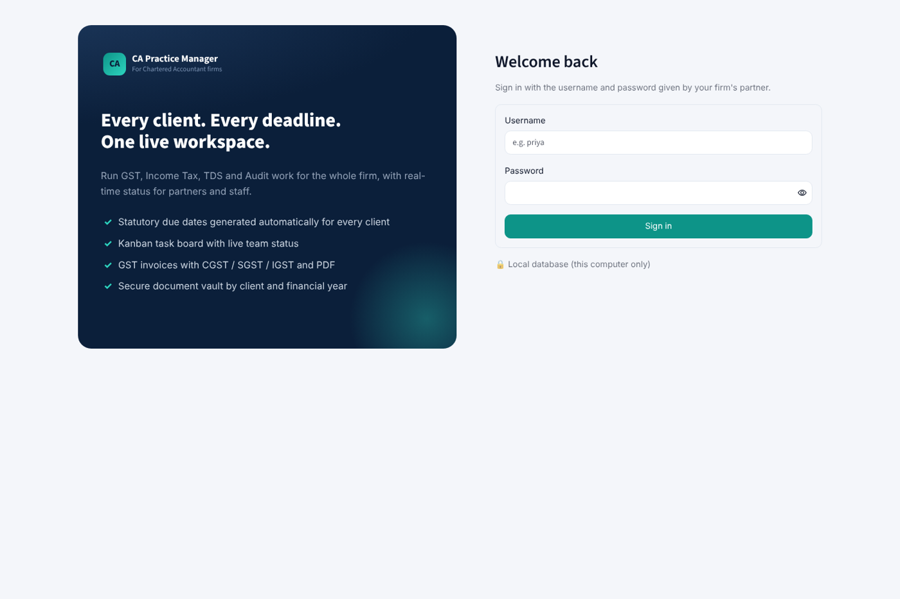 | 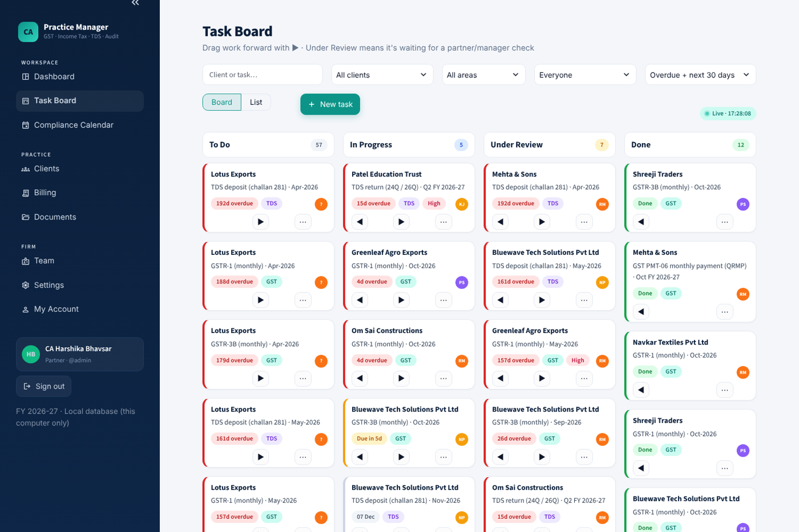 |
| 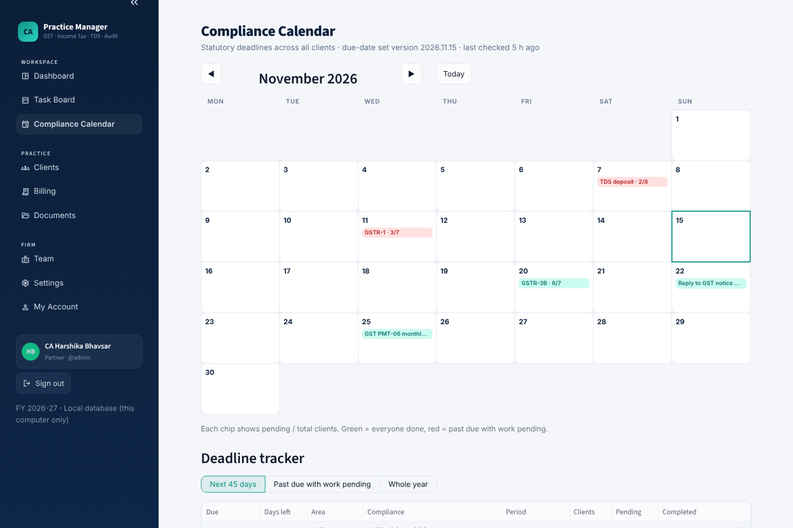 | 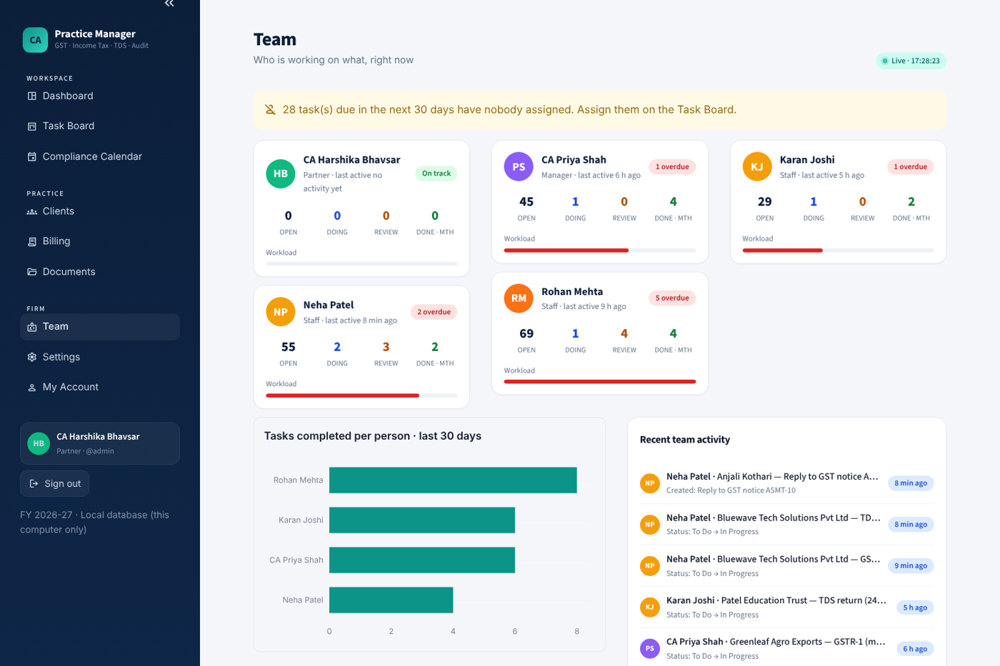 |
| 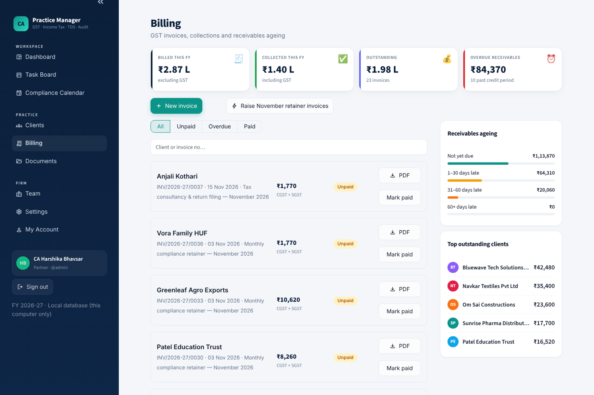 | 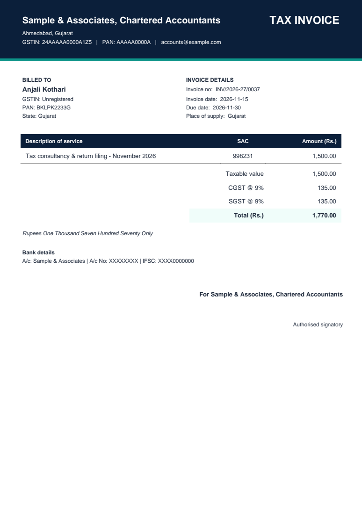 |
| 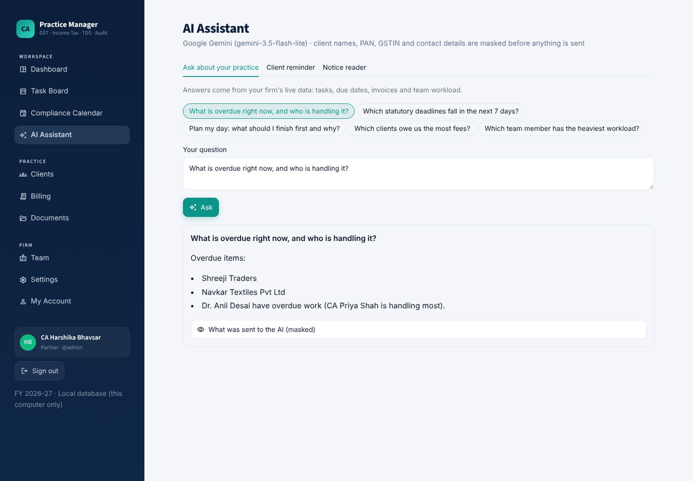 | 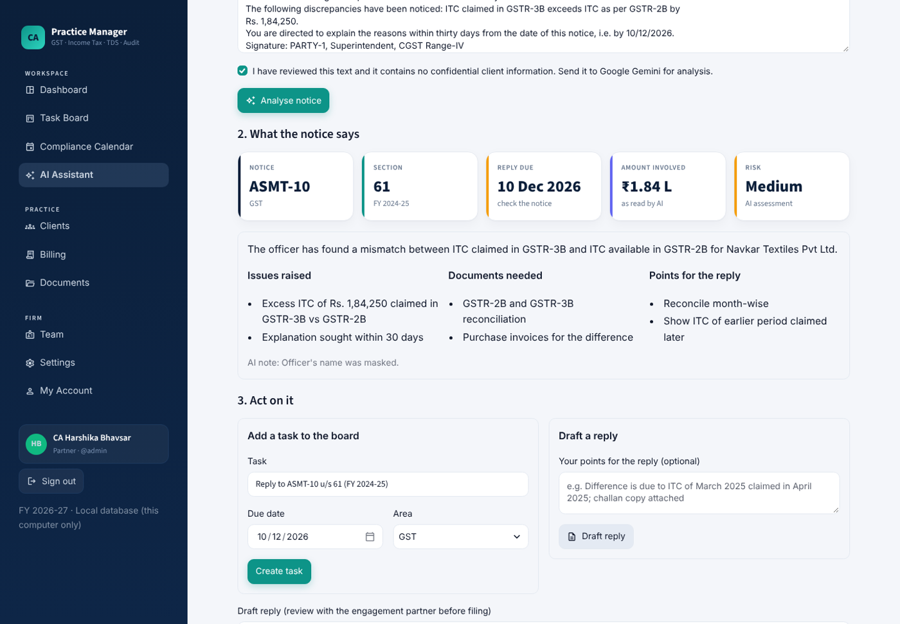 |

## Architecture

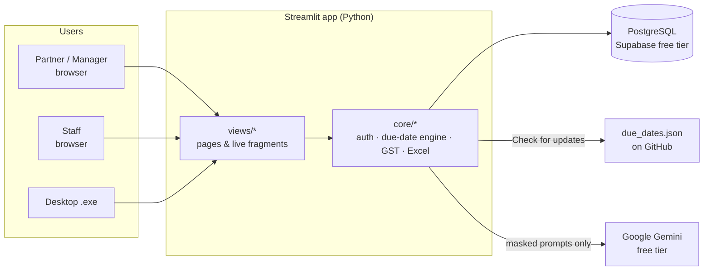

* **Hosted:** Streamlit Community Cloud runs the app and Supabase hosts the database. Staff open a web link from anywhere.
* **Desktop:** the same code packaged as a Windows app (PyInstaller) with its own window (Edge WebView2 via pywebview) and a per-user installer (Inno Setup), built for free by GitHub Actions. On first launch each colleague joins the firm's cloud database, or chooses a local SQLite database for offline use.
* **One codebase, two databases:** SQLAlchemy with portable SQL. SQLite for offline use and PostgreSQL for shared use; both are tested.

## Database design

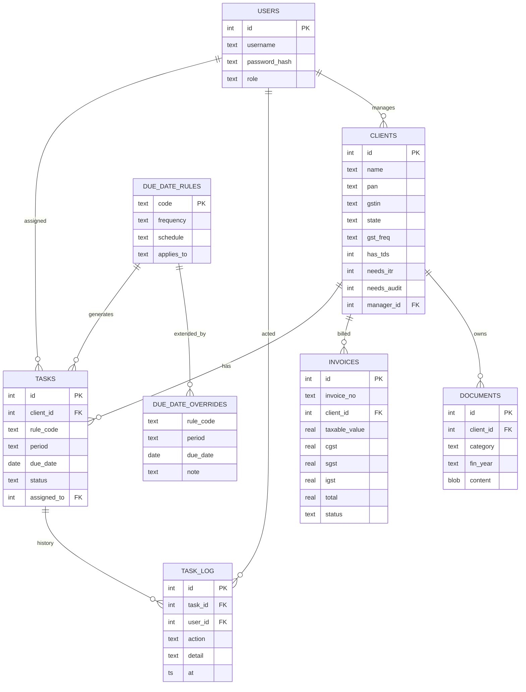

`UNIQUE(client_id, rule_code, period)` makes task generation idempotent: running it again never creates duplicates.

## How the due-date engine works

Each compliance is a **rule** with a compact schedule, for example:

| Rule | Schedule | Meaning |
|---|---|---|
| GSTR-3B (monthly) | `20` | 20th of the month after the return period |
| TDS deposit | `7\|3=30` | 7th of next month, but 30 April for March |
| TDS return | `07-31@0:Q1,10-31@0:Q2,01-31@1:Q3,05-31@1:Q4` | quarter-wise dates; `@1` = next calendar year |

Rules expand into dated tasks for each client they apply to. A one-off extension is stored as an **override** for that rule and period. `reschedule_pending()` then moves every task that is not yet Done; completed work is never touched. Dates are the usual statutory dates and must be checked against current CBIC/CBDT notifications.

## Run it

**Quickest (Windows):** double-click `Start_App.bat`. **Any OS:**
```bash
pip install -r requirements.txt
streamlit run app.py
```
First sign-in: `admin` / `admin@123` (you must set a new password). For a demo, go to **Settings → Data & connection → Load demo data**. Demo staff logins are `priya` (Manager), `rohan`, `neha` and `karan` (Staff), all with password `Demo@1234`.

Full instructions, including the free cloud database, the free web hosting, building the .exe and keeping due dates updated, are in **[SETUP_GUIDE.md](SETUP_GUIDE.md)**.

## Project structure

```
app.py                    entry point: login, roles, navigation
core/  config.py          where data lives (local / cloud / .exe)
       db.py              SQLite + PostgreSQL layer, schema
       auth.py            password hashing, roles, access rules
       duedates.py        due-date rules, task generation, extensions, GitHub updates
       invoice_pdf.py     GST maths, amount in words, PDF
       importer.py        Excel template, client import, Excel export
       ai.py              Gemini client, masking (pseudonymisation), Q&A, reminders, notice reader
       ui.py, clock.py    design system (navy theme), Indian time
views/                    one file per page (dashboard, tasks, calendar, clients, billing, documents, team, settings)
due_dates.json            the firm's master list of statutory due dates
run_app.py, *.spec        desktop launcher (app window + hidden server) and PyInstaller recipe
installer.iss             Windows installer (Start menu / desktop shortcuts, uninstaller)
.github/workflows/        free automatic Windows .exe build on GitHub
```

## Testing done

* Every page opened in a real browser (headless Chromium) on both **SQLite** and **PostgreSQL**, as a Partner and as a Staff member, with no errors.
* Two simultaneous users: a staff card move appeared on the partner's dashboard within 30 seconds, with no reload.
* Due-date engine: generation is idempotent, the March TDS exception is applied, the QRMP 22nd/24th state split works, extensions move only pending tasks, and updates download from a URL.
* GST: intra-state CGST+SGST, inter-state IGST, amount in words; the PDF was rendered and checked.
* Excel import catches bad PAN/GSTIN, a GSTIN that doesn't contain the PAN, and duplicate PANs.
* AI features tested end to end against a recording stand-in for the Gemini API: every request was audited and contained no client name, staff name, PAN, GSTIN, phone or e-mail; wrong-key, quota and no-text-PDF errors show plain-language messages.
* The packaged desktop build was run from a blank data folder: first-run connect screen (wrong and right connection details), forced password change, demo data, every page and invoice download. The server runs as a hidden child process and the app falls back to the browser when no app window is available.

## Limitations

* The AI Assistant uses Google's free tier, where submitted content may be used to improve Google's products. Masking removes identifiers, but financial figures in a notice are still sent; a paid tier (or a local model) is advised for production use. AI answers can be wrong and are always drafts.

* Supabase's free tier gives 500 MB of database space (about 10 MB per upload is allowed here) and pauses after 7 days without use. Streamlit's free hosting sleeps after 12 hours without visits; the first visit after that takes about a minute to wake it.
* A browser refresh signs the user out (sessions are kept in memory).
* Due-date rules are simplified: no turnover-based GSTR-9C, no presumptive-taxation variants and no state-specific GST extensions beyond the QRMP split.
* Real client data on free cloud tiers needs a confidentiality review (ICAI Code of Ethics, DPDP Act 2023) before production use.

## Future scope

Client portal for document upload · WhatsApp/email reminders before due dates · time sheets and client profitability · e-invoice/IRN and UPI payment links · GST/TDS portal data import · object storage for large files · audit-trail exports for peer review.

---
Author: CA Harshika Rujul Vora (M. No. 178886) · AICA Level 2 Capstone, Batch 109, Gandhinagar.
*Built with the help of an AI assistant (Claude); design decisions, domain rules and testing were reviewed by the author.*
