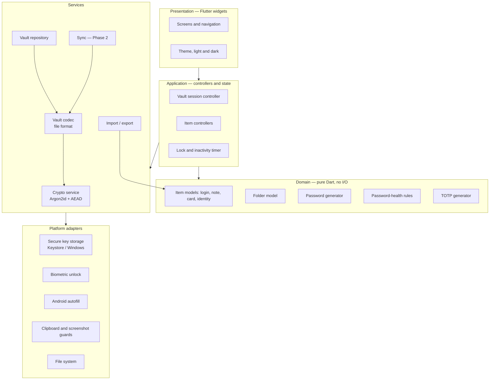
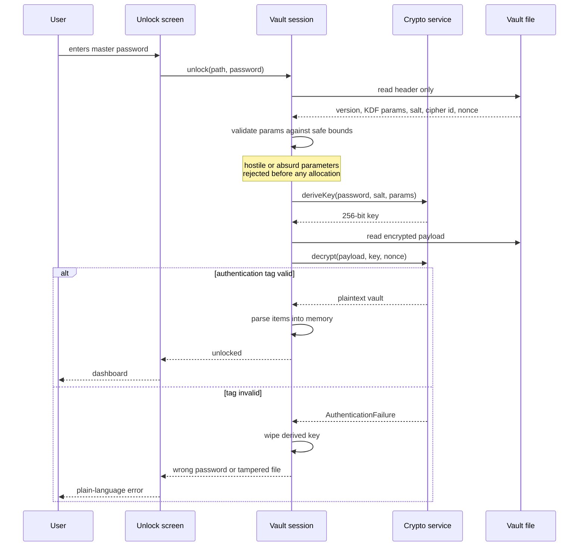
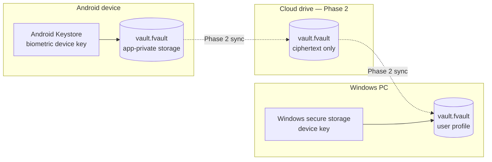

# Family Vault — System Architecture

**Version:** 1.0 · **Date:** 9 November 2026

Family Vault is an offline-first, zero-knowledge password manager. One Flutter codebase
targets Android and Windows. There is no server. A vault is a single encrypted file that
the user owns; synchronisation, when it arrives in Phase 2, moves that encrypted file
through a cloud drive the user already has.

---

## 1. Guiding principles

1. **The key never leaves the device.** Everything that could decrypt a vault is derived
   on the device from something only the user has.
2. **The crypto core has no dependencies on anything above it.** It does not know about
   widgets, files, cloud drives or platforms, so it can be tested in isolation.
3. **Trust flows one way.** Outer layers depend on inner layers, never the reverse.
4. **Nothing sensitive crosses a process boundary.** No analytics, no crash reporting of
   vault contents, no network calls in Phase 1.
5. **Fail closed.** An authentication failure, an unexpected format version or a
   malformed parameter aborts the operation. It is never worked around.

---

## 2. Layered structure



The arrows are the only permitted dependency directions. The domain layer imports
nothing from Flutter, which is what makes it testable without a device.

### Why the crypto service sits below the vault codec

The codec decides *what a vault file looks like*. The crypto service decides *how bytes
are protected*. Keeping them apart means the file format can gain a version 2 without
touching the cipher code, and the cipher can be swapped without rewriting the parser.

---

## 3. Directory layout

```
family-vault/
├── lib/
│   ├── main.dart                  entry point
│   └── src/
│       ├── app/                   app shell, routing, theme
│       ├── core/                  shared utilities, failures, result types
│       ├── crypto/                Argon2id, AEAD, secure random, key handling
│       ├── vault/                 file format, codec, repository, session
│       ├── domain/                models, generator, health rules, TOTP
│       ├── features/              one folder per screen area
│       │   ├── home/
│       │   ├── items/
│       │   ├── folders/
│       │   ├── generator/
│       │   ├── authenticator/
│       │   ├── health/
│       │   ├── trash/
│       │   └── settings/
│       ├── platform/              Keystore, biometrics, autofill, clipboard
│       └── io/                    import, export, sync (Phase 2)
├── test/                          unit, security and widget tests
├── integration_test/              on-device tests (Stage 3 onward)
├── android/  windows/  web/       generated platform projects
├── tool/                          build and bootstrap scripts
├── docs/                          all project documentation
└── .github/workflows/             CI and release pipelines
```

---

## 4. Unlock sequence

This is the security-critical path. Every step is a test case.



The master password is never compared against anything stored. It is correct if, and only
if, decryption authenticates. That is what makes the design zero-knowledge rather than
merely encrypted.

---

## 5. Vault file format (outline)

The full specification is a Stage 2 deliverable. The shape is fixed now because the
pipeline and tests depend on it.

| Region | Contents | Encrypted |
|---|---|---|
| Magic | Fixed identifier and format version | No |
| KDF block | Algorithm id, memory cost, iterations, parallelism, salt | No |
| Cipher block | Algorithm id, nonce | No |
| Payload | All items, folders, favourites, trash, settings | **Yes** |
| Tag | AEAD authentication tag over header and payload | No |

The header is plaintext by necessity: it is what tells the app how to derive the key. It
is therefore restricted to parameters, and it is covered by the authentication tag, so
altering it invalidates the file rather than weakening it. No item title, URL, username,
folder name or count appears outside the payload.

---

## 6. Where data lives



The cloud drive holds the same opaque bytes the device holds. The provider cannot
distinguish a vault with three items from one with three hundred, beyond file size.

---

## 7. Technology decisions

| Concern | Choice | Reasoning |
|---|---|---|
| Framework | Flutter | One codebase for Android and Windows, as required |
| Language | Dart, null-safe, strict analyzer | Required; strictness catches errors the authoring environment cannot compile-test |
| State management | To be fixed in Stage 3 | Stage 1 needs no state library; see decision log D-005 |
| Key derivation | Argon2id | Memory-hard, OWASP-recommended, required |
| Encryption | AEAD — AES-256-GCM or XChaCha20-Poly1305 | Final choice pending library verification in CI; see D-003 |
| Crypto library | Vetted third-party, verified in CI | Never hand-rolled |
| Local storage | Single encrypted file | No database engine can see plaintext |
| Android secure storage | Android Keystore | Hardware-backed where the device supports it |
| Windows secure storage | Windows credential APIs / Hello | Platform-native, no third-party key custody |
| CI | GitHub Actions | Required; also the only place this project can compile |
| Web demo | Flutter web, dummy data, GitHub Pages | Shareable link for assessment, isolated from real vaults |

---

## 8. The authoring constraint, and what it changes

The environment writing this code cannot reach `pub.dev`, `dl.google.com`,
`maven.google.com` or `services.gradle.org`, and has no Flutter or Android SDK. It can
write and reason about code but cannot compile it or resolve a package.

Two consequences shape the architecture:

1. **CI is the compiler.** Every push is the first real compilation. The pipeline
   therefore runs `dart format --set-exit-if-changed`, `flutter analyze --fatal-infos`
   and `flutter test` before it attempts a build, so failures surface as readable
   analyzer output rather than as a build crash.
2. **Dependencies are added one at a time.** Stage 1 deliberately ships with **no
   third-party runtime dependencies**, so the first build is as close to guaranteed as it
   can be. Each later dependency is added in its own commit and confirmed green before
   the next, which keeps the cause of any resolution failure unambiguous.

This is recorded as decision D-002 and is the reason Stage 1 contains a plain app shell
rather than a half-written crypto core.

---

## 9. Testing strategy

| Layer | Test type | Runs on |
|---|---|---|
| Domain, crypto, codec | Unit and security tests | CI, every push |
| Controllers | Unit tests with fakes | CI, every push |
| Screens | Widget tests | CI, every push |
| Platform integrations | Integration tests | Android emulator, Windows runner |
| Whole app | Manual owner testing on a physical phone | Owner |

Security tests are first-class, not an afterthought: wrong password, flipped ciphertext
byte, truncated file, absurd KDF parameters, repeated nonce, unknown format version. Each
asserts a specific refusal, not merely that an error occurred.

---

## 10. What this architecture deliberately does not include

No server. No account system. No telemetry. No remote configuration. No password escrow.
No administrative override. Every one of these would create a party other than the user
capable of reaching the data, which is exactly what the product exists to prevent.
