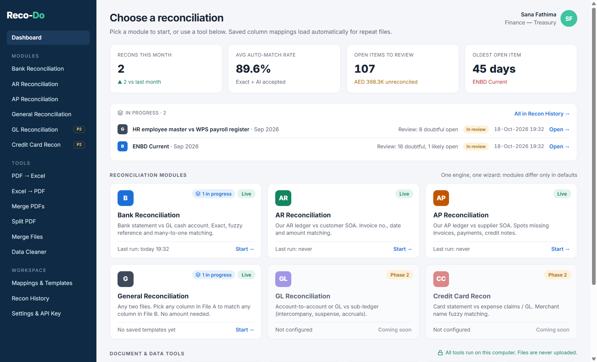
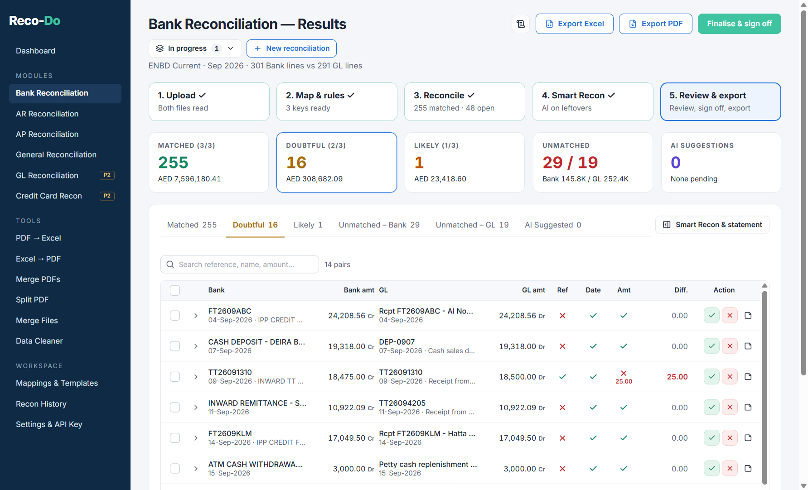
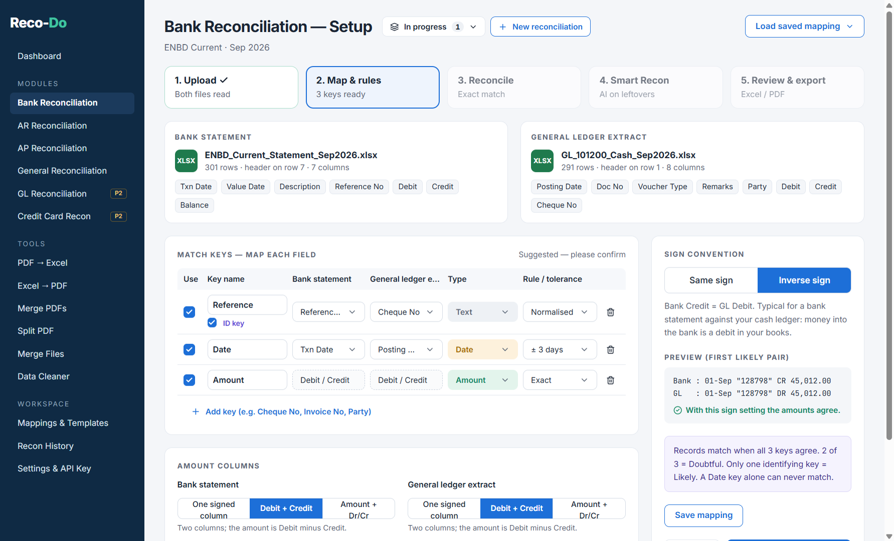
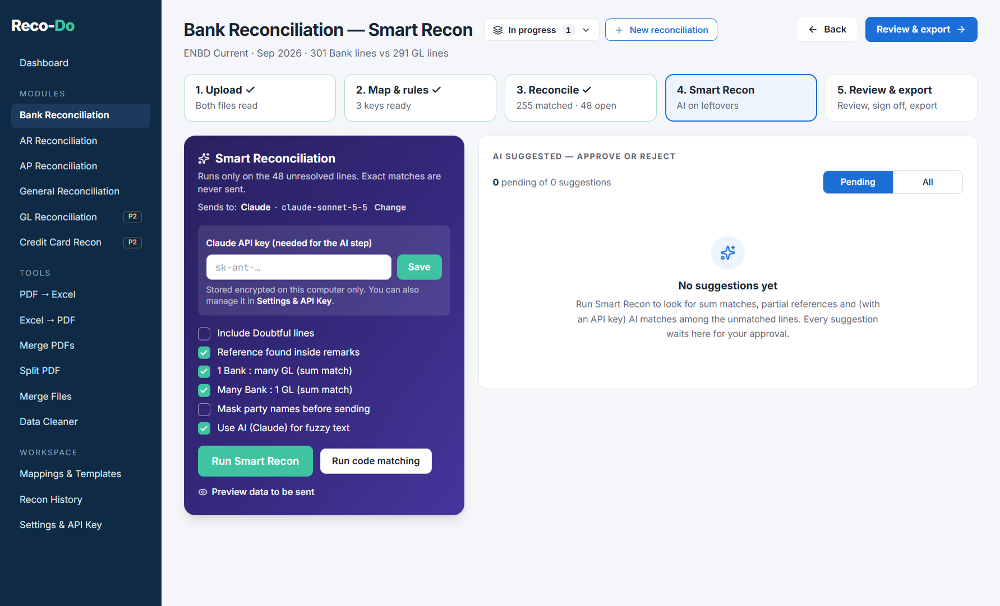
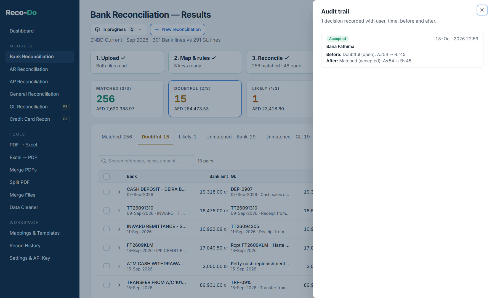
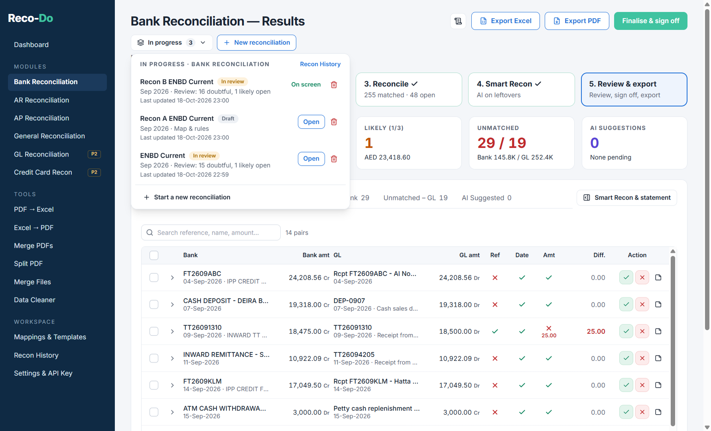
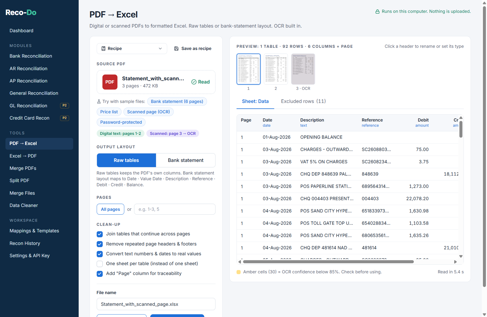
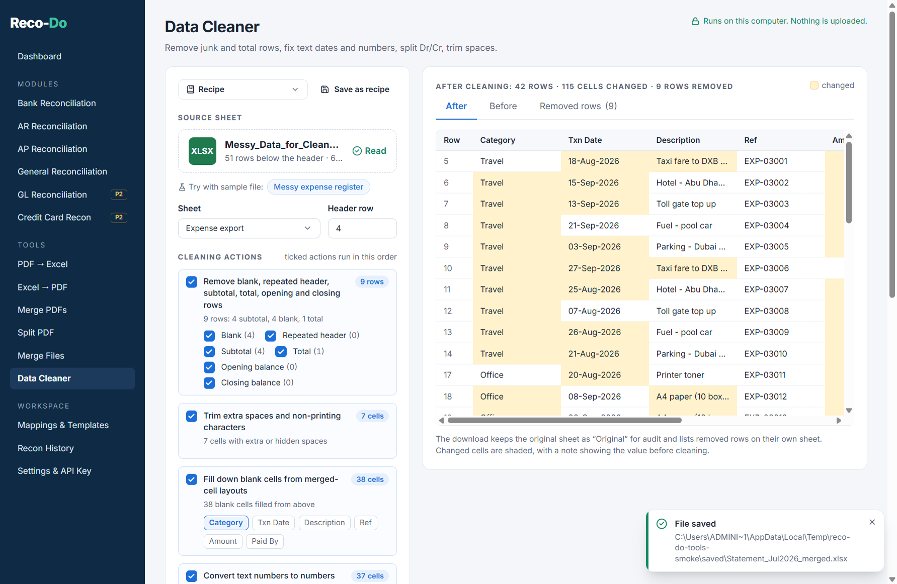
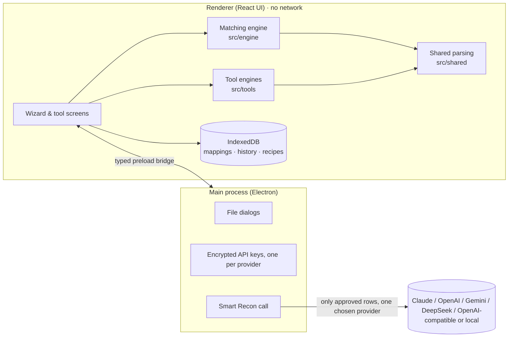

<p align="center"></p>

<h1 align="center">Reco-Do</h1>

<p align="center"><b>Reconciliations, done.</b><br>
A free Windows app that compares two sets of financial records, matches everything that agrees, and shows you only what needs your attention.</p>

<p align="center">
  <a href="https://github.com/Parvezsh/reco-do/releases/latest/download/RecoDo-Setup.exe"><b>⬇ Download Reco-Do for Windows</b></a>
  &nbsp;·&nbsp;
  <a href="#install-in-3-steps">How to install</a>
  &nbsp;·&nbsp;
  <a href="docs/User_Guide.md">User guide</a>
</p>

<p align="center"></p>

---

## What is Reco-Do?

If you work in finance or accounts, you probably reconcile records every month: the **bank statement against the cash book**, a **customer's statement against your receivables ledger**, a **supplier's statement against your payables ledger**, and so on.

Doing this in Excel means copying data around, filtering, using VLOOKUPs and ticking lines off by hand. It takes hours, and it is easy to miss something.

**Reco-Do does the matching for you.** You give it the two files, and in a few seconds it:

- ✅ **Matches** every line that agrees on both sides.
- 🟡 **Flags** lines that *nearly* match (for example the same amount, but the date is two days off) and explains why, in plain English.
- ❌ **Lists** what is left over on each side, so you know exactly what to investigate.
- 📄 **Produces** a finished reconciliation report in Excel or PDF, ready for review and sign-off.

**Everything happens on your own computer.** Your files are never uploaded anywhere. No account or sign-up is needed.

## What can it do?

### Reconciliations

| Type | What it compares |
|---|---|
| **Bank Reconciliation** | Your bank statement against the cash/bank account in your books |
| **AR Reconciliation** (Receivables) | Your customer ledger against the customer's own statement |
| **AP Reconciliation** (Payables) | Your supplier ledger against the supplier's own statement |
| **General Reconciliation** | *Any* two lists: for example an employee list against a payroll file |

*GL Reconciliation and Credit Card Reconciliation are coming in a later version.*

### Handy tools for everyday files

| Tool | What it does |
|---|---|
| **PDF → Excel** | Turns a PDF bank statement (even a scanned one) into an Excel sheet |
| **Excel → PDF** | Prints a spreadsheet into a tidy PDF with page numbers |
| **Merge PDFs** | Joins several PDFs into one |
| **Split PDF** | Splits one PDF into several |
| **Merge Files** | Stacks several statements (Excel, CSV or PDF) into a single sheet |
| **Data Cleaner** | Tidies messy exports: removes blank and total rows, fixes dates and numbers, removes duplicates |

---

## Before you start

You need:

- A computer running **Windows 10 or Windows 11**. *(Reco-Do does not run on Mac, iPad or phones.)*
- About **500 MB** of free disk space.
- **No admin rights** are needed. It installs just for you.

## Install in 3 steps

**1. Download.** Click the link below. Your browser will download a file called `RecoDo-Setup.exe`.

> ### [⬇ Download RecoDo-Setup.exe](https://github.com/Parvezsh/reco-do/releases/latest/download/RecoDo-Setup.exe)

**2. Run it.** Open your **Downloads** folder and double-click `RecoDo-Setup.exe`.

> **Seeing a blue "Windows protected your PC" box?** That's normal for small, independent apps that aren't sold through a big software company. Click **More info**, then click **Run anyway**. You'll only see this once.

**3. Follow the installer.** Click **Next** / **Install**. When it finishes, Reco-Do opens by itself.

From now on, open Reco-Do from the **Reco-Do** shortcut on your **Desktop** or in the **Start menu**. You can delete `RecoDo-Setup.exe` afterwards; you don't need it again.

<details>
<summary><b>Can't install programs on your work computer?</b> Use the no-install version.</summary>

<br>

Download [**RecoDo.exe**](https://github.com/Parvezsh/reco-do/releases/latest/download/RecoDo.exe) instead. It's the app itself, so you just double-click it to run. Nothing is installed. You can even keep it on a USB stick.

</details>

---

## First-time setup (2 minutes)

1. In Reco-Do, click **Settings & API Key** in the left-hand menu.
2. Enter **your name**, **department** and **default currency**. Your name appears on the sign-off and in the audit trail.
3. That's it. Everything else is optional.

> **Just want to see how it works?** Every reconciliation and tool has a **Try with sample files** button. It loads realistic example files in one click, so you can try everything without using your own data.

## How to do a reconciliation

Every reconciliation works the same way, in five simple steps:

| Step | What you do |
|---|---|
| **1. Upload** | Choose your two files (Excel or CSV). Reco-Do finds the column headings by itself and ignores titles, logos, blank rows and totals. |
| **2. Map & rules** | Reco-Do suggests which columns to compare (for example *Reference*, *Date* and *Amount*). Check them, and choose how much difference to allow (for example "dates can be up to 3 days apart"). Click **Save mapping** and next month the same files set themselves up. |
| **3. Reconcile** | Click **Run reconciliation**. Every line is put into one of four groups, each with a reason (see below). |
| **4. Smart Recon** *(optional)* | Finds trickier matches, such as one payment that settles three invoices. Nothing is matched without your approval. |
| **5. Review & export** | Accept or reject the suggestions, add notes, then click **Finalise & sign off**. Click **Export Excel** or **Export PDF** for your report. |

**What the four groups mean:**

| Group | Meaning | What to do |
|---|---|---|
| 🟢 **Matched** | Agrees on both sides | Nothing, it's done |
| 🟡 **Doubtful** | Everything agrees except one detail | Have a quick look, then accept or reject |
| 🟠 **Likely** | Only one detail agrees | Check carefully |
| 🔴 **Unmatched** | Nothing similar on the other side | Investigate: missing entry, timing difference, error… |

**Your work saves automatically.** You can close Reco-Do at any time and carry on later from **In progress** or **Recon History**. You can also have several reconciliations on the go at once.

<p align="center"></p>

📖 For more detail on every screen, read the **[User Guide](docs/User_Guide.md)**.

---

## Is my data safe?

**Yes.** Reco-Do was built to keep financial data private:

- **Your files stay on your computer.** There is no server, no cloud and no account. Reco-Do does not collect or send any usage data.
- **Your original files are never changed.** Reports are always saved as new files.
- **The only exception is optional and in your control:** the AI part of *Smart Recon*. If you choose to turn it on (see below), you first see a preview of exactly which unmatched lines would be sent, and you can hide customer and employee names before anything is sent. If you never set it up, nothing ever leaves your computer.

## Optional: AI suggestions (Smart Recon)

Reco-Do works fully **without AI**. If you'd like extra help with hard-to-match lines, Smart Recon can ask an AI service such as **Claude, ChatGPT, Gemini or DeepSeek** to suggest matches.

To use it you need an **API key** from one of those services. An API key is like a password that lets an app use your AI account. These services usually charge a small amount per use, billed to your own account with them.

1. Get an API key from your chosen AI provider's website (or ask your IT team).
2. In Reco-Do, open **Settings & API Key**, choose the provider under **AI provider (Smart Recon)**, paste the key and click **Test connection**.

Your key is stored encrypted on your computer and is never shown again in full.

---

## Common questions

<details>
<summary><b>My bank statement is a PDF. Can I use it?</b></summary>
<br>
Yes. First open the <b>PDF → Excel</b> tool to turn it into a spreadsheet, then use that spreadsheet in the reconciliation. Scanned (photographed or printed-then-scanned) PDFs work too. Any values Reco-Do is unsure about are shaded amber so you can check them.
</details>

<details>
<summary><b>The PDF is password-protected.</b></summary>
<br>
Reco-Do can't open password-protected PDFs. Open it in your PDF reader, enter the password, and save or print a copy without a password first.
</details>

<details>
<summary><b>Reco-Do picked the wrong row as the column headings.</b></summary>
<br>
On the <b>Upload</b> step, click <b>Change</b> next to the header row and type the correct row number.
</details>

<details>
<summary><b>The dates look wrong (day and month swapped).</b></summary>
<br>
On the <b>Map &amp; rules</b> step, a <b>Date format</b> box appears when dates could be read either way. Switch between DD/MM/YYYY and MM/DD/YYYY there.
</details>

<details>
<summary><b>How do I update to a new version?</b></summary>
<br>
Download the latest <code>RecoDo-Setup.exe</code> from the link above and run it. It updates Reco-Do and <b>keeps all your reconciliations and settings</b>. You can see your current version at the bottom of the left-hand menu, or in <b>Settings → About</b>.
</details>

<details>
<summary><b>Where is my data stored?</b></summary>
<br>
On your computer, in your Windows user folder. To see exactly where, go to <b>Settings → About</b> and click <b>Open data folder</b>.
</details>

<details>
<summary><b>How do I uninstall it?</b></summary>
<br>
Open Windows <b>Settings → Apps → Installed apps</b>, find <b>Reco-Do</b>, click <b>⋯</b> and choose <b>Uninstall</b>.
</details>

<details>
<summary><b>Does it work with large files?</b></summary>
<br>
Yes. It has been tested with 50,000 lines on each side, which reconciles in about 8 seconds. With files that large, each review decision takes about a second to save.
</details>

## More screenshots

| | |
|---|---|
|  **Map & rules:** Reco-Do suggests what to compare |  **Smart Recon:** preview exactly what would be sent |
|  **Audit trail:** every decision is recorded |  **In progress:** several reconciliations at once |
|  **PDF → Excel**, including scanned PDFs |  **Data Cleaner** tidies messy exports |

---

<details>
<summary><h2>For developers</h2></summary>

### Run from source

Requirements: Windows 10/11 and [Node.js](https://nodejs.org) 22 or later.

```bash
npm install          # install dependencies
npm run dev          # run the app in development mode
npm test             # run the automated tests
npm run typecheck    # strict TypeScript check
npm run samples      # regenerate the sample data files
npm run dist         # build release/RecoDo-Setup.exe and release/RecoDo.exe
```

> If you run these from a VS Code terminal and the app starts as plain Node.js, clear the `ELECTRON_RUN_AS_NODE` environment variable first (VS Code sets it for its own processes).

### Releasing a new version

Bump `version` in `package.json`, commit, then push a tag such as `v1.2.0`. The [Release workflow](.github/workflows/release.yml) builds `RecoDo-Setup.exe` and `RecoDo.exe` on GitHub Actions and attaches them to a GitHub Release. The download links above always point to the latest release.

### Architecture



```
src/main/       Electron main process: window, file dialogs, AI call, key storage
src/preload/    the small typed bridge exposed to the UI
src/renderer/   React user interface
src/engine/     matching engine (pure TypeScript, unit-tested)
src/tools/      tool engines (pure TypeScript, unit-tested)
src/shared/     module configuration, parsing, formats, types
tests/          Vitest tests
sample-data/    generated sample files + list of planted scenarios
scripts/        packaging, sample-data generators, screenshot capture
docs/           problem statement, master prompt, mockups, screenshots
build/          app icon and installer script
```

### Privacy design

- The renderer is blocked from the network by a Content-Security-Policy.
- Smart Recon calls are made from the main process, which can reach only the chosen provider's official API host (or the exact base URL saved for an OpenAI-compatible service; plain `http` is allowed only for localhost).
- API keys are encrypted with Windows DPAPI via Electron `safeStorage` and stored in the user-data folder; the UI only ever sees a masked form.

### Sample data

[`sample-data/`](sample-data/) holds realistic, fictional files for every module and tool, with planted scenarios (timing differences, a transposition, a 1-to-3 split, duplicates, bank charges, junk rows above the header, and more). [`sample-data/README.md`](sample-data/README.md) lists each scenario and the expected result. The files are bundled into the app for the **Try with sample files** buttons.

### Testing

- `npm test` runs the Vitest suites: parsing, matching engine (every planted sample scenario plus 50,000-row performance runs), Smart Recon payload checks, exports, wizard logic, tool engines (including OCR) and main-process validators.
- End-to-end smoke runs drive the built app (run `npx electron-vite build` first):
  - `npx electron scripts/wizard-smoke.cjs`: Bank and General through all five steps, review, sign-off, resume and exports.
  - `npx electron scripts/tools-smoke.cjs`: all six tools with their sample files.
  - `npx electron scripts/screenshots.cjs`: the screenshots in this README.

### Tech stack

Electron · electron-vite · electron-builder · React · TypeScript · Tailwind CSS · SheetJS · ExcelJS · pdf.js · pdf-lib · jsPDF · Tesseract.js · IndexedDB (idb) · Vitest

### Known limitations

- OCR accuracy depends on scan quality; complex PDF layouts may need manual column adjustment.
- Password-protected PDFs are not supported.
- The .exe files are not code-signed, so Windows SmartScreen warns on first run.
- GL and Credit Card reconciliation are planned for a later phase.

More background: [problem statement](docs/Reco-Do_Problem_Statement.docx) · [build plan](docs/Master_Prompt_v3.md) · [internal contracts](docs/CONTRACTS.md)

</details>
