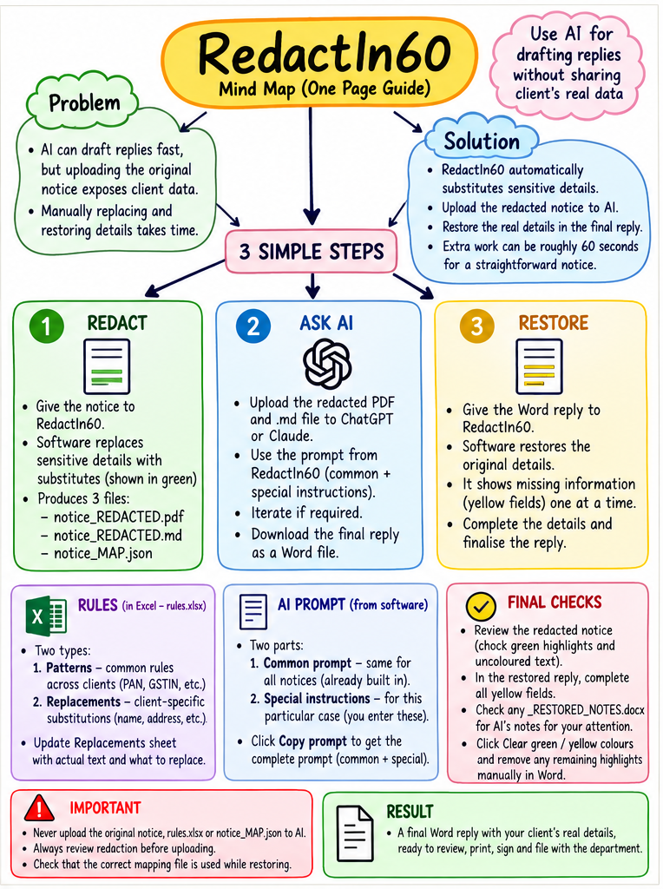

[README.md](https://github.com/user-attachments/files/33976147/README.md)
# RedactIn60 — Privacy-Conscious AI-Assisted Notice Reply Workflow

**AICA Level 2 Capstone Project | Batch 98, Ernakulam | CA Jairam Kamath**  
**Platform:** Windows desktop application built with Python  
**Area:** Chartered Accountancy practice — Income-tax and GST notices

## Project at a glance

**Redact → Ask AI → Restore.** RedactIn60 is a Python desktop tool designed to help Chartered Accountants use AI to draft responses to statutory notices while reducing unnecessary disclosure of client-identifying details to an external AI service.

The application **does not itself generate a legal reply using an AI model**. Instead, it prepares redacted material and a structured prompt for use in a separate AI tool, then helps restore the original particulars in the resulting draft.

## The problem

AI can assist professionals in drafting replies to Income-tax and GST notices, but uploading an original notice may reveal names, addresses, identification numbers and other confidential information. Manually substituting these particulars before consulting AI — and reversing the substitutions afterward — is repetitive, time-consuming and prone to errors.

## The solution

RedactIn60 supports three stages:

1. **REDACT:** Open a notice in the desktop application. Configurable Excel rules and identifier patterns substitute selected sensitive particulars. For supported inputs, the tool can produce a human-reviewable redacted document, a Markdown version for AI processing, and a **private mapping file** needed for restoration.
2. **ASK AI:** Review the redacted output carefully. Copy the consolidated prompt combining built-in general instructions with case-specific instructions, then submit **only the reviewed redacted material** to an external AI tool such as ChatGPT or Claude. Review and refine the draft there; obtain the final reply in Word format.
3. **RESTORE:** Supply the AI-drafted Word reply to RedactIn60 together with the **matching private mapping file**. The tool replaces recognised substitute particulars with their original values, supports completion of highlighted missing-information fields, and produces a draft for professional review.

**Intended benefit:** Minimise repetitive manual substitution and restoration while keeping original client particulars out of the material intentionally supplied to the AI service. The name *RedactIn60* reflects the aspiration that these extra steps can take roughly 60 seconds for a straightforward notice; **60 seconds is not a guaranteed processing time**.

## Key capabilities

- Windows desktop interface with separate redaction and restoration workflows.
- Supports text-based PDF, DOCX, XLSX, TXT, CSV and Markdown input for redaction.
- Customisable substitution rules in `rules.xlsx`, including common identifier patterns and case-specific replacements.
- Redacted, reviewable outputs and Markdown intended for use by an AI drafting service.
- Consolidated AI prompt with general and case-specific instructions.
- Restoration of recognised original particulars into an AI-drafted Word document.
- Guided completion of missing facts marked for later input.
- Visual indications to support review of replaced and incomplete particulars.

## Files needed to run the application

| File | Purpose |
| --- | --- |
| `install.bat` | Windows installer launcher; installs required Python packages. |
| `install_helper.py` | Copies the application files into the user's profile and creates a desktop shortcut. |
| `redactor_gui.pyw` | Desktop user interface. |
| `redactor_core.py` | Document processing, substitution, prompting and restoration logic. |
| `rules.xlsx` | Example/configurable replacement and pattern rules; use only sample data in public copies. |

The application creates/uses additional local files during operation, including a private mapping JSON and a local fixed-prompt text file. **Do not commit client-specific generated files.**

## Installation (Windows)

1. Install **Python 3** from [python.org](https://www.python.org/downloads/) if it is not already installed. On Windows, enable **Add Python to PATH** during installation.
2. Keep the five application files above together in one folder.
3. Double-click **`install.bat`** while connected to the internet. The script installs `pymupdf`, `python-docx`, `openpyxl` and `tkinterdnd2`.
4. Follow the on-screen messages. If installation succeeds, launch **RedactIn60** from the desktop shortcut.

The installer places its working application files under the user's profile (`RedactIn60`). Existing local rules or fixed-prompt customisations may be retained when upgrading; review the selected rules before processing a notice.

## Demonstration overview

For assessment, a demonstration can show: (a) launching the desktop application, (b) selecting a **synthetic/sample notice**, (c) inspecting the redacted results, (d) copying a structured prompt for an external AI service, and (e) restoring a sample AI-generated Word reply using the corresponding local mapping file. The project overview image above illustrates the workflow.

## Critical safeguards and limitations

- **Human verification is compulsory.** Pattern matching and substitutions may miss sensitive information. Inspect every page, table, header, footer and annexure before sharing redacted files.
- **Never submit to external AI:** the original notice, `rules.xlsx` containing real client information, or any `*_MAP.json` mapping file. These must stay local and confidential.
- **Scanned/image-only PDFs:** Text embedded as an image generally needs OCR before text-based redaction. This application is **not an OCR solution**.
- **Not encryption or anonymisation assurance:** It performs rule-based substitution; it does not guarantee removal of every identifying detail or eliminate re-identification risks.
- **Professional responsibility remains with the CA:** Check legal provisions, case law, facts, dates, restored identities, blanks and attachments before any reply is issued or filed.
- The application is intended to support document preparation; it is **not** an automated legal opinion or filing system.

## Technology

Python, Tkinter, PyMuPDF, python-docx, openpyxl and tkinterdnd2. The document-handling application runs locally; using ChatGPT, Claude or another external AI service is a **separate, optional online step controlled by the user**.

## Project scope

This capstone demonstrates a practical AI-assisted workflow for professional practice with privacy-conscious preparation of input documents and controlled post-processing of the AI output. It is a demonstration of workflow integration and professional oversight, not a claim that AI-generated legal content is automatically accurate or that redaction is foolproof.
