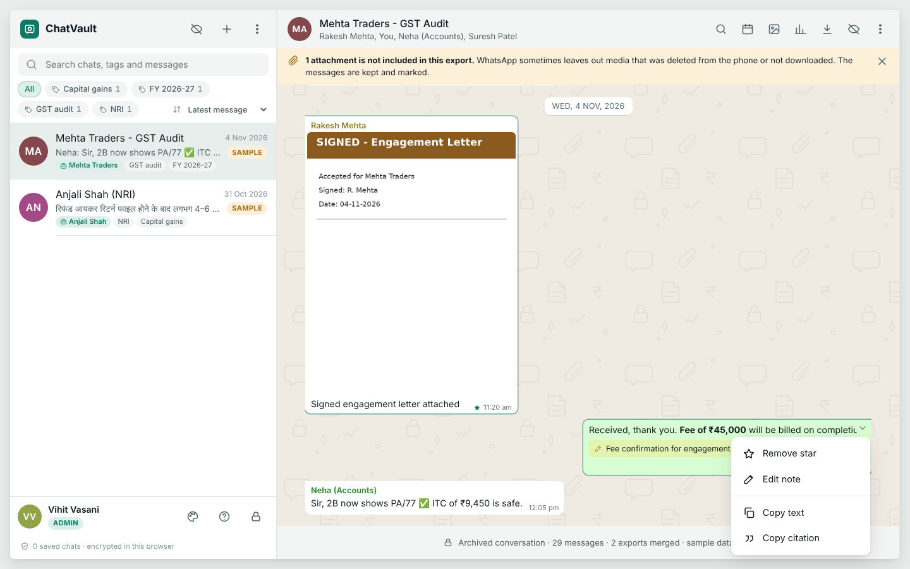
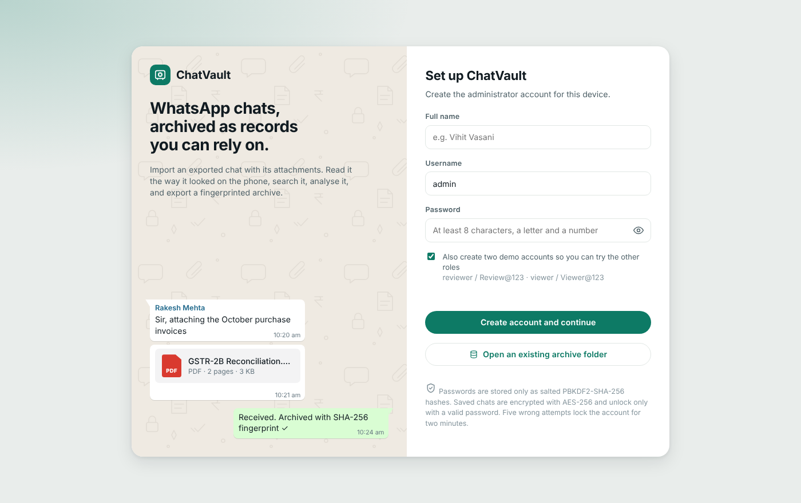
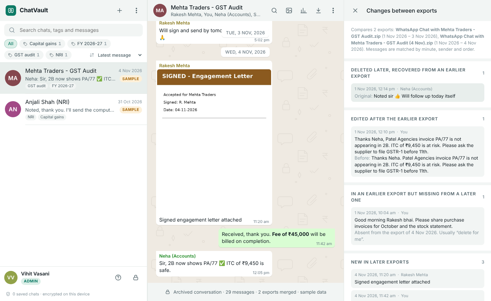
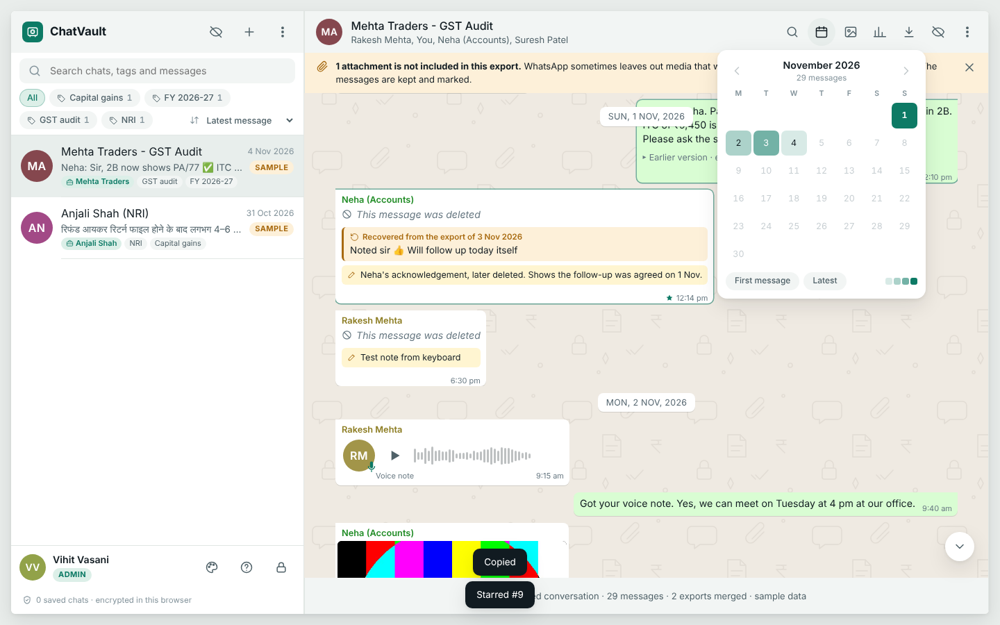
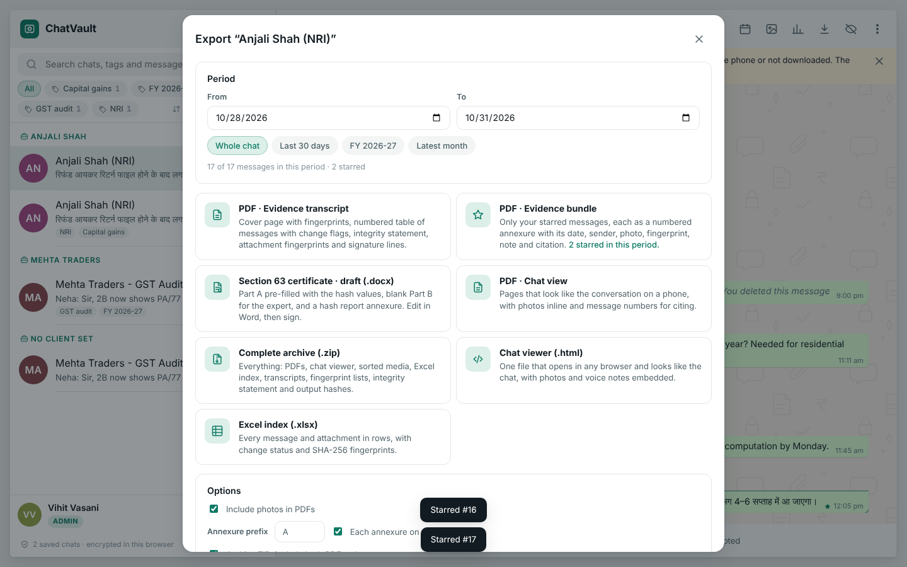
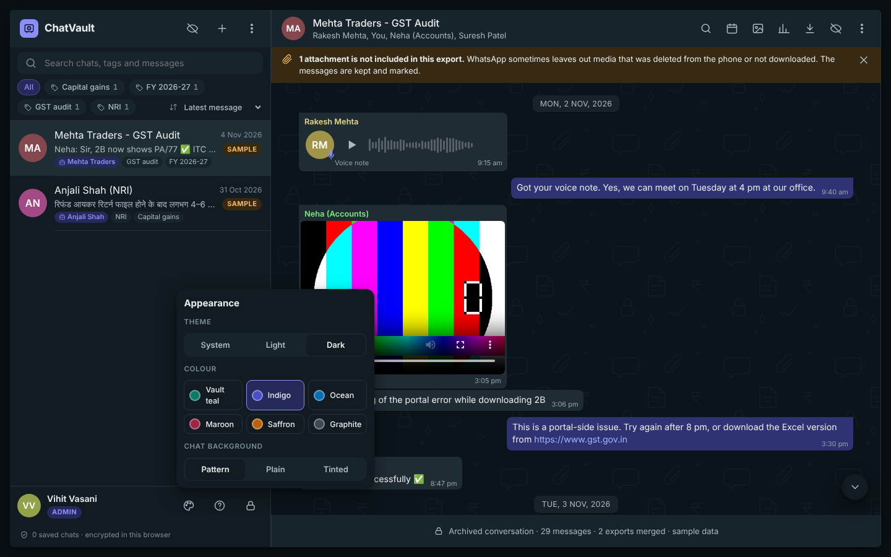
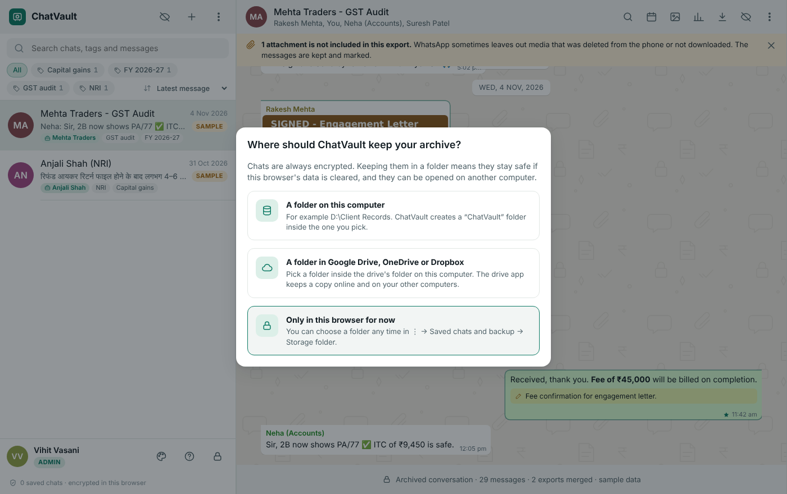

<p align="center"></p>

<h1 align="center">ChatVault</h1>
<p align="center"><b>WhatsApp chats, archived as records you can rely on</b></p>
<p align="center">AICA Level 2 · Batch L2B105 · Use-case project<br>By <b>CA Vihit Vasani</b> (MRN 147038)</p>

---

ChatVault turns a WhatsApp chat export into an organised, searchable, encrypted archive. It reads like the chat on a phone, fingerprints every file with SHA-256, recovers messages deleted between exports, and produces evidence-ready outputs: PDF transcripts, numbered annexure bundles and a draft Section 63 (Bharatiya Sakshya Adhiniyam, 2023) certificate. Everything runs on the user's own device; nothing is uploaded.

**One-page summaries:** [Overview: problem, use cases, features](docs/ChatVault%20-%20One-pager%20-%20Overview.pdf) · [Technology note](docs/ChatVault%20-%20One-pager%20-%20Technology.pdf)



## How to open ChatVault

You need **Google Chrome** or **Microsoft Edge**. No installation, no internet connection.

1. Download this folder (on GitHub: **Code → Download ZIP**, then extract it).
2. Choose one way to open it:
   - **Easiest:** double-click **`ChatVault.html`**.
   - **With a desktop icon (Windows):** double-click **`Create Desktop Shortcut (Windows).bat`** once. A ChatVault icon appears on your Desktop and in the Start menu, and opens ChatVault in its own window, like an installed program. If Windows shows a "protected your PC" notice, choose *More info → Run anyway*; the script only creates the shortcut.
   - **Mac or manual shortcut:** open `ChatVault.html` in Chrome, then **⋮ → Cast, save and share → Create shortcut**, and tick **Open as window**.
3. On first launch, create the administrator account. Tick the box to also create demo accounts:
   - `reviewer` / `Review@123`
   - `viewer` / `Viewer@123`
4. Choose where to keep the archive: a folder on the computer, a Google Drive / OneDrive / Dropbox folder, or the browser only. Sample chats load automatically, and a short guided tour follows.

To archive a real chat: on the phone, open the chat → **Export chat → Include media**, copy the ZIP to the computer and drop it onto ChatVault.

## What it does

| Area | Features |
|---|---|
| **Reading** | Phone-style bubbles, photos, video, voice notes with waveform, PDF viewer, calendar to jump to any day, light/dark mode and six colour themes |
| **Finding** | Search across all chats; filters by sender, date, type, starred, notes, recovered and edited; tags; client and matter fields (PAN, GSTIN, FY) |
| **Merge and compare** | Add a newer export of the same chat: deleted messages are recovered with their original text, edits are flagged, and every change is listed |
| **Integrity** | SHA-256 of every export and file, re-checked whenever a saved chat opens; chain of custody per chat; output hash file in every archive |
| **Evidence outputs** | PDF evidence transcript, PDF chat view, evidence bundle of starred messages as Annexure A-1, A-2…, Excel index, HTML viewer, complete ZIP archive, draft Section 63 certificate (.docx) with hash report |
| **Access control** | Admin, Reviewer and Viewer roles; salted password hashes; lockout after five wrong attempts; auto-lock; privacy screen; audit log |
| **Storage** | AES-256 encrypted in the browser and in a chosen local or online-drive folder; restore on another computer; encrypted backup file |
| **AI and agents** | Claude summary, action items and timeline (in the published version); rule-based insights offline; Python filing agent; agentic-browser task prompts |
| **Languages** | Gujarati and Hindi messages, including in PDFs |

<details>
<summary><b>More screenshots</b></summary>

| | |
|---|---|
|  |  |
|  |  |
|  |  |

</details>

## Technology

| Layer | Technology |
|---|---|
| Interface | HTML5, CSS3, JavaScript (ES2022), single self-contained file |
| Processing | JSZip, custom parser for Android and iPhone export formats |
| Database | IndexedDB (browser database), localStorage, File System Access API (local or cloud-synced folder) |
| Security | Web Crypto API: SHA-256, AES-256-GCM, PBKDF2-SHA-256 (150,000 iterations) |
| Documents | pdfmake with Noto Sans Gujarati/Devanagari, SheetJS, pdf.js, Office Open XML |
| Python | `chatvault.py` command-line archiver (ReportLab, openpyxl), `filing_agent.py`, sample generator |
| AI | Claude (summaries in the published version), agentic-browser task prompts |

Details: [Technology note](docs/ChatVault%20-%20One-pager%20-%20Technology.pdf) and [source/README.md](source/README.md).

## Folder contents

```
ChatVault.html                         the application (open this)
Create Desktop Shortcut (Windows).bat  makes a desktop icon that opens ChatVault in its own window
docs/                                  one-page summaries and sample outputs (PDF, Word)
assets/                                icon, shortcut script, screenshots
source/app/                            application source (src/), build script, bundled libraries and fonts
source/python/chatvault.py             command-line archiver: PDF transcript, Excel index, SHA256SUMS
source/agent/                          filing agent and agentic-browser task prompts
source/samples/                        fictional sample exports and their generator
```

To rebuild `ChatVault.html` from source: `python source/app/build.py` (output in `source/app/dist/`).

## Privacy and limits

- All sample chats, names and documents are **fictional**. No client data is included.
- Processing happens on the device. Folder storage keeps salted password hashes in `vault.json`; keep the folder private.
- Folder storage needs Chrome or Edge with `ChatVault.html` opened from the computer.
- The Section 63 certificate is a **draft** for review. It must be completed and signed by the party (Part A) and the expert (Part B).
- PDF export and Excel export load their libraries from a CDN the first time; the rest works fully offline.
