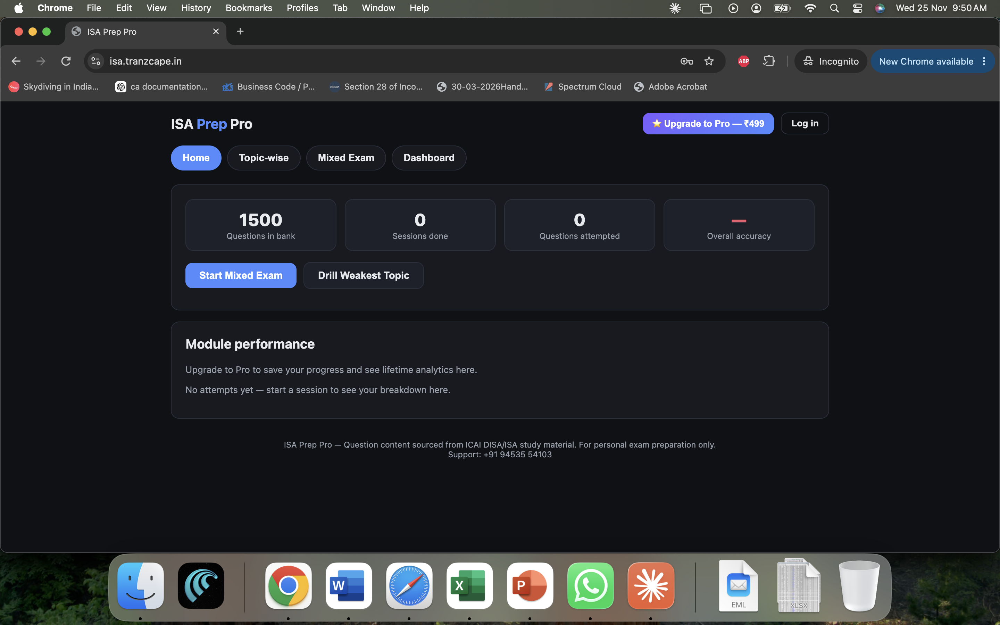
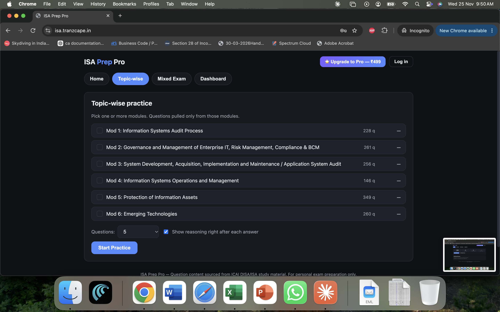
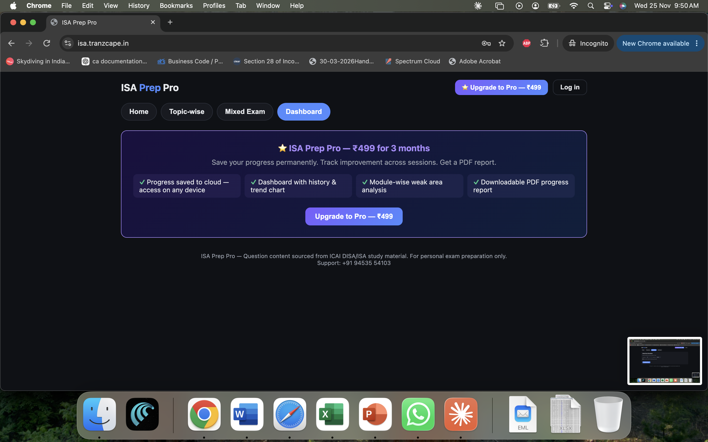
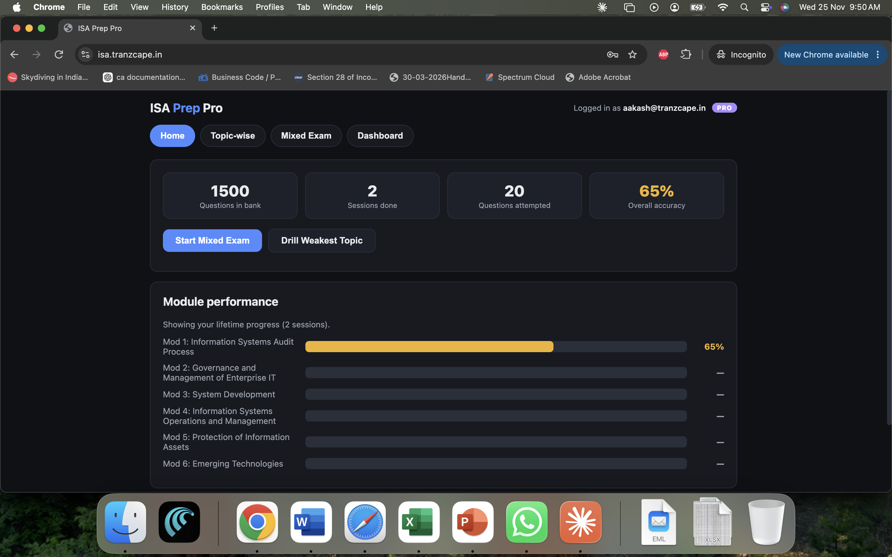
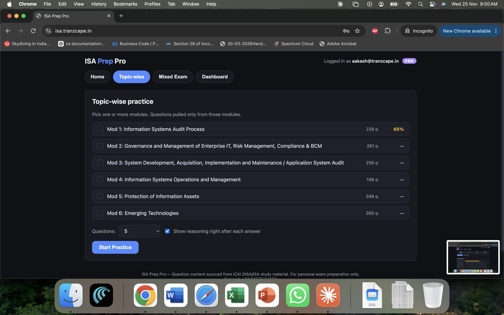
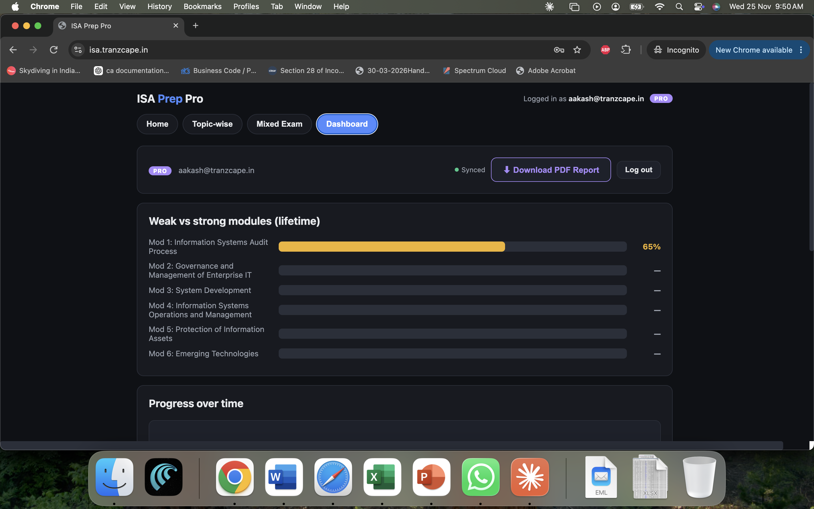
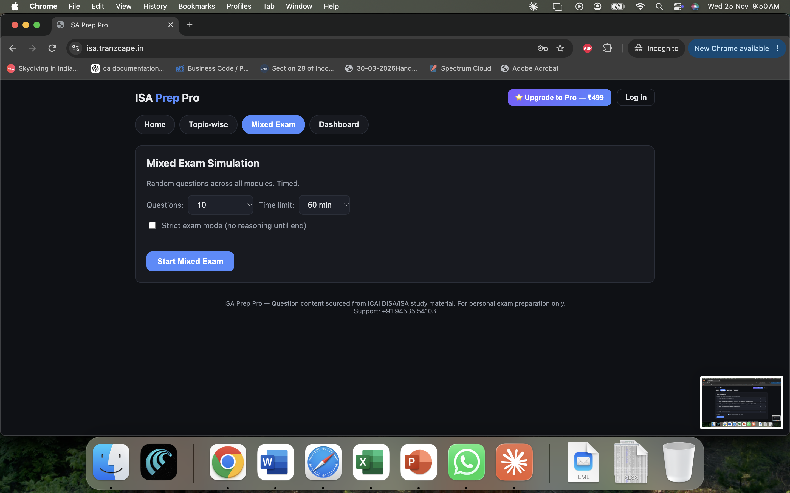

# ISA Prep Pro – AI-Assisted Exam Preparation & Progress Tracker

**Author:** CA Aakash Jhunjhunwala (Membership No. 316161)
**Course:** ICAI AICA Level 2 – Capstone Project (Batch B110)
**Live site:** https://isa.tranzcape.in/

---

## 1. Problem
Chartered Accountants preparing for ICAI's Post-Qualification Course in Information Systems Audit (ISA/DISA) have no structured way to practise the assessment MCQs or to see which modules they are weak in. Study material is long, and self-assessment is mostly done by hand.

## 2. Solution
ISA Prep Pro is a web app that lets candidates:
- Practise from a bank of about **1,500 validated MCQs** covering the ISA modules
- Take **module-wise and mixed mock tests**
- **Track their progress**: scores, attempts and weak areas over time
- Upgrade to a **Pro tier (₹499)** for full access, activated by UPI payment and WhatsApp confirmation

## 3. How AI Was Used
| Stage | AI use |
|---|---|
| Question bank | AI (Claude) was used to draft, classify and explain MCQs from the ISA syllabus. I then checked each one as a CA. |
| Answer explanations | AI-generated explanations for each answer, reviewed for technical accuracy |
| App development | Built as a non-coder with AI-assisted coding: page design, database schema, login and progress-tracking logic |
| Testing & debugging | AI was used to find and fix bugs and to improve the user experience |

> **Key learning:** AI let a practising CA with no coding background build and run a working, paid product. Professional judgement was still needed to check content quality.

## 4. Tech Stack
- **Frontend:** HTML / CSS / JavaScript
- **Backend & database:** Supabase (authentication and data storage)
- **Hosting:** Netlify, custom domain isa.tranzcape.in
- **Payments:** UPI with manual activation over WhatsApp

## 5. Features
- User sign-up and login
- Module-wise practice and full mock tests
- Instant scoring with answer explanations
- Progress dashboard showing attempts, accuracy and weak modules
- Free and Pro access tiers

## 6. Screenshots

### Without login (free access)
| Home | Topic-wise practice | Dashboard |
|---|---|---|
|  |  |  |

### After login (progress tracking)
| Home | Topic-wise practice | Dashboard |
|---|---|---|
|  |  |  |

### Mixed mock test

## 7. How to Use
1. Visit https://isa.tranzcape.in/
2. Sign up or log in
3. Pick a module or a mock test and start practising
4. Check your progress dashboard

## 8. Impact & Future Scope
- Saves candidates preparation time and shows them which modules to focus on
- Planned: AI tutor chat for doubts, adaptive tests that target weak areas, and extending the format to other ICAI certificate courses

## 9. Disclaimer
This is an independent practice tool and is not affiliated with or endorsed by ICAI. The questions are for practice only.
