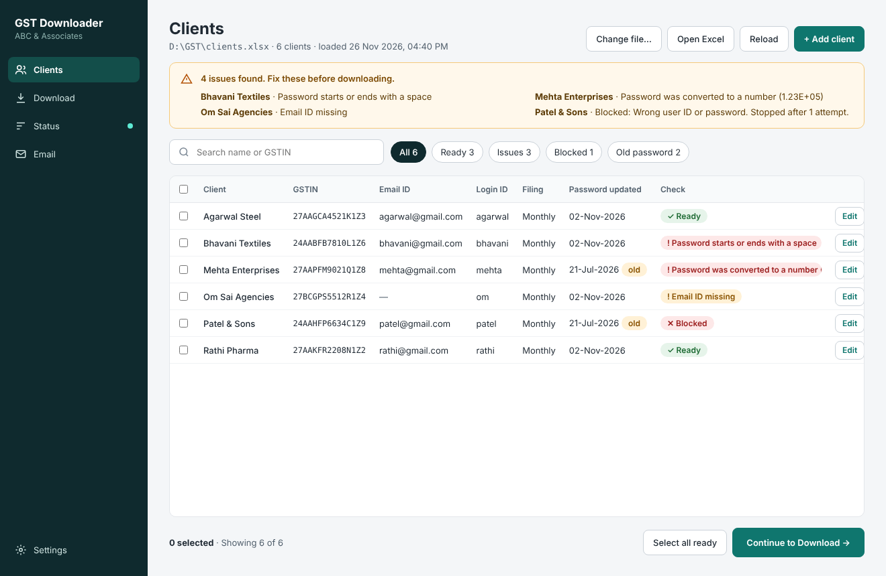
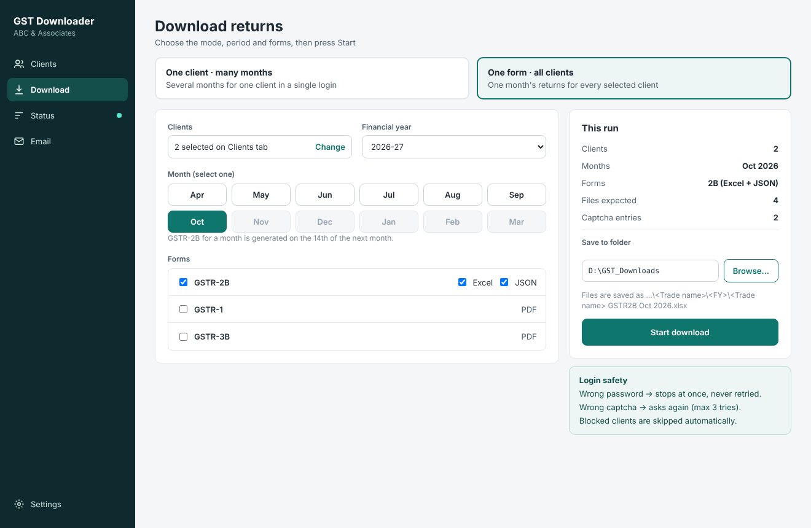
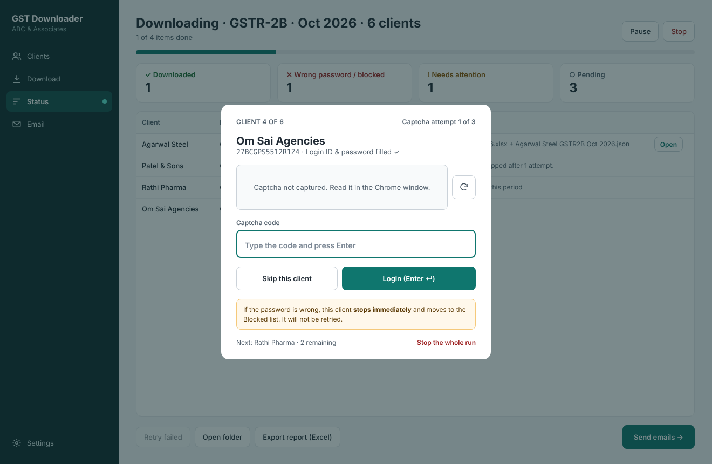
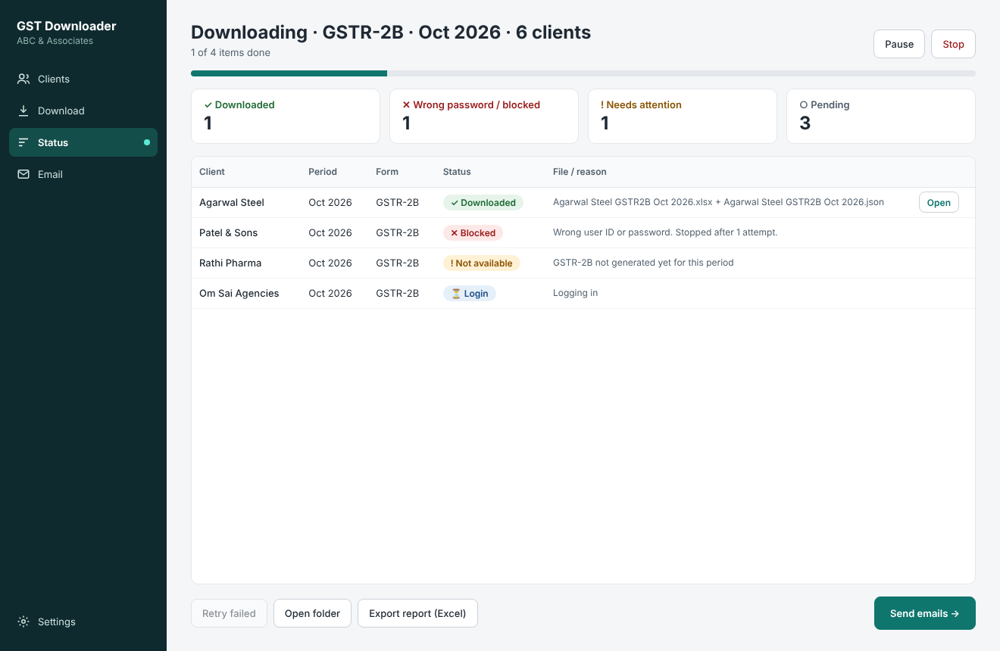
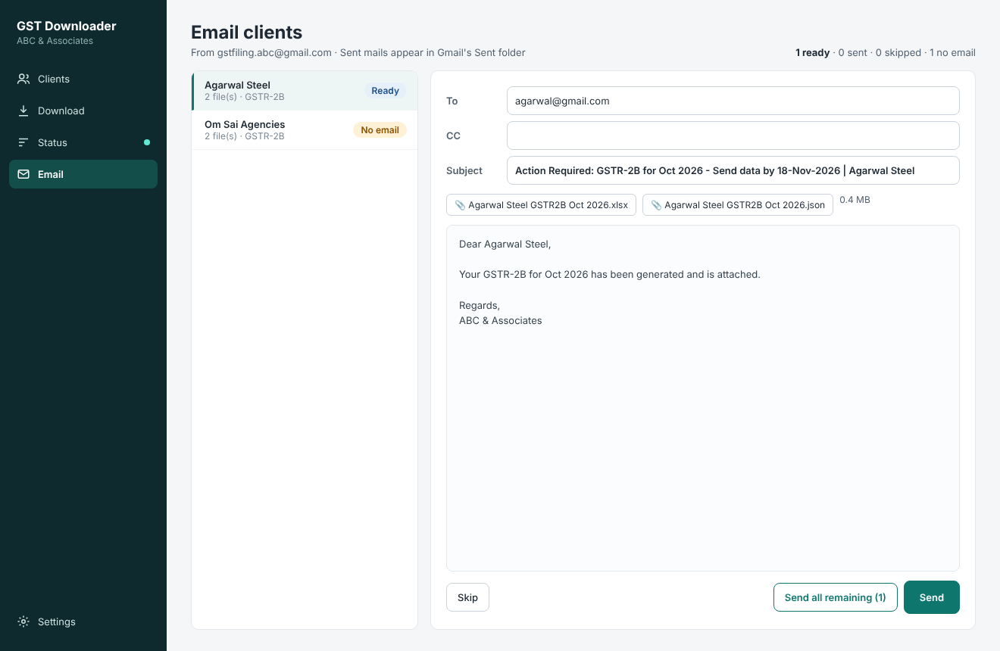
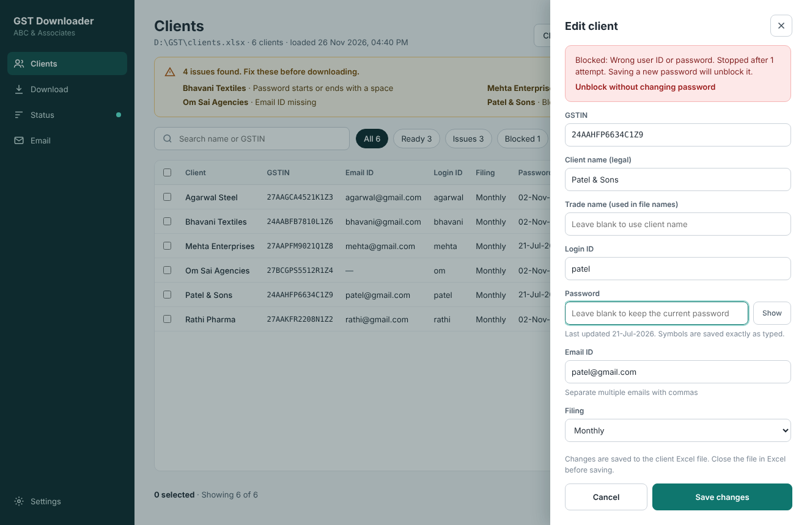
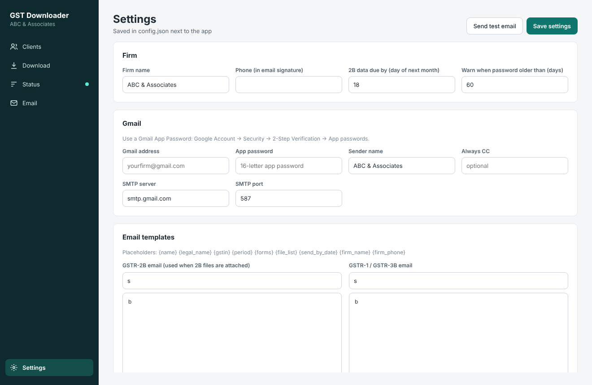

# GST Return Downloader

A Windows desktop app that downloads GST returns from the Indian GST portal for many clients at once. It renames each file and emails it to the client after a staff member reviews it.

It was built for a tax practice where staff were downloading **GSTR-2B** by hand for 100+ clients every month.



## Features

- **Client list from Excel:** GSTIN, name, trade name, email, login ID, password and filing type.
- **Checks the client list before any login:** blank password, a space at the start or end, a password Excel turned into a number or date, a missing email, a bad GSTIN or a duplicate GSTIN.
- **Edit and add clients inside the app:** password changes are written back to the Excel file, and the date of the change is saved.
- **Two download modes:**
  - one client, many months, in a single login
  - one month's form(s) for all selected clients
- **Forms:** GSTR-2B (Excel and/or JSON), GSTR-1 (PDF), GSTR-3B (PDF).
- **Quarterly (QRMP) clients:** GSTR-1 and GSTR-3B are fetched once per quarter.
- **Captcha:** the app shows the portal's captcha; the user types it and presses Enter.
- **Automatic file naming:** `ABC Enterprises GSTR2B Oct 2026.xlsx`, saved under `<folder>\<Trade name>\<FY>\`.
- **Live status table:** shows what was downloaded, what failed and why. It can be exported to Excel, and failed items can be retried.
- **Email step:** each client's email is shown for review before sending, with separate templates for GSTR-2B and for GSTR-1/3B. It sends through Gmail SMTP with an App Password.
- **Manual fallback:** if the portal changes and a button cannot be found, the app asks the user to click it in Chrome, then catches the downloaded file and renames it.
- **Debug snapshots:** a screenshot and page details are saved when a portal step fails.

## Login safety

The GST portal locks an account after 3 wrong passwords, and unlocking it needs the client's OTP. The app is designed so this can never happen because of it:

| Portal reply after login | What the app does |
|---|---|
| Success | Continues |
| Wrong captcha | Reloads the login page and asks for a new captcha (max 3 times) |
| Wrong user ID / password | **Stops at once.** The client is added to the Blocked list and is never tried again |
| Locked / password expired / unclear / timeout | Same as a wrong password: stops and blocks |

- A client stays blocked until its password is changed. This is detected by comparing a SHA-256 hash, so the password itself is never stored.
- Text already on the page before the login click is ignored. A static label can therefore never be mistaken for a "wrong captcha" reply and trigger a second password attempt.

## Screenshots

| Download setup | Captcha |
|---|---|
|  |  |
| **Live status** | **Email review** |
|  |  |
| **Edit client** | **Settings** |
|  |  |

*The screenshots use made-up sample data.*

## Tech stack

- **Python 3.11 / 3.12**
- **pywebview:** a desktop window with an HTML/CSS/JS interface (Edge WebView2 on Windows)
- **Selenium 4:** drives Google Chrome on the GST portal. Selenium Manager fetches the right ChromeDriver
- **openpyxl:** reads and writes the client Excel file and the report
- **smtplib:** Gmail SMTP. Tries port 587 (STARTTLS) and falls back to port 465 (SSL)
- **PyInstaller:** packages the app as a Windows `.exe`

## Project structure

```
main.py        Starts the desktop window
api.py         Functions the UI calls (bridge between JavaScript and Python)
jobs.py        Download job: background thread, captcha prompts, login safety, renaming
portal.py      Selenium automation of the GST portal
clients.py     Read / validate / update the client Excel file
blocked.py     Blocked-client list (hash of GSTIN + password)
emailer.py     Builds and sends client emails
naming.py      Financial year, quarter, period labels and safe file names
settings.py    Defaults and config.json (all portal texts and IDs are configurable)
ui/            index.html, style.css, app.js
tests/         Offline tests with a fake GST portal
docs/          Screenshots
```

## Run from source (Windows)

1. Install Python 3.11 or 3.12 and tick **"Add python.exe to PATH"**. Google Chrome must also be installed.
2. Double-click `run.bat`. It installs the requirements the first time and starts the app.
3. On first start the app creates a blank `clients.xlsx` and a `config.json`. Fill in the clients. Set the Password column to **Text** format before typing passwords.

Or run it by hand:

```
pip install -r requirements.txt
python main.py            # add --debug for the developer console
```

## Build the .exe

Double-click `build_exe.bat`. It creates:

- `dist\GST Downloader\GST Downloader.exe`
- `dist\GST Downloader.zip`, ready to share

## Tests

The tests run without Chrome, internet or a GST login. A fake portal stands in for the real one.

```
python tests/test_offline.py
```

They cover:
- file naming, financial year and quarter logic
- reading and validating the Excel file, including number and space passwords and `=`-prefixed passwords
- the login-safety rules: exactly one attempt on a wrong password, blocked clients skipped on the next run, unblock after a password change, captcha retry limit
- quarterly handling, manual-fallback file capture, email building and the API layer

## Configuration

Everything the app looks for on the portal is in `config.json` → `"portal"`: URLs, element IDs, button texts and error messages. These can be edited if the portal changes, without touching the code.

The Settings screen covers:
- firm details
- Gmail sender
- the "2B data due by" day
- the password-age warning
- both email templates

## Limitations

- The captcha must be typed by a person. The app does not try to bypass it.
- Portal layout changes may need edits in `config.json`. The manual fallback keeps the app usable in the meantime.
- Gmail sending needs an App Password (2-Step Verification on). An antivirus with email scanning or a firewall can block SMTP.

## Privacy

`clients.xlsx`, `config.json`, `blocked.json`, logs, the `debug` folder and downloaded returns are listed in `.gitignore`. They contain client passwords or tax data and must never be committed.

## Disclaimer

This is an independent project and is not affiliated with GSTN or the Government of India. Use it only for GST accounts you are authorised to access.
