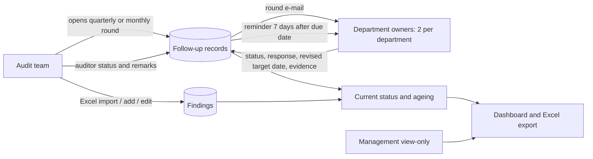
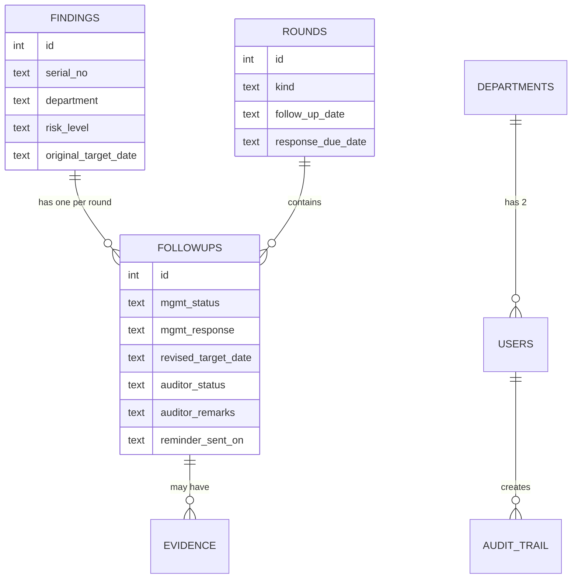

# System design: Audit Findings Tracker

## 1. Overview

One Streamlit application (`03_Code/app.py`) with three layers inside the same file:

1. **Settings**: read from environment variables or `.streamlit/secrets.toml`. They choose the database and the e-mail method. This is what makes two variants out of one code file.
2. **Core logic**: database access, login, permissions, import, rounds, ageing, reminders, e-mail, exports, sample data. It contains no Streamlit code and is tested on its own (`tests/test_core.py`).
3. **Screens**: the Streamlit pages for each role.

## 2. Roles and permissions

Permissions are enforced inside the core functions, not only by hiding buttons. A department owner who tries to update another department's item gets a `PermissionError` (tested).

| Action | Audit Admin | Department Owner | Management |
| --- | :---: | :---: | :---: |
| Import, add, edit findings | Yes | No | No |
| Open a follow-up round, send reminders | Yes | No | No |
| Enter management status, response, revised target date | No | Own department only, until the auditor reviews the round | No |
| Set auditor status and remarks, close a finding | Yes | No | No |
| View dashboard and register | All | Own department | All |
| Change the original target date | Yes (logged) | Never | No |
| View audit trail and e-mail log, manage users | Yes | No | No |

## 3. Data model

Tables: `users`, `departments`, `findings` (the 14 Excel columns + id), `rounds`, `followups`, `evidence`, `audit_trail`, `email_log`. Dates are stored as ISO text (`2026-11-27`) so the same SQL runs on SQLite and PostgreSQL.

## 4. Business rules

**Status definitions**

| Status | Definition |
| --- | --- |
| Open | No action has started, or no response was received by the follow-up date |
| Ongoing | Implementation has started or is partly done, with a revised date, but is not yet fully in place |
| Closed | Fully implemented, evidence on file. For the auditor status, Internal Audit has also verified it |

**Current status.** A finding's official status is the auditor status of its latest *reviewed* round (Open if none). The management status of the latest round is shown beside it. If management says Closed and the auditor does not, the finding is flagged as a disagreement.

**Rounds.** Quarterly = every finding the auditor has not closed. Monthly = only the unclosed High-risk findings. A finding cannot be put into two rounds with the same follow-up date.

**Management update rules.** Status, response (required) and revised target date can be saved until the auditor has reviewed the round. If the target date has already passed and the status is not Closed, a revised target date is compulsory. The original target date is never changed by an owner.

**Auditor review rules.** Closing a finding needs remarks.

**Ageing.** Days overdue = today minus the target date, for every finding the auditor has not closed. Buckets: not yet due (0 or less), 1-30, 31-60, 61-90, over 90 days. Shown against the original target date and against the latest revised target date.

**Reminder.** If a follow-up item still has no management update and no auditor review, and the response due date + 7 days is today or earlier, one reminder is sent to the department's two users, copying the audit team. Each item is reminded once. The 7 days is a setting (`REMINDER_DAYS`).

**Escalation (optional).** With `ESCALATION_ENABLED=true`, an item still unanswered 14 days after the due date (after its reminder) triggers one e-mail to the department head. Off by default.

## 5. The two variants

Same `app.py`. Only the settings differ.

| Setting | Variant A: Gmail test | Variant B: Microsoft 365 intranet |
| --- | --- | --- |
| `DATABASE_URL` | empty (SQLite) or the Supabase connection string | empty (SQLite) or the company SQL Server / PostgreSQL |
| `EMAIL_MODE` | `gmail` (uses `GMAIL_USER`, `GMAIL_APP_PASSWORD`) | `graph` (uses `GRAPH_*`) or `smtp` (company relay) |
| `TEST_EMAIL_OVERRIDE` | your own address, so no real user is e-mailed during testing | empty |
| Hosting | own computer or Streamlit Community Cloud | internal server, intranet link set in `APP_URL` |

Moving from A to B = copy the settings file, change these values, and start the app on the intranet server.

**Checklist for IT before Variant B**

1. A server (Windows or Linux) with Python 3.10+ and a fixed internal address and port.
2. HTTPS certificate for the intranet name.
3. A shared mailbox (for example the audit follow-up mailbox) and an app registration in Microsoft Entra ID with permission to send mail from it, or the address of the company SMTP relay.
4. Database decision: SQLite file, or a SQL Server / PostgreSQL database with a user for the app.
5. Backup of the database and the evidence data.
6. Optional: single sign-in with company accounts, and a daily scheduled task that runs the reminders.

## 6. Security notes

* Passwords are stored as salted PBKDF2-SHA256 hashes, never as text.
* Secrets (database string, mail passwords) live in `secrets.toml` or environment variables and are excluded from GitHub by `.gitignore`.
* Every create/edit/review/reminder action is written to the audit trail with user and time. Nothing is deleted except by the Audit Admin's explicit "wipe all findings" action (typing WIPE), which is itself logged.
* The test password `Test@123` exists only for dummy test users. In production set `DEFAULT_PASSWORD` before the first start and reset passwords on the Users screen.

## 7. Where the build differs from the prompt

| Prompt said | Built version |
| --- | --- |
| Evidence files in Supabase storage / internal shared folder | Stored inside the database (max 5 MB each), which works the same on every variant. Storage buckets can be added later |
| Daily scheduled job for reminders | Button "Send reminders now" for the Audit Admin. The same function can be called from a scheduled task when IT is ready |
| Single sign-in with Microsoft Entra ID for Variant B | Not built yet. Username and password are used; this needs IT's help to add |
| Department owner can edit only management update and target date | As specified; evidence upload is the only extra and is attached together with the response (to be confirmed by the user) |
