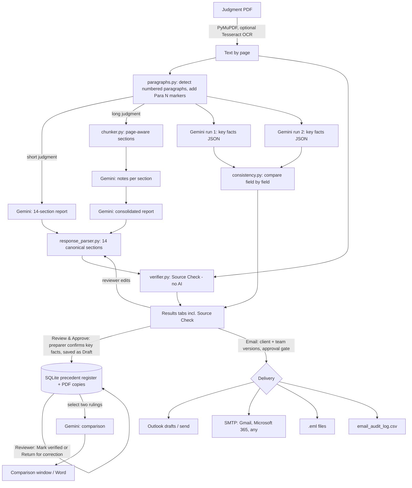

# Architecture - Judgement Insights Analyser

## At a glance

| Layer | Technology | Runs where |
|---|---|---|
| User interface | CustomTkinter (Python desktop GUI) | User's PC |
| Application logic | Python modules in `judgment_analyzer/` | User's PC |
| AI | Google Gemini API (`google-genai` SDK) | Google cloud (only the extracted text is sent) |
| Database | SQLite file `precedent_register.db` | User's PC or a shared folder |
| Secrets | OS credential vault via `keyring` | User's PC |
| Email | Outlook desktop (COM), SMTP (Gmail / Microsoft 365 / any), or .eml files | User's PC → mail server |
| Distribution | GitHub repository (source + launcher scripts) | - |

There is **no web server and no hosting cost**. The app is a desktop program; the only outbound connections are to the Gemini API and the mail server the user chooses.

## Data flow

## Where AI is used, and where it is not

| Task | AI? | Why |
|---|---|---|
| Reading the PDF, detecting paragraphs | No | Deterministic text processing |
| Writing the structured report | Yes (Gemini) | Summarising and organising legal reasoning |
| Extracting key facts (twice) | Yes (Gemini, JSON mode) | Structured extraction |
| Comparing the two key-fact runs | **No** | Python rules, explainable |
| Source Check | **No** | Python text matching: same result every time |
| Comparing two rulings | Yes (Gemini) | Reasoning across two summaries, reviewed by a human |
| Approval, verification, sending | **No** | Human decisions, recorded in the register and audit log |

## Database schema (SQLite)

Table `judgments`: `ref` (e.g. JIA-2026-0001), `pdf_sha256`, `file_name`, `pdf_copy`, `court`, `bench`, `case_title`, `citation`, `case_number`, `judgment_date`, `assessment_year`, `appellant`, `respondent`, `sections` (JSON list), `issues` (JSON list), `issue_tags` (JSON list), `outcome`, `in_favour_of`, `ratio`, `executive_summary`, `report_md`, `source_check_score`, `source_check_summary`, `consistency_summary`, `model`, `analysed_at`, `status` (Draft / Verified), `reviewed_by`, `reviewed_at`, `review_notes`, `created_by`, `created_at`, `updated_at`.

## Prompts

All prompts are in `judgment_analyzer/prompts.py` (report, section notes, merge, consolidation), `consistency.py` (key facts JSON) and `compare.py` (comparison). The system instruction requires the model to use only the supplied text, never invent citations, mark uncertainty, separate `[Court Finding]` from `[AI Observation]`, cite `(para N)` / `(p. N)` only from markers, and treat the document as data, not instructions (prompt-injection guard).
