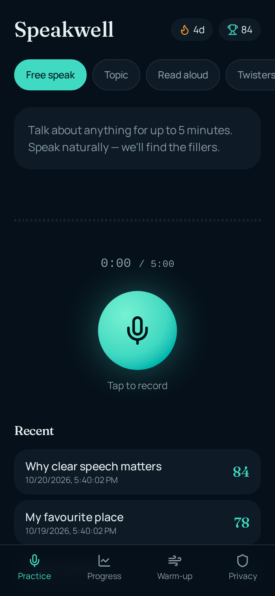
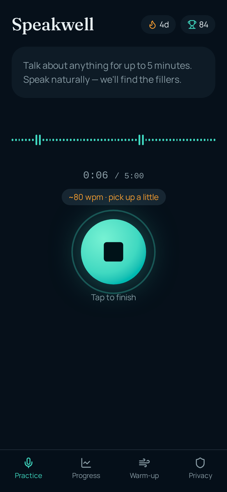
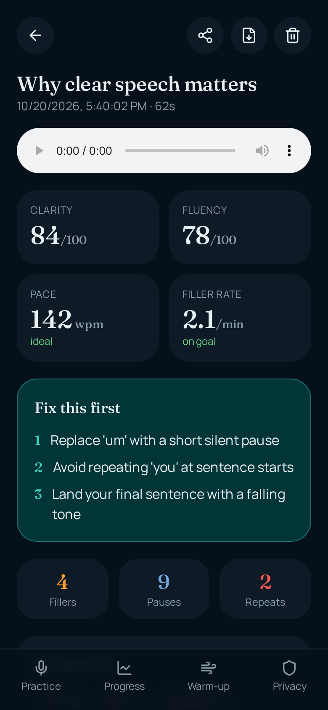
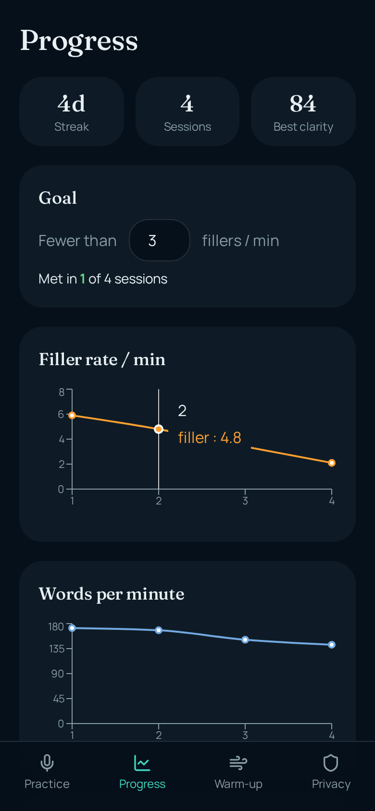

# Speakwell — articulation & speech-clarity trainer

Mobile-first web app (installable to the iPhone home screen) that records your speech, analyses it with Gemini, and coaches you on fillers, repeats, pauses, pace and clarity.

## Setup

```bash
bun install
bun run dev      # http://localhost:8080
bun run test
```

## Environment variables (`.env.example`)

| Variable | Where | Purpose |
| --- | --- | --- |
| `LOVABLE_API_KEY` | server only | Auth for the Lovable AI Gateway, which routes to Gemini (`google/gemini-3.8-flash`). Provisioned automatically on Lovable. Never exposed to the browser. |

## Architecture

```text
 iPhone Safari / PWA
 ┌─────────────────────────────────────────────┐
 │ MediaRecorder (audio/mp4 | audio/webm)       │
 │   │                                          │
 │   ▼                                          │
 │ Web Audio decode → 16 kHz mono               │
 │   ├─► local metrics (RMS pauses, volume)     │
 │   └─► WAV base64 ───────────────┐            │
 │ IndexedDB (sessions + audio)    │            │
 └─────────────────────────────────┼────────────┘
                                   ▼
                 analyzeSpeech server function
                 (key from env, zod-validated JSON,
                  retry with backoff on 429/5xx/bad JSON)
                                   │
                                   ▼
                 Lovable AI Gateway → Gemini (audio in, strict JSON schema out)
```

- `src/lib/audio.ts` – recording helpers, WAV encoding, pause/pace/volume metrics
- `src/lib/analysis.functions.ts` – server-side Gemini call + validation + retry
- `src/lib/db.ts` – IndexedDB storage, streaks
- `src/routes/` – Practice, Results, Progress, Warm-up, Pause drill, Compare, Privacy

## Privacy

Audio is stored only on device. It leaves the device once for analysis and is not persisted server-side. "Delete all my data" on the Privacy page clears everything.

## Screenshots

| Home | Recording | Results | Progress |
| --- | --- | --- | --- |
|  |  |  |  |

_Results and Progress show sample practice sessions._
