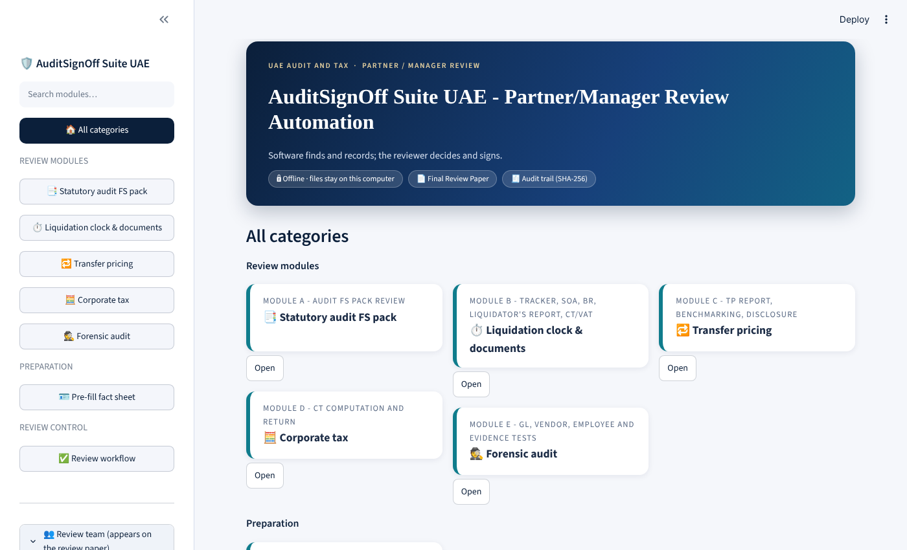
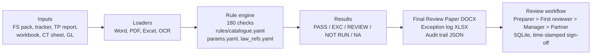
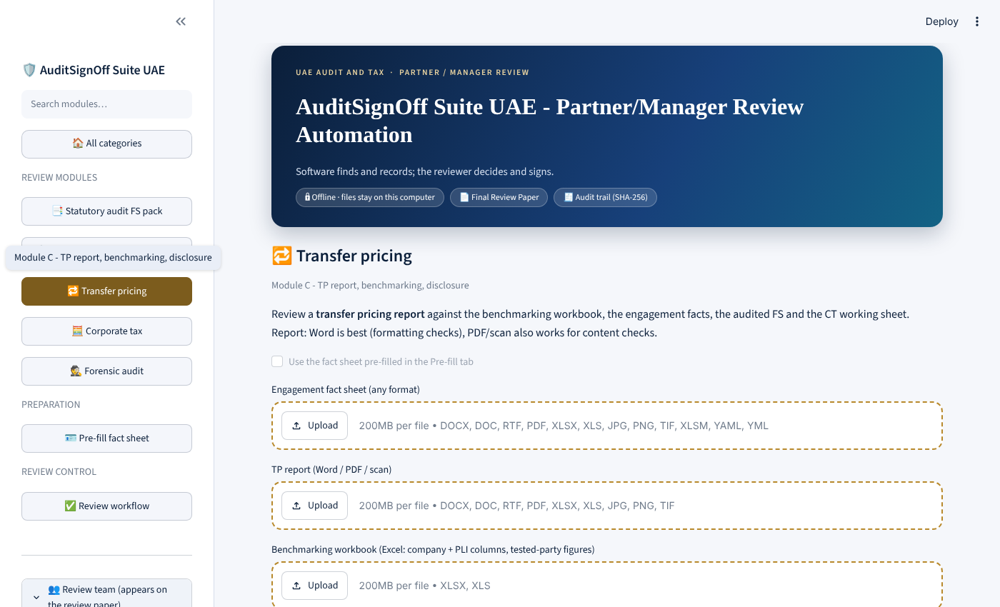
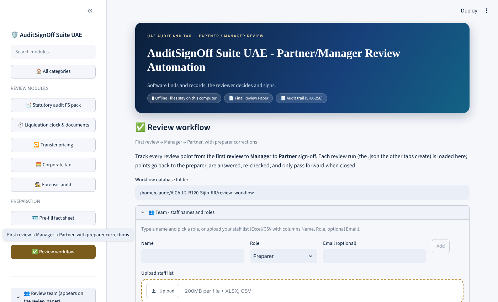

# AuditSignOff Suite UAE
### Partner / Manager Review Automation for UAE audit and tax files - AICA Level 2 Capstone Project

**Participant:** Sijin.KR (M.No 217826) | **Batch:** AICA-L2-B120-Abu Dhabi | **Folder:** `AICA-L2-Batch-120-Sijin-KR`
**Stack:** Python 3.10-3.13, Streamlit, python-docx, openpyxl, pdfplumber, PyYAML | **Status:** working prototype, 107 automated tests passing

> **Software finds and records; the reviewer decides and signs.**
> An **offline** tool (no cloud calls, no telemetry) that reads the working papers, runs a rule catalogue of **180 review checks**, and hands the Manager and Partner a **Final Review Paper that lists only exceptions, each with page or cell evidence**. A four-level workflow (Preparer > First reviewer > Manager > Partner) tracks corrections and sign-offs with date and time.



---

## 1. The problem
Every statutory audit pack, liquidation file, transfer pricing (TP) report, corporate tax (CT) computation and forensic report passes through several review levels before the Partner signs. Review depends on Word and Excel checklists completed from memory:

* presentation, consistency and arithmetic errors still reach Manager and Partner level;
* review depth varies by reviewer;
* the evidence that a check was done is a tick, not a trace.

## 2. The solution
| Principle | How it is built |
|---|---|
| Rules decide, people sign | Every check is plain code driven by `rules/catalogue.yaml`; no AI model decides a pass or fail |
| Exceptions only | The review paper repeats nothing that passed; each exception carries a page, heading, table or cell reference |
| Honest status | A check with a missing input is **Not run**, never Pass; judgement items are **Review** with the evidence attached |
| Evidence trail | Every run writes a JSON audit trail with SHA-256 of each input file; workflow rounds and sign-offs are time-stamped |
| Offline and private | UI bound to 127.0.0.1; nothing leaves the PC |

### Architecture


## 3. What is built
| Module | Checks | What it reviews |
|---|---|---|
| **A. Statutory audit FS pack** | 51 | name and signatories vs fact sheet, years and dates, auditor's report, fonts and margins, balance sheet / cash-flow / equity tie-outs, TB vs FS, mandatory notes, review gates |
| **B. Liquidation** | 26 | 20-business-day clock, VAT 30-day rule, 45-day creditor block, one-year limit, licence; Board Resolution, Statement of Affairs, Liquidator's report (OCR for scans) |
| **C. Transfer pricing** | 79 | managerial-remuneration checklist (TP-01 to TP-79): cover, TOC, company details vs FS/BIRF, annexures, PLI, interquartile range recomputed from the workbook, comparables funnel, workbook integrity (errors, duplicates, hidden sheets), placeholders, regulatory references |
| **D. Corporate tax** | 10 | re-performs the CT computation, compares with the return and FS, deadlines and penalties, QFZP de minimis, small business relief |
| **E. Forensic** | 14 | general-ledger analytics (holiday, weekend and night journals, round sums, splitting, backdating), vendor/employee matching, **signature forgery screening**, **bank diversion and unrecorded payments**, **FS over/understatement indicators**, **inventory diversion**, evidence custody, document authenticity |
| **Review workflow** | - | four-level sign-off, corrections loop, staff list, stamped review paper, movement trail |

Check classes: **113 A** (automated), **40 B** (assisted - evidence for the reviewer), **27 C** (judgement). All 180 are implemented; a test fails if the catalogue and the code disagree.

## 4. Run it in 5 minutes
Everything needed is in this folder, including synthetic sample data.

| Step | Windows | Mac / Linux |
|---|---|---|
| 1. Install Python 3.10-3.13 (tick *Add to PATH*) | python.org | `python3 --version` |
| 2. Install packages | `pip install -r requirements.txt` | `pip3 install -r requirements.txt` |
| 3. Self-check (19 checks; optional items show as warnings) | `python doctor.py` | `python3 doctor.py` |
| 4. Start the screen | `run_app.bat` | `./run_app.sh` |
| 5. Open http://localhost:8501, choose a module, upload files from `samples/`, press **Run** | | |
| 6. Download the Final Review Paper (DOCX), exception log (XLSX), audit trail (JSON) | | |
| 7. Run the tests (optional) | `pytest -q` | `pytest -q` |

Optional: **LibreOffice** (only to calculate a CT sheet never opened in Excel) and **Tesseract** (only for scanned files).



## 5. Try each module with the supplied samples
All names, numbers and files in `samples/` are **invented**. Each module has a clean file (expect no exceptions) and a file with seeded errors (expect them to be found).

| Module | Command | Expected result |
|---|---|---|
| A - clean FS pack | `python -m auditsignoff fs --engagement samples/engagement_clean.yaml --fs samples/fs_clean.docx --tb samples/tb_clean.xlsx` | 50 checks: 30 pass, **0 exceptions** |
| A - seeded errors | `python -m auditsignoff fs --engagement samples/engagement_errors.yaml --fs samples/fs_errors.docx --tb samples/tb_errors.xlsx` | **19 exceptions (26 findings)**: misspelt name, wrong year header, Arial font, 9 pt text, balance sheet and TB out of balance, missing IFRS 18 and end-of-service notes, ... |
| B - liquidation | `python -m auditsignoff liq --input samples/liq_difc_breach.yaml --today 2026-10-17` | **7 exceptions**: FTA notification overdue, VAT deregistration late, report date inside the creditor block, outstanding NOCs and bank letters |
| C - TP clean | `python -m auditsignoff tp --engagement samples/abc_sample/engagement_abc.yaml --report samples/abc_sample/ABC_COMPANY_FY2024_TP_Report.docx --workbook samples/abc_sample/ABC_COMPANY_FY2024_TP_Benchmark_Workbook.xlsx --fs samples/abc_sample/ABC_FS_Notes.docx --birf samples/abc_sample/ABC_BIRF.xlsx` | 79 checks: 36 pass, 1 exception (TP-11, ownership confirmation) |
| C - TP seeded errors | same command with the `_ERRORS` report and workbook | **10 exceptions (14 findings)**: wrong year, Q3 differs from workbook, duplicate comparable, `#REF!` formulas, placeholder text, "Mr. Mr." ... |
| D - CT | `python -m auditsignoff ct --ct samples/ct_demo_locked.xlsx` | 10 checks: 6 pass, 0 exceptions, 4 not run (no return/FS supplied) |
| E - forensic (full fraud case) | `python -m auditsignoff fa --case "ZENITH TRADING FZCO" --gl samples/forensic_case/gl.xlsx --period-end 2025-12-31 --years 2025 --vendors samples/forensic_case/vendors.xlsx --employees samples/forensic_case/employees.xlsx --bank samples/forensic_case/bank_statement.xlsx --mandate samples/forensic_case/mandate.xlsx --signatures samples/forensic_case/signatures --fs-data samples/forensic_case/fs_data.xlsx --stock samples/forensic_case/stock_register.xlsx --holidays 2025-01-01 2025-12-02 2025-12-03 --related "Faisal Nazir" "Nazir Consultancy"` | **8 of 14 checks raise exceptions (47 findings)** - see the case study below. The same company without fraud (`python samples/make_forensic_case.py --clean <folder>`) raises **none** |

Output goes to `out/` (review paper .docx, exception log .xlsx, audit trail .json). Ready-made review papers are in **`sample_outputs/`** so you can see the result without running anything:

| Folder | File to open |
|---|---|
| `sample_outputs/A_fs_errors/` | Final Review Paper (.docx) |
| `sample_outputs/B_liquidation_difc_breach/` | Final Review Paper (.docx) |
| `sample_outputs/C_tp_abc_seeded_errors/` and `C_tp_abc_clean/` | Final Review Paper (.docx) |
| `sample_outputs/D_ct_demo/`, `E_forensic_fraud_case/` | Final Review Paper (.docx) |

### The TP sample in one table (seeded-error version)
| Check | Exception found |
|---|---|
| TP-03 | Financial year on the cover does not agree to the engagement |
| TP-14 | Remuneration in the report does not trace to the notes to accounts |
| TP-16 | Components per the BIRF do not add up to the total in the report |
| TP-33 | Duplicate comparable in the set |
| TP-34 | Workbook has error values / broken references (including a hidden sheet) |
| TP-45 | Number of comparables stated in the report differs from the workbook |
| TP-46 | Q3 in the report does not agree to the workbook (range recomputed with QUARTILE.INC) |
| TP-73 / TP-74 | Unfinished text (placeholder); doubled title before a name |

## 5A. Forensic case study - ZENITH TRADING FZCO (FY2025)
A complete synthetic case file in `samples/forensic_case/` (about 1,700 ledger lines, 450 bank lines, signature images, FS data, stock register). The finance manager, **Faisal Nazir**, runs several schemes at once; the tool finds each one and traces it to the row, cheque or item. The same company without fraud (`--clean`) raises **no exception**, so the checks are not just crying wolf.

| Scenario | Check | What the tool reports in the case |
|---|---|---|
| Journals on public holidays, Saturdays and at night | FA-05 | 28 material postings on weekends / holidays (1 Jan, 2-3 Dec National Day supplied with `--holidays`); 40 entries created 22:00-05:00 |
| Rounding off the figures | FA-05 | 21% of material lines are round thousands (advances of 10,000-50,000), against an 8% alert level |
| Prepared and approved by the same person; backdated revenue | FA-05 | 130 self-approved lines; revenue dated 29 Dec but created 10 Feb 2026 |
| Splitting below the approval limit | FA-05 | six payments of 48,600-49,250 to one payee, just under the 50,000 limit |
| Ghost vendor | FA-06, FA-12 | "Nazir Consultancy Services" shares the employee's bank account, address and phone; 11 payments, AED 518,558 |
| Authorised signatory's signature forged | FA-11 | cheque CHQ-10455 for AED 1.2 million: similarity 0.17 to the specimen (genuine signatures score 0.58+) |
| Signature copy-pasted; signed after resignation; over the single limit; not on the mandate | FA-11 | CHQ-10231 = CHQ-10340 pixel-identical; CHQ-10402 after the director's authority ended; CHQ-10417 AED 80,000 alone; CHQ-10431 signed by a non-signatory |
| Vendor paid into a changed bank account | FA-12 | Alpha Supplies paid AED 185,000 into an account that is not in the vendor master |
| All funds moved to another account | FA-12 | on 30 Dec a single transfer took 93% of the balance to "Gulf Horizon Trading", an unapproved account |
| Receipt passed straight out; payments hidden from the books | FA-12 | AED 420,000 in, AED 415,000 out to the same account within two days; five bank payments (AED 1.8 million) not in the GL |
| Revenue overstated, profit without cash | FA-13 | FS revenue 8.3% above the ledger; receivables +162% against revenue +22%; margin 33% to 40%; operating cash only 9% of profit; Beneish M-score -0.36 |
| Year-end window dressing | FA-13 | AED 300,000 sale on 30 Dec reversed on 8 Jan |
| Costs understated | FA-13 | operating expenses fall from 14.2% to 9.9% of revenue; payable days drop from 50 to 29 |
| Inventory diverted or not recorded | FA-14 | physical stock short of book by 5% (AED 51,280); goods dispatched but not invoiced (AED 31,200); stock at a third-party location; negative stock; goods received but unbilled (AED 9,000); invoiced but never received (AED 12,600); FS inventory AED 190,735 above the register |

Every finding is an **indicator for the examiner, not proof**: the signature test screens and a handwriting expert must confirm, Benford and Beneish are statistical, and the report wording separates fact from opinion (FA-10).

## 6. What you update to review your own file
Replace the sample with your file (same layout) or fill the blank template in `templates/`.

| Module | Files you provide | What you fill in |
|---|---|---|
| A | Engagement fact sheet (`templates/Engagement_Fact_Sheet.xlsx`); FS pack (Word, PDF, Excel or scan); TB (optional) | Company name exactly as on the trade licence, authority, shareholders and signatories, year end, auditor |
| B | Liquidation tracker (`templates/Liquidation_Tracker.xlsx`); optional BR, SOA, liquidator's report | Dates (resolution, appointment, advertisements, licence expiry), authority, filings |
| C | Fact sheet; TP report; benchmark workbook; audited FS; BIRF (`templates/BIRF_Template.xlsx`) | The workbook needs a comparables table and, for remuneration, a "Total managerial remuneration" line |
| D | CT working sheet (layout of `samples/ct_demo_locked.xlsx`; blank: `ct_working_sheet_blank.xlsx`) | Blue input cells only |
| E | General ledger (Excel/CSV); vendor and employee lists; optional bank statement, signatory mandate and signature images, FS data (CY/PY), stock register | Period end, years, public holidays, persons of interest; column layouts are in `docs/USER_GUIDE.md` |

Full input rules, the Final Review Paper layout, the liquidation document checks, the review workflow and the Teams hand-off are in **[`docs/USER_GUIDE.md`](docs/USER_GUIDE.md)**; the CT and TP steps are in **[`docs/CT_TP_step_by_step.md`](docs/CT_TP_step_by_step.md)**.

## 7. Review workflow


1. Create the engagement; the first run can create it automatically.
2. **First reviewer** loads the run; each exception becomes a numbered review point to clear or reopen.
3. Open points go **back to the preparer**, who answers each; the corrected file is re-run and fixed points auto-clear.
4. With no point open the file passes to **Manager**, then **Partner**; a Partner close with nothing open is the **sign-off** (locked).
5. The review paper is stamped with the status, sign-off table and a time-stamped movement trail.

## 8. UAE regulatory basis
| Module | Framework applied |
|---|---|
| A - FS pack | IFRS / IAS, ISA, Federal Decree-Law No. 32 of 2021 (Commercial Companies Law) |
| B - Liquidation | Commercial Companies Law; FTA VAT and Corporate Tax deregistration timelines |
| C - Transfer pricing | Federal Decree-Law No. 47 of 2022 (Corporate Tax), Ministerial Decision No. 97 of 2023 (Master/Local File), OECD TP Guidelines |
| D - Corporate tax | Federal Decree-Law No. 47 of 2022 and related Cabinet and Ministerial Decisions, FTA guides |
| E - Forensic | UAE AML/CFT framework, ISA 240, CFE fraud-examination methodology |

References and AED thresholds sit in `rules/law_refs.yaml` and `rules/params.yaml` (as at 16 Oct 2026), so a change in law is a data edit, not a code change. **They must be re-verified against the FTA and Ministry of Finance websites before production use.**

## 9. Quality assurance
| Evidence | Result |
|---|---|
| Automated tests (`pytest -q`) | **107 passed** |
| Self-check (`python doctor.py`) | 19 passed, 2 warnings (optional OCR / LibreOffice), 0 failed |
| Seeded-error recall, FS pack | 22 of 22 seeded defect types found; the clean pack gives 0 exceptions |
| Seeded-error recall, TP set | every seeded defect found; the clean set raises one expected ownership query |
| Catalogue vs code | test fails if any check is marked implemented without a rule |
| Screens | every page opened by an automated UI test with no error |
| Output integrity | every Word, Excel and JSON output is re-opened after writing |

## 10. Limits you must know
* Tested on **synthetic** packs only. Before reliance, run shadow testing on closed engagement files.
* Statement tables are recognised by row labels (`Total assets`, ...); packs with unusual labels need a label map in `rules/params.yaml`.
* The public-holiday list is empty by design; load the official calendar or the business-day clock is early by the holidays in the window.
* The "standards not yet effective" list holds sample entries; the technical partner signs off the list each year-end.
* Grey areas are flagged, not decided: QUARTILE.INC vs EXC, VAT/CT deregistration clock start date, the 45-day creditor window.
* No login: reviewer names are an honour-system choice; restrict the app to the office network.
* A Windows EXE package and an on-device language model for drafting wording are future work.

## 11. Conclusion
AuditSignOff Suite UAE turns the review checklists of a UAE audit and tax practice into **executable, testable rules**. In place of a ticked checklist, the Manager and Partner receive a paper of exceptions with evidence, an audit trail that can be re-verified by hash, and a time-stamped record of who reviewed what and when. Because the software never decides alone - judgement items are handed to the reviewer with the evidence - responsibility for the review stays with the engagement team, which is where professional standards place it.

**Next steps:** shadow-pilot on closed files, official holiday calendar, Windows installer, optional on-device drafting of finding wording, role-based login.

## 12. Repository map
```
auditsignoff/   engine: loaders, rules_fs / rules_liq / rules_tp* / rules_ct / rules_fa, report, workflow, CLI
app.py          Streamlit screens             doctor.py   self-check
rules/          catalogue.yaml (180 checks), params.yaml, law_refs.yaml, workflow.yaml
samples/        synthetic inputs (FS, liquidation, ABC TP set, locked CT demo, forensic) + generators
sample_outputs/ ready-made review papers for each module
templates/      blank fact sheet, liquidation tracker, BIRF
tests/          107 tests         docs/  user guide, CT/TP steps, screenshots
```

## 13. Licence and confidentiality
All rights reserved - see [`LICENSE`](LICENSE). You may read the project and run it **unmodified on the supplied synthetic samples** to evaluate it. Copying, republishing, rebuilding the rules or checklists into another product, or removing the sample-file protection is not permitted. All people and companies in `samples/` and `tests/` are invented. The CT sample workbooks are a **locked demo extract**: formulas are hidden and locked and only the blue input cells can be typed in.
