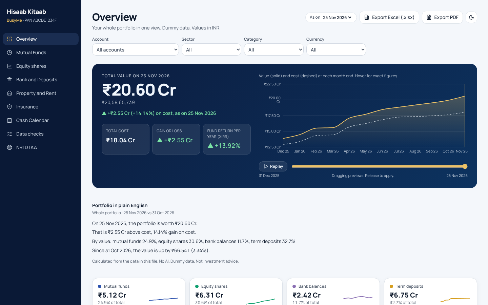
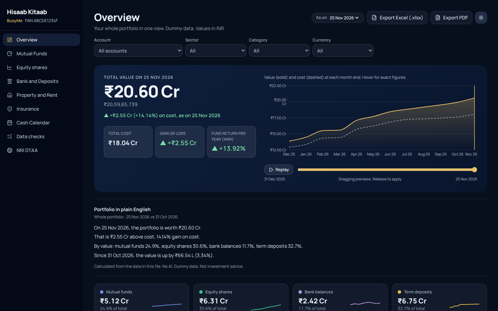
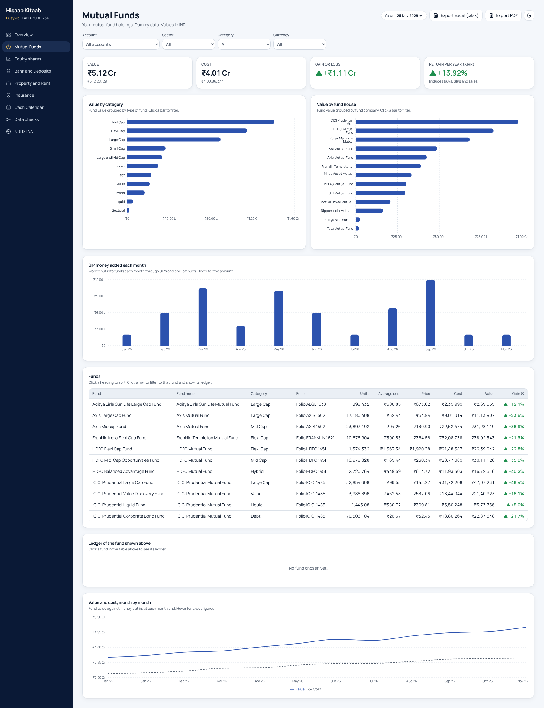
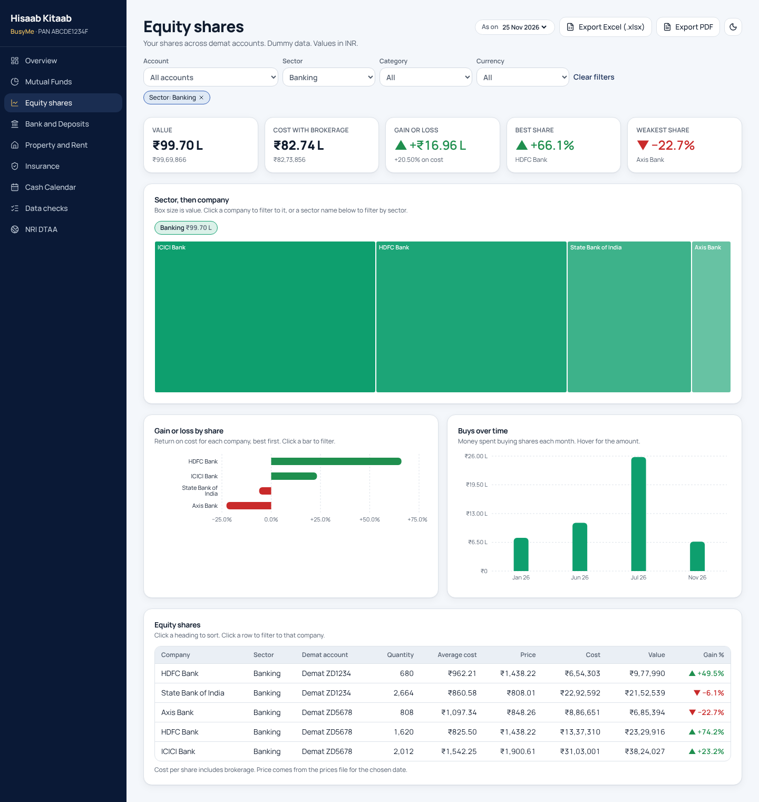
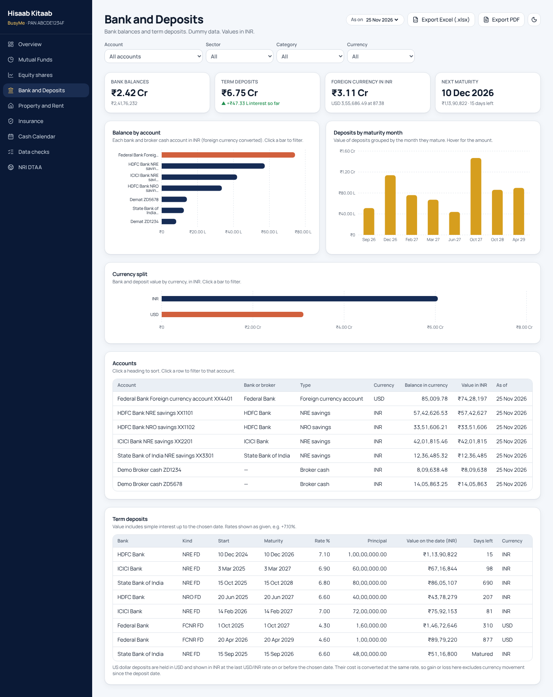

# Hisaab Kitaab: Portfolio Dashboard

*Hisaab kitaab* is Hindi and Urdu for "the books and accounts": a clear account of who owns what and how much. For the investor who is too busy to open every portal.

AICA Level 2, Batch 127. Individual capstone by Jignesh Sagala.

**Start here, in four steps**

1. **Problem:** [section 1](#1-problem-statement). What the investor cannot see today.
2. **Input files:** [section 2](#2-solution-at-a-glance) and the folders `db_dummy/` (eleven tables) and `samples/` (six made-up locked statements).
3. **Process:** [section 7](#7-how-it-runs) (eleven steps), [section 5](#5-statement-readers-private-laptop-only) (readers), [section 6](#6-test-result) (tests) and [Lovable build log](docs/Lovable_Build_Log.md).
4. **Output:** open `dashboard/HisaabKitaab_Dashboard.html` in any browser. No setup. See [section 3](#3-the-dashboard).

**All data in this repository is dummy.** Company, fund and bank names are real public names, used for realism. Every number (units, prices, balances, rates, account numbers) is invented.





---

## 1. Problem statement

An investor in India, living in India or abroad, holds money in many places: mutual funds across several fund houses (some in demat form, some not), shares through a broker, savings accounts, term deposits, and sometimes startups, other equity and commodity. A rented house and insurance policies also have to be tracked.

There is no consolidated view. Every institution sends its own statement, in its own layout, mostly as a password-protected PDF by monthly email. Some are available only after logging into a platform and asking for the statement to be emailed. To know what everything is worth today, the investor must collect each statement, remember each password, and add the numbers by hand. This takes time, and the investor is busy. Rules and tax treatment also change from time to time, and the investor depends on a CA each year before filing.

**Bonus for non-resident Indians (NRI).** An NRI has extra layers: NRE, NRO and FCNR accounts, balances in US dollars that need the USD/INR rate of the day, and treaty tax relief (DTAA) on fund redemptions. The dashboard handles the first two in the same pages. The NRI DTAA tab is a worked example of the third.

The investor wants one answer, on any date: **what is everything worth, what did it cost, where does it sit, and what needs attention.**

Why that is hard today:

- A fund bought through a monthly SIP changes its units and average cost every month.
- A share bought in several lots has an average cost that must include brokerage.
- Foreign currency deposits and balances, where held, need the USD/INR rate of the day.
- Value on a past date needs the price of that date, not today's price.
- Money going out (SIPs, insurance premiums, house tax and maintenance) is easy to forget.

**No confidential or sensitive data leaves the owner's laptop.** Uploading locked statements to an online tool would expose passwords and identity numbers. So the statements are opened only on the laptop, by Python readers. The password is typed by the owner, hidden, and kept in Windows Credential Manager, never in a file. Only counts and PASS or FAIL results were reported back to Claude. The public project holds dummy data only.

---

## 2. Solution at a glance

```
 Statements (PDF, on the laptop only)            Public prices
        |                                              |
   Readers: open, read, check their own output    prices_fetch.py (separate script)
        |                                              |
        +------------->  Database: 11 CSV tables <-----+
                                 |
                       build_dashboard.py
                                 |
          ONE HTML file: 9 pages, slicers, charts, no internet needed
```

**One dashboard code, two data sets.**

| Data set | Where | Who sees it |
|---|---|---|
| `db_dummy/` | This repository | Everyone. Real names, invented numbers. |
| Real database | The owner's laptop only (`db_real/`, ignored by git) | The owner only. Never uploaded. |

Real statements are opened only by the readers, on the laptop. What came back to Claude (the build partner) was counts and PASS or FAIL.

### The database: eleven CSV tables

| File | Holds |
|---|---|
| `instruments.csv` | Each fund and share: name, kind, sector or category, fund house |
| `transactions.csv` | Opening balance, buys, SIPs, sells: date, account, units, price |
| `prices.csv` | Price of each holding on month ends and the latest date, plus the USD/INR rate |
| `bank_balances.csv` | Balance of each bank account on each date |
| `fixed_deposits.csv` | Term deposits: start, maturity, rate, principal |
| `broker_cash.csv` | Cash lying with the broker, per demat account |
| `sip_plan.csv` | Monthly SIP plan: five funds, INR 40,000 each, INR 2,00,000 a month, on the 5th |
| `owner.csv` | Name of the owner (BusyMe) and birth date, used for the age-85 check |
| `properties.csv` | House property: cost, own value estimate, tenant, rent, lease dates, yearly house tax and maintenance (one amount, ₹1,40,000, due 30 April) |
| `rent_receipts.csv` | Each month's rent received, with the bank account it was credited to |
| `insurance.csv` | Three policies: term cover INR 10 Cr, medical cover INR 2 Cr for a family of 4, retirement policy with INR 10,000 a month income to age 85 |

Insurance cover is not an asset and the house has its own page. **Neither is added to the consolidated total on the Overview.** The Overview carries a note line saying so.

### Inputs: what goes in, how it arrives, what reads it

| Input | How it arrives | Read by | Writes |
|---|---|---|---|
| Consolidated fund and demat statement (CAMS / CDSL) | Locked PDF, monthly, by email | `cdsl.py`, run by `cdsl_check.py` | A counts-and-checks report. The fund and demat rows are read and checked. |
| Broker contract notes (Zerodha style) | Locked PDF, one per trade day, by email | `zcn.py`, run by `zcn_check.py` | `buys.csv`, `sells.csv`, `charges.csv` (share buys with brokerage) |
| Broker funds ledger (Zerodha style) | Locked PDF, weekly | `zledger.py`, run by `zledger_check.py` | `zerodha_cash.csv` |
| Bank statements (savings, and customer statement with term deposits) | Locked PDF, monthly | `bank.py`, run by `bank_check.py` | `bank_balances.csv`, `fixed_deposits.csv` (same layout as the database tables) |
| Opening holdings and cost at the start date | Holdings file and trade history | `open_position.py` | `opening_position.csv` |
| Prices: fund NAV, share prices, USD/INR | Public sources | `prices_fetch.py` | `prices.csv` |
| SIP plan, owner name and PAN, house, rent, insurance | Typed by the owner | none | `sip_plan.csv`, `owner.csv`, `properties.csv`, `rent_receipts.csv`, `insurance.csv` |

**What is real and what is generated in this repository.** The dummy database `db_dummy/` is made directly by `tools/make_dummy_db.py`. It is not read from PDFs. The made-up PDFs in `samples/` are read by the same readers, as a separate demonstration of the input and process steps. In the real run, the readers' output files are put together into the same eleven tables as `db_real/`, on the owner's laptop. That real data set is not part of this upload. In the dummy data the rent receipts are typed; in the real run the rent credit is also visible in the bank statement.

---

## 3. The dashboard

Open `dashboard/HisaabKitaab_Dashboard.html` in any browser. It needs no internet and no server. This is the main dashboard: the same nine pages, with the screen design built in Lovable.

The numbers on every page come from two calculation files that the tests check against the Python calculation in `app/` (section 6). The Lovable page shows the same totals as Python.

### Nine pages, one set of slicers

The sidebar shows the owner's name and PAN (made-up in the dummy data) and the number of holdings.

Slicers: **As on** (every month end plus the latest date), **Account**, **Fund house**, **Sector**. The Mutual Funds tab adds **Fund category**; the Bank tab adds **Currency**. Slicers apply to every tab together. Click any bar, slice, tile or table row to filter further; a chip shows each active filter and one click removes it.

| Tab | Shows |
|---|---|
| Overview | A navy top panel with the total value, cost, gain and fund return beside a large trend of total value at each month end, with a time slider: drag it and every number moves live, release it to set the date for the whole page; click an asset card to filter the page; a mini trend on each asset card; month-by-month value against cost, with a Replay button that steps through the months; split by asset class; a waterfall of where the gain came from; an At a glance panel; where the money is held by account type (NRE, NRO, FCNR, demat, funds) and by currency; a month-by-month price-change heatmap for the ten largest funds and shares; five best and five worst by return on cost; top 10 funds and shares; all holdings as tiles (size = value, colour = gain or loss); needs-attention list. A light and dark switch sits in the left menu. Motion is switched off for people who ask their system for reduced motion. |
| Mutual Funds | Value, cost, gain, **XIRR**, SIP total of the month with the **SIP plan** (5 funds x INR 40,000) and a month-by-month SIP chart; value by fund house and by category; **units and average cost after every SIP**; full ledger of the chosen fund; sortable table |
| Equity shares | Value, cost with brokerage, gain, best and weakest share; sector then company tiles; gain or loss by share; buys by month; sortable table |
| Bank and Deposits | Bank balances (with broker cash), term deposits, foreign currency in INR, next maturity; balance by account; maturity ladder; currency split; account and deposit tables with status |
| Property and Rent | House value against cost, rent per month and over 12 months, rent received month by month, lease end, yearly house tax and maintenance and its next due date, every rent receipt. Not in the total |
| Insurance | Three policies on their own page: cover, premium, due day, premiums paid and still to pay, next due date, the retirement income schedule. Not in the total |
| Cash Calendar | Money going out in the next 12 months: SIP on the 5th, three premiums, house tax and maintenance. Month bars, a month calendar to page through, the full list. Rent and deposit maturities are money coming in and are not listed |
| Data checks | The rules in plain words, every data check with PASS or FAIL, the size of each table |
| NRI DTAA (bonus) | Sample page, no portfolio data. How a non-resident claims the India treaty relief on a fund redemption: eight steps and a complete dummy pack of ten documents (request letter, tax residency certificate, Form 41, Annexure G, five self-attested copies, no-TIN declaration) with a dated timeline, then three sample folios checked against D1 to D3. Every sheet is marked SAMPLE and uses dummy identifiers only |







### The rules behind every number (also written on the Data checks tab)

1. **Value on a date = units held on that date x price of that date.** The price is the latest one on or before the date.
2. **Units held = opening balance + purchases and SIPs up to the date, less sales.**
3. **Average cost = total cost / total units.** A new purchase or SIP adds units and cost; the average is recalculated. A sale removes units at the average cost. Share cost includes brokerage.
4. **Fund NAVs are published once a day.** The dashboard shows month ends and the latest date in the price file. It is not a live ticker.
5. **Deposits** = principal plus simple interest to the date. Interest stops at maturity and the deposit is flagged until it is closed or renewed.
6. **Foreign currency** is shown in USD and in INR at the USD/INR rate of the date.
7. **XIRR** counts the opening balance as invested on the opening date at that day's value (the original purchase dates are not in the data). It appears from 6 months after the opening date.
8. **A slicer keeps only items that carry that attribute.** A share has a sector; a fund has a fund house; a bank account has neither.

### Needs attention

Every page has **Export Excel** and **Export PDF** buttons at the top right. Excel gives a real .xlsx file: a Summary sheet (page, date, filters, key figures) and one sheet for each table on the page. PDF opens the browser's print window; choose Save as PDF.

The account list is grouped bank first: pick a whole bank (all its savings, deposits and FCNR accounts) or one account, then demat accounts and fund folios.

The Overview lists deposits maturing within 90 days, deposits past maturity, funds and shares more than 10% below cost, overdrawn accounts, and any data check that failed.

---

## 4. Prices: a separate script

The dashboard never goes to the internet. `app/prices_fetch.py` is a separate backend script that adds prices to `prices.csv`:

| Price | Source |
|---|---|
| Mutual fund NAV | AMFI daily NAV file, by ISIN |
| Shares and commodities | Yahoo Finance chart data (NSE symbol + `.NS`; unofficial, may change) |
| USD/INR | Frankfurter (European Central Bank rates) |

It only adds rows, never rewrites history, never adds the same date and key twice, and one failing source does not stop the others. It **refuses to write into the dummy folder**, so real prices are never mixed with invented numbers. Month-end history builds up by running it on each month end.

The repository ships **only the dummy prices file**. The live internet calls could not be tested in the build environment; the parsers, the plan and the safe append are tested offline. First run on a laptop: `py -m app.prices_fetch path\to\real_db --dry-run`.

---

## 5. Statement readers (private, laptop only)

Real statements are PDFs with passwords. Four readers turn them into the CSV tables above, and a fifth script (`open_position.py`) works out the opening cost. They run on the owner's laptop. They read by position on the page, not by text order, and **check their own output before anything is used**:

| Reader | Statement | Self-checks include |
|---|---|---|
| `cdsl.py` | Consolidated fund and demat statement | Units: opening + transactions = closing; folio values and demat values add to the statement totals |
| `zcn.py` | Broker contract notes | Every trade row read; totals and charges tie |
| `bank.py` | Bank statements, two layouts | Running balance on every row; opening and closing balances; summary table = transactions; deposit totals tie |
| `zledger.py` | Broker funds ledger | Every row follows from another; one closing balance |

Passwords are typed by the owner (hidden), kept in the Windows Credential Manager, never in a file or on a command line. What was reported back to Claude was **counts and PASS or FAIL only**.

### Try a reader on made-up statements

`samples/` holds six made-up locked statements for **BusyMe** (made-up PAN **ABCDE1234F**). **The password of every sample is `Demo@2026`.** All data in them is invented.

```
py -m pip install -r requirements-extra.txt
py tools\demo_readers.py
```

The script opens each PDF with the password, runs the reader and its checks, and prints counts and PASS or FAIL only, the same way the real run reports. It also shows that a wrong password is refused.

Each reader has planted-error tests on made-up PDFs (`tools/make_dummy_*.py`): a changed balance, a missing month, an unread row must each make a check FAIL.

---

## 6. Test result

`py tests/run_all.py` runs everything. Full output: [docs/test_result.md](docs/test_result.md).

| Test | What it proves | Result |
|---|---|---|
| Readers (4 files, 209 checks including planted errors) | Each reader reads its made-up statements right and fails when an error is planted | Pass |
| Made-up statements (`samples/`) | Six locked PDFs for BusyMe: every reader check passes on them, a wrong password is refused, holder name and PAN are present, no other name appears | Pass |
| Price script (offline) | Parsers read sample answers; one failing source does not stop the rest; second run adds nothing; dummy folder refused | Pass |
| Engine: JavaScript vs Python | Two separate implementations of the rules agree on **108 questions** (12 dates x 9 slicer combinations), **1,445 holding lines**: value, cost, units, XIRR, SIP total, buys by month, month-end series | Pass |
| Calendar, premiums, SIP: JavaScript vs Python | `life.js` and `life.py` give the same calendar lines, premiums paid, next due dates and year premiums on 13 dates (826 calendar lines). Hand cases: next 12 months INR 31,40,000 = SIP 24,00,000 + premiums 6,00,000 + house tax and maintenance 1,40,000; term 3 of 10 paid, retirement 12 of 21 paid, income 300 months | Pass |
| Hand cases | Opening 100 units at 10, SIP 50 at 12, sale of 30: units 120, cost 1,280, average 10.6667, value 1,680 (worked by hand). XIRR of 1,000 to 1,100 in 365 days = 10.0000% | Pass |
| Excel formulas | A third method: plain Excel formulas on the same tables give the value of funds and shares on all 12 dates; largest difference INR 0 | Pass |
| On screen | A real browser clicks slicers and charts; the **displayed** totals equal the Python engine; holdings filter, search, range buttons and CSV export; SIP plan, house property, insurance and calendar figures against the Python life module; DTAA results; phone width on all 9 pages has no sideways scroll; tooltip works; no console error | Pass |

Errors were also planted in the engine on purpose (a wrong sale cost, interest not stopping at maturity). The tests failed, as they should, then the engine was restored.

Dummy totals on 25 Nov 2026: total INR 20,59,65,739. Mutual funds 5,12,28,129. Equity shares 6,31,09,507. Bank balances 2,41,76,232. Term deposits 6,74,51,872. XIRR of the funds since 31 Dec 2025: 13.9%. Outside the total: house property INR 2,80,00,000 (own estimate); insurance cover INR 12 Cr.

---

## 7. How it runs

Eleven steps take a statement email to the dashboard. Claude, Python and the owner each have a part.

| # | Step | Who | Input → Output | Check |
|---|---|---|---|---|
| 1 | Collect | Claude, Gmail connector, scheduled on the 10th of the following month | Previous month's India statement emails → attachments, one folder per email subject, saved on the laptop | Files saved match emails found |
| 2 | Sort | Owner | Folder → private laptop folders by type | None |
| 3 | Unlock | Python (`set_password.py`, `secrets_store.py`) | Password typed once, hidden → Windows Credential Manager | Never in a file, a command line or chat |
| 4 | Probe | Python (`probe_all.py`) | Locked PDFs → one masked layout file (digits become 9, words become x) | Claude sees layout only, never real data |
| 5 | Read | Python (four readers) | PDFs → CSV rows and counts | Units, balances and totals tie. A FAIL means the file is not used |
| 6 | Opening cost | Python (`open_position.py`) | Holdings and trades → opening position | Anything that does not fit is flagged |
| 7 | Prices | Python (`prices_fetch.py`) | AMFI, Yahoo, FX → `prices.csv` | Adds only, no duplicates |
| 8 | Assemble | Python | Reader files → 11 tables | Dummy set: `tools/make_dummy_db.py` |
| 9 | Build | Python (`build_dashboard.py`) | Tables → one HTML file | None |
| 10 | Test | Python (`tests/run_all.py`) | All code → 11 tests | All pass |
| 11 | Review | Owner | Dashboard → his own books | Owner signs off |

In this upload, step 1 is not included, because it reads the owner's own mailbox. The made-up PDFs in `samples/` stand in for steps 1 and 2. Step 5 is run on them by `tools/demo_readers.py`. Step 7 is tested offline.

Learning from the five days used here:

| Day | Used in this project |
|---|---|
| 1 | Prompt parts (role, purpose, context, output, boundaries, examples) to specify each build step. Projects to keep all chats in one place. |
| 2 | Data-visualisation prompting: tiles sized by value, splits, one headline view. |
| 3 | App pattern: single purpose, works offline, no uploads, flags bad data instead of reporting it silently, self-checks. |
| 4 | Coding agent used to write, run and test the code. |
| 5 | Price script and statement readers as the feeds into the database. The scheduled email collection is not part of this upload. |

### Screen design: Lovable

One more tool was used for the dashboard screen: **Lovable**, an online builder that makes web pages from written instructions. Claude wrote and sent the main instructions. Lovable was told not to change the two tested calculation files, and to show only numbers that come from them. Dummy data only was sent. The result was checked against the Python calculation (same totals to the rupee) and rebuilt as one offline file, `dashboard/HisaabKitaab_Dashboard.html`. The eight messages sent, what each asked, and what was learned are in [`docs/Lovable_Build_Log.md`](docs/Lovable_Build_Log.md).

---

## 8. Limits and boundaries

- The dashboard covers mutual funds, shares, bank balances, term deposits, the rented house and insurance. Startups, other equity and commodity are outside it.
- Statement emails are collected by Claude through the Gmail connector on a schedule, on the 10th of the following month, for the previous month. It runs only when the laptop is connected. The scheduled task itself is not in this upload. The Zerodha Kite connection is not built.
- Not tax advice and not investment advice. No buy, sell or hold view. Read-only: nothing is ever ordered or changed at a bank or broker.
- **Dummy numbers are invented.** Fund and company names are real and may differ slightly from today's official scheme names.
- Past months need a price for that month end. A month without prices in `prices.csv` shows the nearest earlier price, and the Data checks tab flags prices older than 7 days.
- XIRR uses the opening value as the starting investment. It is not the true return since the first purchase.
- Share cost comes from contract notes. Months without a contract note have no cost; the real data set must include every buy to show true cost.
- Deposit values use simple interest. Banks may compound; treat as an estimate.
- Shares price source (Yahoo) is unofficial and may be delayed or change.
- Readers are built and tested on the layouts of the owner's own institutions. Another bank or broker needs its own reader. A file that does not pass its checks is never used.
- Only dummy data was sent to Lovable. No real statement, PAN, account number, password or key was given to it.
- The dashboard is one HTML file and holds all data inside it. Treat the **real** dashboard file as confidential: it never leaves the laptop.
- The readers and the dashboard were also run on the owner's laptop (Python 3.15.2). The test suite was run in the build environment only.

---

## 9. How to run

1. On GitHub press **Code, Download ZIP**, then unzip. To open the dashboard, no install is needed.
2. Double-click **`run_dummy.bat`**, or double-click `dashboard\HisaabKitaab_Dashboard.html`. The dashboard opens in the browser.
3. Steps 5 to 7 below need Python 3 from python.org. Tick **Add python.exe to PATH**.
4. Try: change **As on**, click a slice, click a fund row, sort a column, open **Data checks**.
5. Run all tests: `py tests/run_all.py` (needs `pip install -r requirements.txt`; for the reader tests `pip install -r requirements-extra.txt`; the screen test also needs `playwright install chromium`; the Excel test needs LibreOffice; tests that cannot run say SKIPPED).
6. Read the made-up statements: `py tools\demo_readers.py` (needs `pip install -r requirements-extra.txt`).
7. Remake the dummy database: `py tools/make_dummy_db.py`.
8. Excel cross-check: open `tests/excel_check.xlsx` in Excel 2019 or 365, type an **As on** date, type the dashboard's Mutual funds + Equity shares value in the yellow cell. The difference shows.

**With real data (private, never upload):** build a database folder in the same table layout outside this project, then
`py -m app.build_dashboard "C:\path\db_real" "C:\path\Dashboard_Real.html" "Real data"`. Keep that file and folder off GitHub.

### Folder map

| Path | Holds |
|---|---|
| `samples/` | Six made-up locked statements (password `Demo@2026`) |
| `db_dummy/` | The dummy database (12 CSV files incl. `price_sources.csv`) |
| `dashboard/` | `HisaabKitaab_Dashboard.html` (the dashboard, one file) |
| `lovable/` | Source of the Lovable dashboard, as one zip. Rebuild steps are inside (`BUILD.txt`) |
| `app/portfolio.py` | Python engine and data checks (also the test oracle) |
| `app/life.py` | Python rules for SIP plan, rent, insurance and the cash calendar (test oracle for `life.js`) |
| `app/web/` | Dashboard source: `engine.js`, `life.js`, `charts.js`, `app.js`, `style.css`, `template.html` |
| `app/build_dashboard.py` | Builds the one-file dashboard |
| `app/prices_fetch.py` | Separate price script |
| `app/cdsl.py`, `zcn.py`, `bank.py`, `zledger.py` and `*_check.py` | Statement readers and their checking scripts (private use) |
| `tools/` | Makers of the dummy database and dummy statements, `demo_readers.py`, the Excel check |
| `tests/` | All tests, `excel_check.xlsx` |
| `docs/` | Screenshots, test result, prompt log, Lovable build log |
