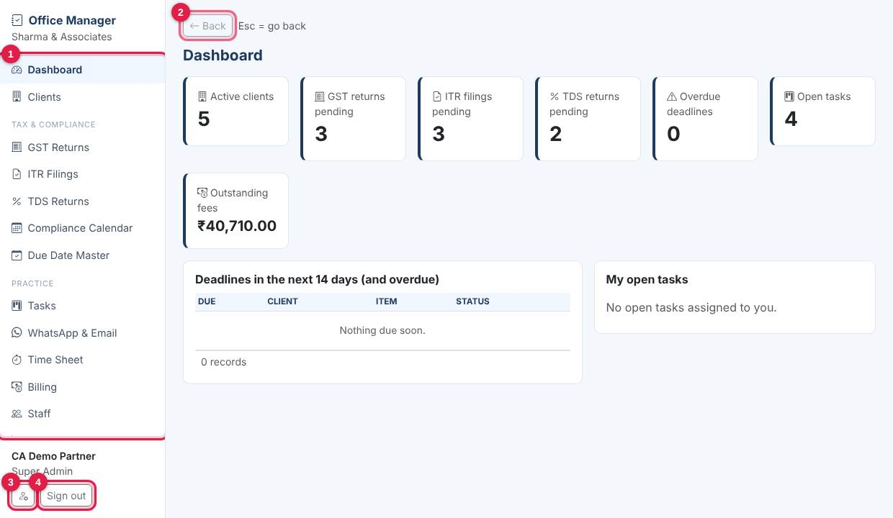
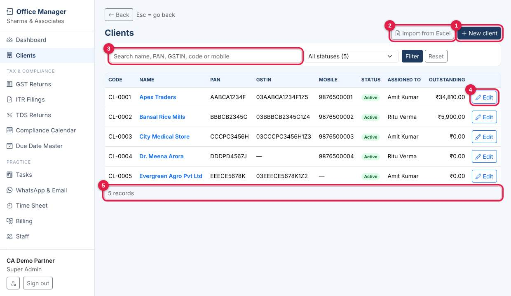
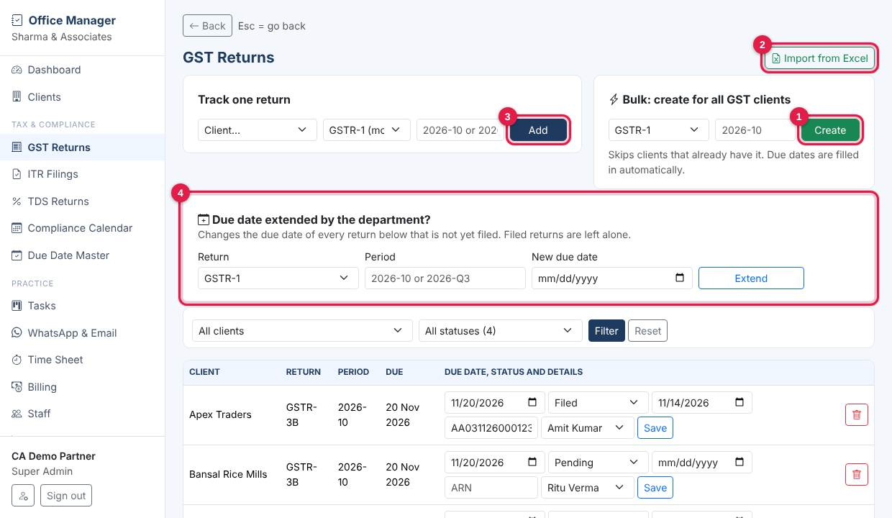
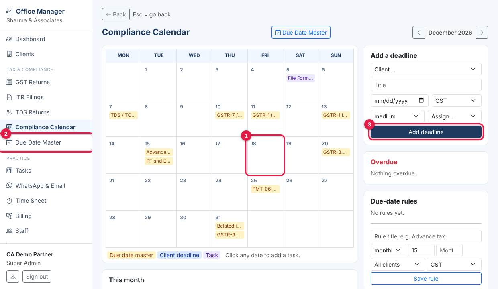
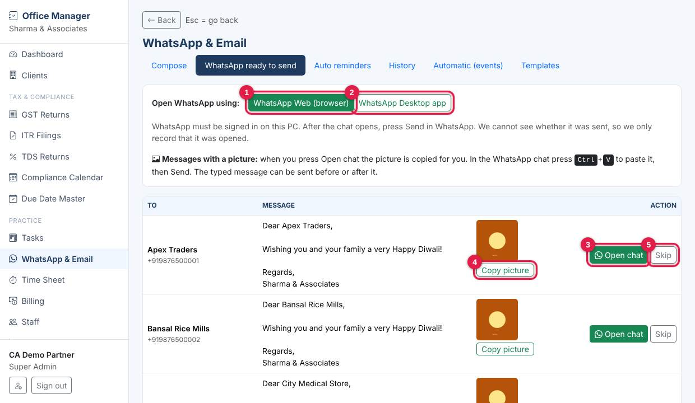
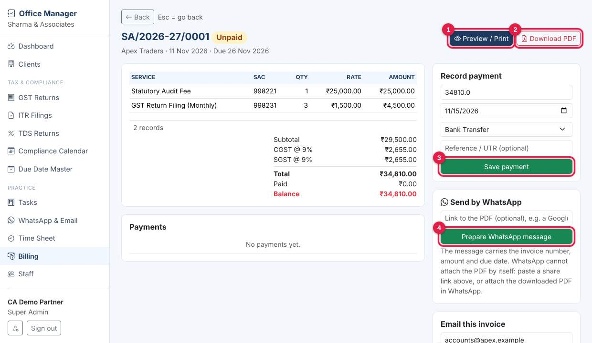

# Office Manager — Practice Management Software for CA & Advocate Offices

**AICA Level 2 Capstone Project**
**Submitted by:** CA Neeraj Sharma
**Batch:** B108

---

## 1. Problem Statement

Small and mid-sized CA and Advocate offices in India run on a mix of Excel sheets, WhatsApp, paper diaries and
memory to track client compliance due dates (GST, ITR, TDS), bill clients, and follow up on pending work. This
causes missed due dates, duplicated effort across staff, and no single record of who owes what to whom.

**Objective:** build a self-contained desktop practice-management application — usable without the internet,
without recurring software fees, and without a paid WhatsApp/SMS API — that a small office can install on one
PC and run as its system of record for clients, statutory due dates, billing and client communication.

## 2. What the Application Does

Office Manager is a Flask-based desktop application (packaged with `pywebview` as a Windows program) that gives
a CA or Advocate office:

| Area | What it covers |
|---|---|
| **Clients** | Client master with GST/PAN, Excel bulk import, GST-portal lookup (auto-fills name/address/PAN from a GSTIN, captcha-verified), pincode-to-city/state autofill, contact person & designation, encrypted client-portal login storage |
| **Compliance tracking** | GST / ITR / TDS trackers with bulk creation, a statutory due-date master pre-loaded through March 2027, manual due-date extension, ITR e-verification status, ARN/acknowledgement numbers |
| **Calendar & tasks** | A compliance calendar showing due dates and tasks together, click-a-date to create a task, a task board |
| **Billing** | Services master, invoices with PDF, payments, hour-based billing with client-specific rates, invoice preview, invoice-by-WhatsApp/email |
| **Client communication ("WhatsApp Manager")** | Click-to-chat WhatsApp (no paid API) and email, bulk send, editable templates with drag/click fields, image attachments, scheduled email, and automatic (event-based) reminders for due dates and unpaid invoices |
| **Reports** | On-screen, PDF, Excel and CSV reports (client register, GST/ITR/TDS registers, invoice/receipt registers, the firm's own GST summary) with the firm's letterhead |
| **Administration** | Roles (Super Admin/Partner/Manager/Employee) plus a per-user, per-module permission override; an Activity Log; configurable backup (on open/close/daily, to any folder including a synced Drive/OneDrive folder) |
| **Built-in Help** | A Help screen inside the app, illustrated with 39 annotated screenshots of the actual running application |

The same codebase works for **Advocates** as well as CAs (an "office type" setting changes labels and adds a
Matters & Hearings module).

## 3. Why This Design

- **Works offline, no subscription**: SQLite + a bundled web server inside a desktop window, so the office owns
  its data and pays nothing recurring to run it.
- **No paid messaging API**: WhatsApp messages are prepared with the right text and opened in WhatsApp Web/Desktop
  for the user to press Send — avoiding the cost and approval process of the official WhatsApp Business API.
- **Multi-staff on one office network**: the same app can run in "server" mode on one PC; other staff reach it
  from a browser on the office LAN, with their own login and permissions.
- **Safety of client data**: CSV/Excel export is sanitised against formula injection; portal passwords and the
  email password are stored encrypted, not in plain text.

## 4. Technology Stack

- **Backend:** Python 3.11+, Flask 3 (application-factory pattern), Flask-SQLAlchemy / SQLAlchemy 2, SQLite (WAL mode)
- **Desktop packaging:** `pywebview` (native window) + `waitress` (WSGI server) + PyInstaller (`.exe` build)
- **Front end:** Jinja2 templates, vanilla JavaScript, Bootstrap-based CSS with a 5-theme system
- **Documents/data:** `openpyxl` (Excel import/export), `reportlab` (PDF invoices/reports)
- **Security:** `cryptography` (Fernet) for encrypted credential storage
- **External, unauthenticated lookups:** the public GST "Search Taxpayer" service (captcha-verified) and
  India Post's pincode API, both used only to save re-typing — no login credentials of the government portals
  are required for these
- **Testing:** `pytest`, with a browser-realistic test client (real CSRF tokens scraped from rendered HTML,
  not injected) — **74 automated tests**, covering CSRF protection, role/permission gating, imports, billing,
  reports, backup/restore round-trips, due-date automation, and more

## 5. Project Structure

```
audit_manager/          Application package (application factory, models, views, services, templates, static)
  views/                 One Flask blueprint per module (clients, trackers, billing, whatsapp, calendar_view, ...)
  services/              Business logic: GST/pincode lookup, WhatsApp/email rendering, backup, imports, reports, billing
  templates/, static/    Jinja templates, CSS/JS, and the 39 Help screenshots
tests/                  74 pytest tests
tools/make_help_pictures.py   Regenerates the in-app Help screenshots from a live, Playwright-driven instance
run_desktop.py          Entry point: opens the app as a desktop window (or `--server` for the office-LAN mode)
OfficeManager.spec, build_windows.bat   PyInstaller packaging into a Windows .exe
docs/USER_GUIDE.md      Full end-user guide (installation, office-network setup, building the .exe, known limits)
docs/screenshots/       A few of the in-app screenshots, for quick viewing here
```

## 6. Screenshots

| Dashboard | Clients | GST Tracker |
|---|---|---|
|  |  |  |

| Compliance Calendar | WhatsApp Queue | Invoice |
|---|---|---|
|  |  |  |

More screens are shown, annotated, inside the application's own Help menu.

## 7. Running the Project

```
pip install -r requirements.txt
python run_desktop.py
```
The first run shows a setup screen to create the firm and the first administrator (there are no default
passwords). See **[docs/USER_GUIDE.md](docs/USER_GUIDE.md)** for: running it across an office network for
multiple staff, building the Windows `.exe`, backups, and known limitations.

## 8. Running the Tests

```
pip install -r requirements-dev.txt
python -m pytest
```

## 9. Current Scope & Future Work

Not yet covered: audit working-paper management, a client-facing portal, and the official (paid) WhatsApp
Business API. These are natural next steps once the core practice-management workflow is validated in use.

---
*Built with Claude (Anthropic) as a technical collaborator, under the direction and requirements of CA Neeraj Sharma.*
