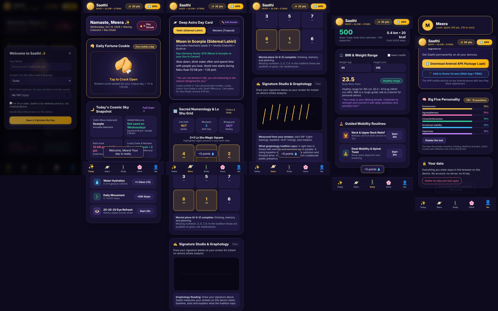

# Saathi: your daily companion for body, glow and stars

**AICA Level 2 Capstone Project** · Participant: **Ankit Kothari** · Batch: **B120**
Demo video: _add link_ · Live web app: _add link_

> **Try it in 10 seconds, no install, no internet, no API key:** download this folder and double-click **`web/index.html`** (Chrome or Edge, phone or computer).



## The problem

People want simple daily nudges to drink water, move, rest their eyes and care for their skin. Many also enjoy astrology and numerology. Today that means juggling 5–7 separate apps, most of which want an account and upload personal data. Many "AI" lifestyle apps also overclaim: they show impressive-looking readings that are really fixed text, or diagnose from photos.

## The solution

**Saathi** is one warm, private and honest companion that works on any phone or computer:

| Tab | What it does | How it works |
|---|---|---|
| **Today** | Daily fortune cookie (one per day, rare golden ones), today's sky, water, steps and eye-break habits with points and streaks | Points and streaks are counted from what you actually log and saved on your device |
| **Stars** | Day card: Moon sign (Vedic or Western), nakshatra, tithi, Rahu Kaal, Abhijit, sunrise/sunset, lucky colour and number, a personal day score | Real astronomy calculated in the browser for your city (see *Accuracy* below) |
| **Numbers** | Life Path (keeps master numbers 11/22/33), Moolank, Bhagyank and the Lo Shu grid with complete planes and missing numbers | Calculated from your birth date |
| **Signature Studio** | Draw your signature; get slant, baseline and size, and what graphology tradition says | Measured from your strokes (median-of-slopes baseline, length-weighted slant) |
| **Body** | Walk timer, BMI with WHO or Asian cut-offs and your healthy weight range, guided neck and desk routines | BMI only from numbers you type, never from a photo |
| **Glow** | Morning and evening rituals for face, hair and nails | Wellness tips with a clear "see a dermatologist" signpost |
| **Me** | Level and points, a 10-question Big Five personality test (TIPI), download the Android app, delete your data | Scored with the published TIPI key (Gosling, Rentfrow & Swann, 2003) |

There are two versions:
- **`web/`**: the complete web app. It's a single page with no server, no account and no API key, and your data stays in the browser. It can be installed to the home screen.
- **`android/`**: the native Android app (Kotlin + Jetpack Compose), built in Google AI Studio. The ready-to-install APK is at `web/downloads/saathi.apk`, and the web app's **APK** button downloads it.

## AI concepts from the course, applied

1. **Prompt-driven development:** the app was specified, generated and iterated with Google AI Studio (Gemini) and Claude, then reviewed and tested. This is the "specify → generate → review → test" loop from the course.
2. **Grounding over hallucination:** an early version showed fixed placeholder results (the same Moon sign and numbers every day). These were replaced with real calculations, and each one is tested against a reference. The app shows what it actually computed, or asks for the missing input.
3. **Responsible AI:** 18+ confirmation, "for reflection, not advice" labels, no medical or financial claims, BMI never inferred from images, signatures never stored, and graphology never used for hiring, legal or money decisions.
4. **Privacy by design:** no account, no server, and no data leaves the device. A "Delete my data" button wipes everything.
5. **Evaluation and testing:** automated accuracy tests against a professional astronomy library, plus a full browser click-through test (below).
6. **Explainability:** every reading says *why*: "Lucky number 2: your personal day number", "Moon in Scorpio vs your Sun in Cancer", "slant 99°, baseline +6.5°, measured from your strokes".

## Accuracy (checked by `npm test`)

| What | Reference | Result |
|---|---|---|
| Moon position (2,000 random dates, 1950–2050) | astronomy-engine | worst error **0.02°**; Moon sign and nakshatra agree **99.85%** (the rest are boundary seconds) |
| Sun position | astronomy-engine | worst error **0.009°** |
| Sunrise and sunset, 29 cities | astronomy-engine | within **3 minutes** |
| Abu Dhabi, Wed 14 Oct 2026 | known values | Moon in **Scorpio** (Vedic) / **Sagittarius** (Western); Rahu Kaal **12:08–1:35 pm** |
| Numerology, 14 Aug 1992 | worked example | Life Path **16/7**, Moolank **5**, Bhagyank **34/7**, personal day on 14 Oct 2026 = **2** |
| Signature strokes | drawn with known angles | slant within **3°**, baseline within **1.5°** |

Method: Sun from Meeus's low-precision solar theory; Moon from the main periodic terms of Meeus, *Astronomical Algorithms*, ch. 47; Lahiri ayanamsa; NOAA sunrise algorithm; panchang (tithi and nakshatra) taken at local sunrise; Rahu Kaal and Abhijit from the real day length for the city.

## Run and test

```
# Use the app: double-click web/index.html, or serve it:
npx serve web

# Tests (Node 20+)
npm install
npm test                      # 10 accuracy and logic tests
CHROME_PATH="<path to chrome>" node tests/e2e.mjs   # 11-step browser click-through
```

To host it for free, drag the `web` folder onto **app.netlify.com/drop** to get an HTTPS link you can share.

## Project structure

```
web/
  index.html            the app (UI)
  js/saathi-core.js     calculation engine (astronomy, panchang, numerology, signature, TIPI, points)
  js/app.js             app logic, saved in the browser (localStorage)
  downloads/saathi.apk  Android app
android/                Kotlin + Jetpack Compose source (open in Android Studio)
tests/                  core.test.mjs (accuracy) and e2e.mjs (browser click-through)
docs/screenshots/       screens from the test run
```

## Honest limits

- Astrology, numerology and graphology are cultural traditions offered for fun and reflection. They are not science, and Saathi says so on screen.
- The walk timer estimates steps from walking time (about 100 steps a minute). Real step counting needs the phone's sensors in the Android app.
- The Android prototype uses a simplified lunar model; the web app's engine is the accurate, tested one.
- Data lives in one browser on one device. There's no cloud backup by design.

## Built with

HTML, CSS and JavaScript (no frameworks, no external libraries at runtime), Kotlin and Jetpack Compose (Android), Node's test runner, Playwright, and astronomy-engine (tests only). Built with Google AI Studio (Gemini) and Claude as AI coding assistants. Designed, directed and reviewed by Ankit Kothari.
