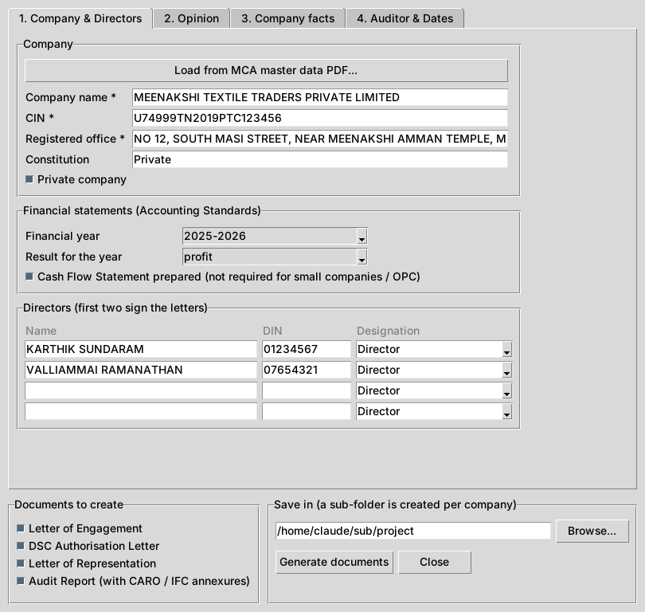
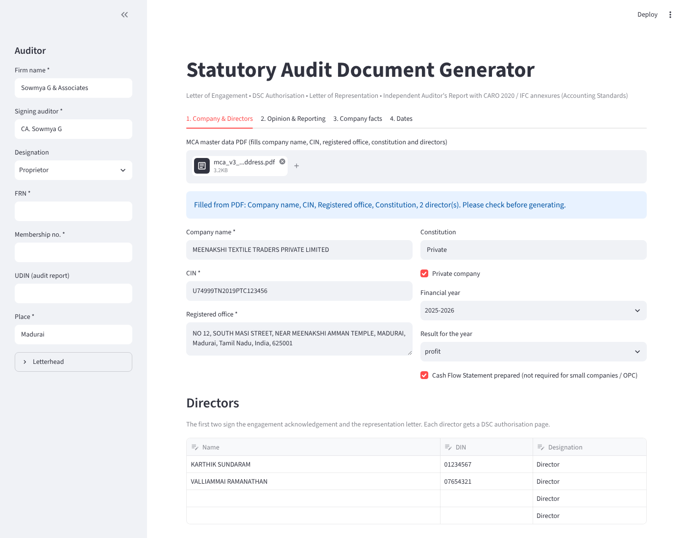

# Statutory Audit Document Generator

**AICA Level 2 Capstone Project (Batch 101, Chennai). CA Sowmya G, Sowmya G & Associates, Madurai**

A tool for Chartered Accountants that turns a company's **MCA master data PDF** into a
ready-to-review statutory audit file in Word, in under a minute:

| # | Document | Printed on |
|---|---|---|
| 1 | Letter of Engagement (SA 210) | Auditor's letterhead |
| 2 | DSC Authorisation Letter, one page per director | Company's letterhead |
| 3 | Letter of Representation (SA 580), with fill-in tables for figures | Company's letterhead |
| 4 | Independent Auditor's Report (SA 700 / 705 / 706), with **CARO 2020** and **IFC** annexures | Auditor's letterhead |

Built for companies reporting under **Accounting Standards** (Companies Act, 2013).

---

## The problem

For every company audit, the same set of documents is prepared again and again: the
engagement letter, the DSC authorisation, the representation letter, the auditor's report
and the CARO annexure. The company's name, CIN, registered office and directors are retyped
from the MCA master data each time, and the report wording has to be changed by hand for
every choice: type of opinion, CARO applicability, IFC, private or public company, cash
flow statement, and audit trail status. Retyping invites errors, such as a wrong CIN, the
books-of-account address used instead of the registered office, or a qualified opinion
whose section 143(3) paragraphs were not updated to match.

## The solution

1. **Upload the MCA master data PDF.** The company name, CIN, registered office,
   constitution and directors (name and DIN) are filled in automatically.
2. **Answer a few questions** in four tabs: the opinion, CARO / IFC, audit trail, and a
   list of company facts (PPE, inventory, borrowings, deposits, CSR and so on).
3. **Click Generate.** The four Word documents are created with the correct wording for
   every combination of answers, with every place that needs the client's figures
   **highlighted in yellow**.



## Key features

**Reading the MCA master data PDF**
- Reads the MCA V3 layout, where each value is centred vertically against its label.
  A two- or three-line registered office therefore starts *above* the label line; the
  program assigns each value line to the label whose vertical centre is nearest.
- Never takes the *"Address at which the books of account are to be maintained"* into
  the registered office.
- Takes director **name and DIN only**, never designation or category, and joins
  names that wrap onto a second line.
- Keeps spacing as printed on the master data, with a space after every comma.
- Also reads bordered-table layouts and values printed below their labels, and gives a
  clear message for scanned PDFs with no text.
- Works out the constitution from the CIN when it is not printed
  (PTC, PLC, OPC, NPL and so on).

**Auditor's report logic**
- Four opinions (Unmodified / Qualified / Adverse / Disclaimer), with matching *Basis for*
  paragraphs and section 143(3)(d) wording; Emphasis of Matter.
- CARO 2020 annexure covering all 21 clauses of paragraph 3, driven by tick-boxes.
  Unticked items are reported as not applicable or nil, and items needing figures are
  marked **[Review]**.
- IFC annexure under section 143(3)(i), or the G.S.R. 583(E) exemption line for private
  companies. Annexures are lettered A, B in order.
- Private company: section 197 not applicable, section 177 omitted in CARO 3(xiii).
- Cash Flow Statement optional, for small companies and OPCs.
- **Audit trail (Rule 11(g))**: three answers (throughout the year / enabled mid-year from
  a date / not maintained). The report, the clause 2(b) exception and the Letter of
  Representation all change together and stay consistent.

**Letters**
- Engagement letter in the firm's own wording, with a clause on the use of AI tools and
  redaction of confidential data, in line with the DPDP Act, 2023.
- Letter of Representation that follows the firm's model, with blank tables for
  depreciation, bank balances, fixed deposits, inventory, receivables, related party
  transactions and MSME suppliers.

**Checks before generating**
- Required fields, dd/mm/yyyy dates, 8-digit DINs, the 21-character CIN format, and the
  audit-trail date when the trail started mid-year.

## Three ways to run it

| | Who it is for | What is needed |
|---|---|---|
| **Windows program (.exe)** | Team members | Nothing. Double-click the exe. |
| **Desktop app in IDLE** | Python learners | Python 3.11 to 3.13, `pip install python-docx pdfplumber` |
| **Browser app (Streamlit)** | Any OS, or online | `pip install -r requirements.txt` |

### Desktop app (IDLE)

```
py -m pip install python-docx pdfplumber
```

Open `desktop_app.py` in IDLE and press **F5**. Keep `audit_engine.py` and `ca_logo.jpeg`
in the same folder.

### Browser app

Double-click `run_web.bat` (Windows), or run:

```
py -m pip install -r requirements.txt
py -m streamlit run streamlit_app.py
```



### Windows .exe

Run `build_exe.bat` once on any Windows PC with Python 3.12 or 3.13. The program appears
as `dist\Audit Document Generator.exe` and runs on other PCs without Python. Documents
are saved in `Documents\Audit Documents`. To have GitHub build the exe automatically,
see [docs/BUILD_EXE.md](docs/BUILD_EXE.md).

## Project structure

```
audit_engine.py      Document engine: MCA PDF reading, all wording, Word output
desktop_app.py       Desktop window (tkinter). Also the source of the .exe
streamlit_app.py     Browser version (Streamlit)
ca_logo.jpeg         Letterhead logo          app.ico   Program icon
requirements.txt     Packages                 run_web.bat / build_exe.bat
tests/               Automated tests and dummy MCA PDFs (fictitious companies)
samples/             Documents generated for a dummy company (.docx and .pdf)
screenshots/         Screens of the desktop and browser apps
docs/                Test report, development log, exe build guide
```

## Technology

Python 3 · **python-docx** (Word documents, letterheads, highlighted fill-ins) ·
**pdfplumber** (word positions and tables from the MCA PDF) · **tkinter** (desktop
window) · **Streamlit** (browser app) · **PyInstaller** (Windows exe) ·
**pytest** (232 automated tests).

## Testing

**232 automated tests, all passing.** They include every combination of opinion ×
audit trail × private/public × CARO/IFC × cash flow (192 report variants), PDF reading
on six layouts, both screens, the packed exe, and a run in a real browser. See
[docs/TEST_REPORT.md](docs/TEST_REPORT.md).

```
py -m pip install pytest reportlab
py -m pytest -v tests
```

## Sample output

[samples/](samples/) has the four documents generated for a **fictitious** company,
*Meenakshi Textile Traders Private Limited*, from the dummy master data
`samples/Dummy_MCA_Master_Data.pdf`. PDF copies are included for viewing on GitHub.

## Important

- The documents are **drafts for professional review**. The auditor remains responsible
  for the final wording, the opinion and every CARO clause. Yellow highlights mark items
  that must be completed.
- **Confidentiality:** run the desktop app or exe locally, so client data stays on the
  computer. Do not upload client master data to any public repository or online service.
- All companies, people and DINs in this repository are fictitious.

## Author

**CA Sowmya G**, Proprietor, Sowmya G & Associates, Chartered Accountants, Madurai.
AICA Level 2 Certificate Course, Batch 101 (Chennai): Capstone Project.
