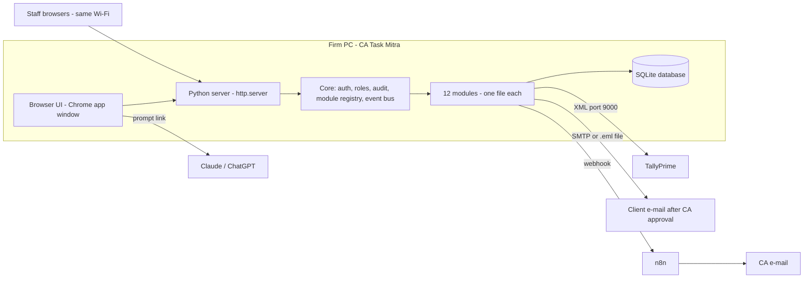
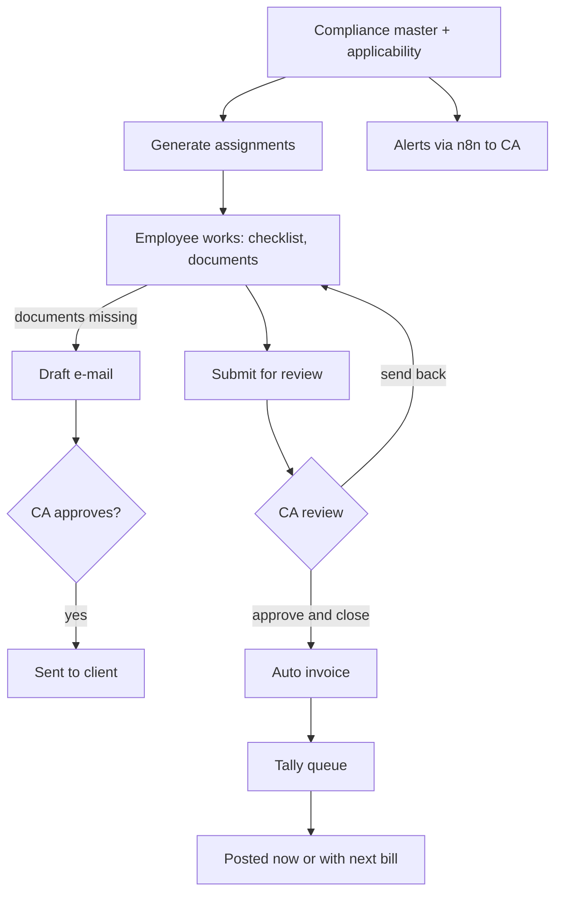

# Architecture

## Workflow

## Design points
- **Modular monolith:** each module exposes `MANIFEST`, `SCHEMA`, a router and optional `seed`/`demo`; the registry loads them and keeps on/off state per module and sub-module, with dependency checks.
- **Loose coupling:** modules talk through an event bus (e.g. `assignment.closed` → invoice → `invoice.created` → Tally queue).
- **Security:** pbkdf2 password hashing, cookie sessions, role checks on every route, audit log of every change, secrets masked.
- **Standard library only:** Python http.server, sqlite3, urllib, smtplib – easy to package as an EXE.
