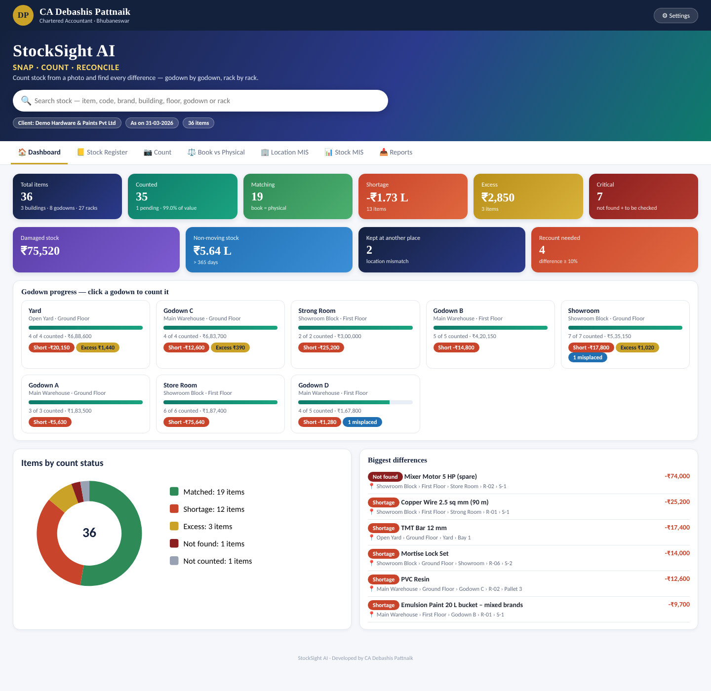
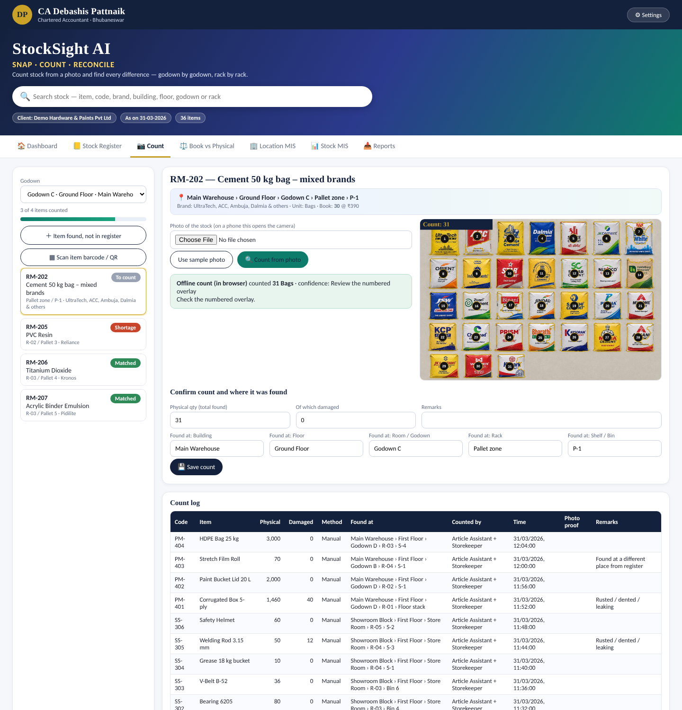

# StockSight AI — Snap · Count · Reconcile

**AICA Level 2 Capstone Project** · CA Debashis Pattnaik (M. No. 316339) · Batch 110, Bhubaneswar

StockSight AI is a single HTML file for a **special assignment of physical verification of stock** (agreed-upon procedures, SRS 4400 (Revised)). It counts stock from a photo and finds every difference godown by godown and rack by rack. It then gives MIS and downloads a Word report and an Excel MIS.

Built on **Claude (Anthropic)** · HTML + JavaScript · No installation

## What it does

- **Dashboard**: colour KPI cards for total, counted, matching, shortage, excess and critical items. It also shows damaged and non-moving stock, items kept at another place, items needing a recount, a progress card for every godown, and the biggest differences.
- **Search**: find stock by item, code, brand, building, floor, godown or rack. Click a result to count it.
- **Photo count**: the app puts a number on every piece. Optional AI (Gemini, OpenAI or Claude) counts mixed stock and reads brands and rack labels.
- **Good count practice**:
  - Blind count, which hides the book qty while counting.
  - Recount list.
  - Add an item found that is not in the register.
  - Barcode / QR scan.
  - Photo proof with a SHA-256 fingerprint.
- **Book vs physical**, **Location MIS** and **Stock MIS**: shortage, excess, not found, kept at another place, damaged, non-moving and suggested provision.
- **Reports**: Word report with Annexures A–F, a 14-sheet Excel MIS, a count log, and points for management.
- **Settings**: assignment, signatory, rules and AI key, kept on a separate page.

## How to open

Double-click `StockSight_AI.html`. It opens in Chrome or Edge, and nothing needs to be installed. On a phone, the photo button opens the camera.

## Demo

1. **Dashboard** → *Load demo stock register*. This loads 36 items with brands, in 3 buildings and 8 godowns.
2. Type **cement** in the search bar → click RM-202.
3. *Use sample photo* → *Count from photo*. The app counts 31 bags against 30 in the book. Then click *Save count*.
4. See **Dashboard**, **Book vs Physical**, **Location MIS** and **Stock MIS**.
5. **Reports** → download the Word report and the Excel MIS.

## Demo result

| | |
|---|---|
| Stock register | 36 items, ₹31,66,300 |
| Coverage | 99.0% of value counted |
| Shortage / excess | ₹1,73,100 / ₹2,850 |
| Largest shortage | Showroom Block › First Floor › Store Room, ₹75,640 |
| Kept at another place / recount needed | 2 / 4 |
| Damaged / non-moving | ₹75,520 / ₹5,63,600 |
| Photo count in the browser | Cement 31 and paint buckets 23, both correct. Touching pipes were flagged and checked by hand. |

## Files

| Path | Content |
|---|---|
| `StockSight_AI.html` | The application |
| `01_Project_Summary_Document.docx` | Project summary |
| `02_Prompts/` | Prompts (.docx and .txt) |
| `03_Example_Files/` | Stock register, sample photos and app-counted photos, example Word report, Excel MIS and count log |
| `04_Presentation/` | 6-slide presentation |
| `screenshots/` | App screenshots |

## Data safety

The API key is never saved. Without a key, everything stays on the computer. All data here is demo data.
