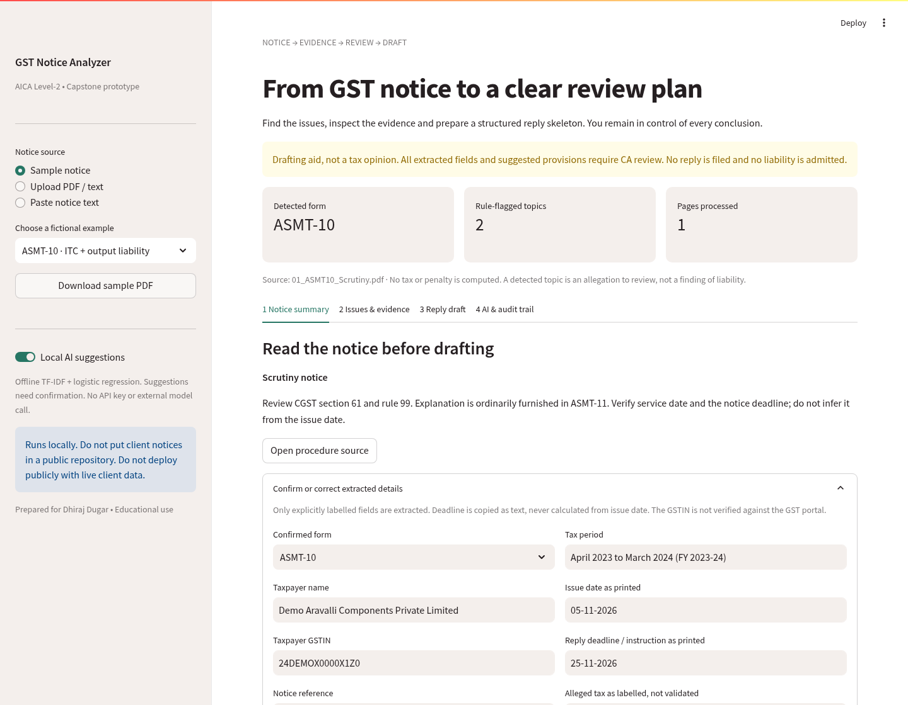
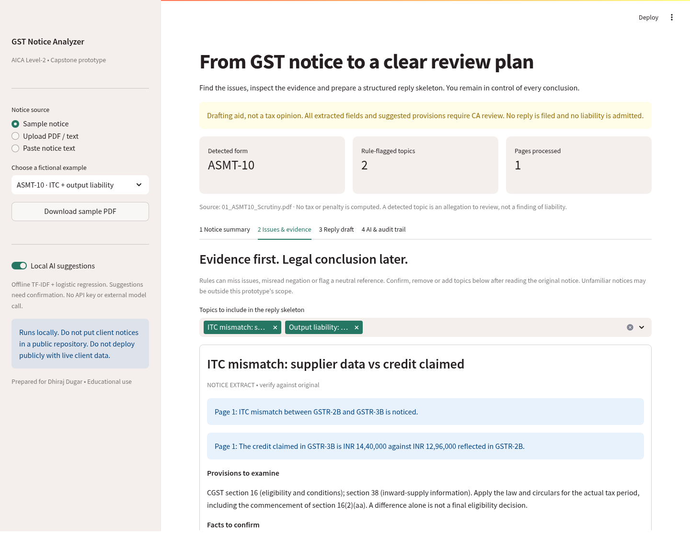
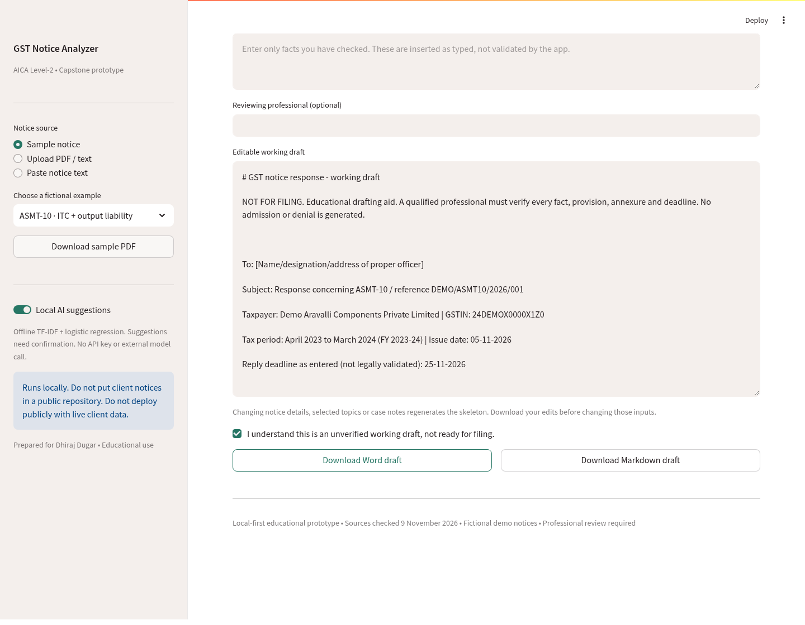

# GST Notice Analyzer

**AICA Level-2 capstone prototype prepared for Dhiraj Dugar**

An offline-first assistant for a practising Chartered Accountant who needs to turn a GST notice into a review plan and a structured reply skeleton. It combines PDF text extraction, evidence-backed issue rules and a small local machine-learning model. The final facts and legal position remain the CA's responsibility.

## What the working app does

- Reads searchable PDFs or UTF-8 text files, or accepts pasted notice text.
- Recognises **ASMT-10, DRC-01 and DRC-01A** when the form heading is present.
- Extracts explicitly labelled taxpayer name, GSTIN, reference, tax period, issue date, reply deadline and alleged tax. Every field is editable.
- Flags five supported topics: supplier-data/ITC mismatch, GSTR-1 versus GSTR-3B output liability, reverse charge, blocked/ineligible ITC, and delayed/non-filing.
- Shows the source wording with page references, relevant CGST provision notes, facts to verify and documents to collect.
- Runs a genuine local NLP model: TF-IDF word/bigram features + logistic regression, trained on **60 synthetic labelled sentences**. It suggests issue categories, not legal conclusions. Additional AI topics are never silently inserted into a draft.
- Creates an **editable Word (.docx) or Markdown working reply**, with unknown facts left as placeholders. Also downloads an analysis audit JSON.
- Includes three fictional notice PDFs and matching text versions. The built-in demo needs no upload, API key, GST login or client data.

**Not included:** OCR, GST portal integration, live law updates, full legal research/case-law search, fee/interest/penalty/limitation calculations, automatic filing, or a production-grade language model. This is not a ChatGPT/API integration; the AI runs on the laptop.

## Windows setup

### Recommended environment

Windows 10/11 and **64-bit Python 3.11** from python.org. Check **Add Python to PATH** during installation. Python 3.10 was used for verification; 3.11 is recommended for a fresh Windows setup. Internet is needed for the initial dependency installation, not for analysing a notice afterward. Official-source links open online only when you click them.

Extract the ZIP first. Work **inside** `DhirajDugar-GST-Notice-Analyzer`, not inside the ZIP preview. Avoid a path containing unusual characters if Python installation has trouble.

### Easy option

1. Double-click `SETUP_WINDOWS.bat`. Wait until it says setup is complete. It creates a private `.venv` and installs the pinned dependencies.
2. Double-click `RUN_WINDOWS.bat`.
3. If the browser does not open, visit the local address printed in the window (normally `http://localhost:8501`).
4. Keep the command window open while using the app. Press **Ctrl+C** to stop it.

Do not upload the generated `.venv` folder to GitHub.

### Command-line option (Command Prompt)

Open Command Prompt in the extracted project folder:

```bat
python -m venv .venv
.venv\Scripts\activate.bat
python -m pip install -r requirements.txt
python -m streamlit run app.py
```

If `python` is not recognised but the Python launcher is installed, use `py -3.11` in place of `python` for the first command. Calling `python -m streamlit` uses the selected environment and avoids PATH problems. On later runs, activate the environment and run the last command; no reinstall is needed.

### macOS / Linux

```sh
python3 -m venv .venv
source .venv/bin/activate
python -m pip install -r requirements.txt
python -m streamlit run app.py
```

## Three-minute demo

1. Launch the app. It opens with **ASMT-10 · ITC + output liability** selected.
2. In **Notice summary**, show the form, period and explicitly printed reply date. Expand the extracted text if needed. Verify/correct the fields.
3. In **Issues & evidence**, show the two topics and the exact notice extracts. Explain the difference between an allegation and a conclusion.
4. Review the facts-to-confirm, provision notes and document checklist. Remove a topic or add one only after checking the original.
5. In **AI & audit trail**, explain the local machine-learning component and its limitations. Scores are not calibrated legal confidence.
6. In **Reply draft**, enter optional checked facts, review/edit the skeleton and tick the working-draft acknowledgement. Download Word or Markdown.
7. Switch the sidebar to **DRC-01 · RCM + blocked credit**. It shows a different procedure, FY 2024-25 and two different issues. Explain why the complete SCN is needed and why section 74A matters.

Read `VIDEO_SCRIPT.md` for a 3-5 minute face-on-camera + screen-share narration. Use fictional data only.

## Samples and expected results

| Included PDF | Scenario | Expected rule topics | Explicit sample deadline |
|---|---|---|---|
| `01_ASMT10_Scrutiny.pdf` | FY 2023-24 scrutiny | ITC mismatch; output liability gap | 25-11-2026 |
| `02_DRC01_ShowCause.pdf` | FY 2024-25 SCN summary | RCM; blocked ITC | 26-11-2026 |
| `03_DRC01A_PreNotice.pdf` | FY 2023-24 pre-notice intimation | RCM; late filing | 24-11-2026 |

All sample entities, identifiers, allegations, dates and amounts are fictional. GSTIN-like strings are **intentionally invalid demo identifiers**, not registrations. No official seal or signature is used. The DRC-01 sample includes illustrative grounds for demonstration; a live DRC-01 summary must be read with the full SCN and annexures. Sample dates are not general statutory deadlines.

The sample PDFs are included already. Optional regeneration uses `python -m pip install reportlab==4.2.5` then `python samples/generate_samples.py`; ReportLab is not an app dependency.

## How it works

```text
Searchable PDF / text
        |
        v
pdfplumber + explicit-label metadata extraction
        |
        +--> evidence rules --> initial issue selection --> human confirmation
        |
        +--> TF-IDF + logistic regression --> review-only additional suggestions
                                                    |
                                                    v
Curated provision notes + verified fields + selected topics + user's case notes
                                                    |
                                                    v
Editable reply skeleton --> Word / Markdown + analysis audit JSON
```

- `engine.py` owns extraction, metadata, rule matching, local-model inference and exports.
- `knowledge.py` owns the curated issue/procedure notes and observed official-source links.
- `data/training_examples.csv` contains all model training examples. No downloaded weights or pickled model is required; training is deterministic and local at first use.
- `app.py` provides the Streamlit workflow. Notice bytes are processed in the running process; the app does not write uploaded notices into the project or train on them.
- `.streamlit/config.toml` binds locally and disables Streamlit usage statistics. No LLM/API is called. Normal Python/browser processes may use OS memory/swap; close the app to end the session. Downloads must be handled as confidential case files.

See `MODEL_CARD.md`, `SOURCES.md` and `TESTING.md` for scope, legal-source notes and test evidence.

## Important review controls and limitations

- **No automatic deadline:** the deadline is copied only when it has a recognised explicit label. A phrase such as "within 30 days of service" does not become an invented calendar date. Verify service, portal record and any extension. Flexible live notice formats may need manual entry.
- **Form heading required:** an unsupported form is labelled Unknown; confirm it manually. Mentioning a form somewhere in the body is not enough.
- **OCR not included:** image-only/empty pages are flagged, not silently treated as complete. Mixed PDFs can contain missing issues on scanned pages. Verify extracted text against every page.
- **Rules and AI are fallible:** limited English vocabulary, wrapped PDF lines, negation and novel issues can defeat detection. "No issue found" never means the notice is valid or harmless. Model scores are not legal confidence or an accuracy claim.
- **Procedure matters:** ASMT-10 explanation: review rule 99 / ASMT-11. DRC-01: review the full SCN and rule 142 / DRC-06. DRC-01A: distinguish pre-notice Part A from submissions in Part B. No automated filing occurs.
- **Tax period matters:** sections 73/74 concern periods up to FY 2023-24; section 74A concerns FY 2024-25 onward. Do not use a current provision mechanically for an earlier period. SGST/IGST law, notifications, exceptions, judicial decisions and amendments need case-specific verification.
- **No fabricated defence:** draft points are prompts to investigate, not assertions that ITC is eligible, no tax is due or payment has occurred. User-entered facts are inserted as typed, not checked by the app.
- **Draft reset:** changing metadata, selected issues or case notes regenerates the skeleton. Download any manual draft edits before changing those inputs.
- Limits: 10 MB, 30 PDF pages, 100,000 extracted characters. Encrypted/damaged PDFs show an actionable error. Only PDF and UTF-8 text are supported.
- Prototype, not hardened for untrusted public uploads. Keep it on localhost, do not expose it publicly, and have IT/security review it before any firm-wide deployment.

## Verification

```bat
python -m pip install -r requirements-dev.txt
python -m pytest -q
```

The shipped version passed **29 automated tests** on Python 3.10, including real sample PDF extraction, issue detection, simple negation, no invented deadlines, missing metadata placeholders, invalid input handling, real model inference, Word content checks and a Streamlit interaction test across all three examples. It was also opened in a browser and a Word draft downloaded successfully. These are software checks, not legal validation or a measured real-world AI benchmark. A Windows laptop itself was not available for testing; see `TESTING.md`.

## Screenshots

Actual running-app screenshots with fictional sample data:





## Submission folder

Keep the project as one folder: `DhirajDugar-GST-Notice-Analyzer`. Include the README, source, sample PDFs/text, dataset, tests, screenshots and video script. Do not include `.venv`, `.git`, `__pycache__`, keys, client documents or downloaded live-case drafts. No included file is over 100 MB.

GitHub publication, fork/PR and the course submission form are separate steps. A video link is also required by the course form. This project package does not itself submit anything.

## Development disclosure and participant responsibility

This package was developed with AI-assisted coding. Before presenting or making any course originality declaration, the participant should run, understand, review and adapt it, and check the course's rules on assistance. Do not describe an unreviewed generated project as independently authored. The participant supplies their own explanation, practical validation and any required attribution/declaration.
