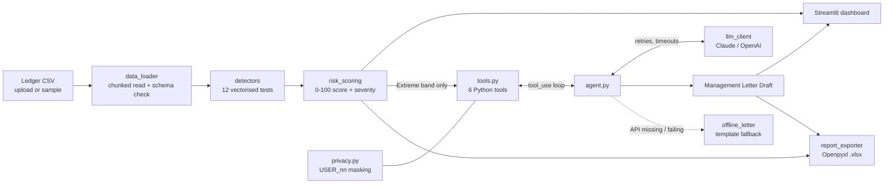

# Smart Ledger Anomaly & System-Override Detector Dashboard

ICAI AICA Level 2 Capstone – **Proposal B**

## Video Walkthrough

**Video Walkthrough: <PASTE LINK HERE>**

*(Record the 2-minute script at the bottom of this file, upload it as an unlisted YouTube video or a Google Drive "anyone with the link" file, and paste the link above before pushing.)*

---

## 1. Problem statement

Traditional audit sampling skips key ledger-entry anomalies and strange weekend or system overrides that imply high internal-audit risk. This tool scans **100%** of a general-ledger / journal-entry CSV, flags risky entries with automated Python variance analysis, scores them, and feeds **only the extreme anomalies** to an LLM agent that investigates them with tools and drafts a **Management Letter**. Results are shown in a Streamlit dashboard and exported to an Excel audit report.

## 2. Tech stack

| Layer | Tool |
|---|---|
| Data pipeline | Python, **Pandas**, NumPy, SciPy |
| LLM | **Anthropic Claude API** (`anthropic` SDK, default model `claude-sonnet-5-5`), plus OpenAI and **Groq** (OpenAI-compatible, default `openai/gpt-oss-120b`) via `LLM_PROVIDER` |
| UI | **Streamlit** + Plotly |
| Reporting | **Openpyxl** (formatted Excel workbook with native chart), **python-docx** (Management Letter as a Word document) |
| Config / secrets | python-dotenv (`.env`) |
| Tests | pytest |

## 3. Architecture



```
ledger_anomaly_detector/
├── app.py                        Streamlit dashboard
├── requirements.txt  .env.example  .gitignore
├── data/
│   ├── generate_sample_data.py   synthetic ledger + injected anomalies
│   ├── sample_ledger.csv         ~52k rows (~10 MB)
│   ├── sample_ledger_5k.xlsx     5,000-row Excel sample (real Excel dates / numbers)
│   └── sample_ledger_ground_truth.csv   which entries carry which injected anomaly
├── src/
│   ├── config.py                 paths, schema, thresholds, weights, holidays
│   ├── data_loader.py            CSV + Excel ingestion, sheet detection, validation, column mapping
│   ├── detectors.py              12 rule / statistical detectors
│   ├── risk_scoring.py           weighted score + severity bands
│   ├── tools.py                  Python functions exposed to the LLM
│   ├── agent.py                  tool-calling loop + conditional branches
│   ├── llm_client.py             provider abstraction, retries, timeouts, error mapping
│   ├── offline_letter.py         deterministic fallback letter
│   ├── privacy.py                reversible user-name pseudonymisation
│   ├── pipeline.py               load -> detect -> score helper
│   └── report_exporter.py        Excel export + plain-text letter
└── tests/                        pytest (detectors, loader, tools, agent, export)
```

## 4. Setup and run (Windows PowerShell)

Requires **Python 3.11+** (pandas 3.x); developed on Python 3.14.

```powershell
cd ledger_anomaly_detector
python -m venv .venv
.\.venv\Scripts\Activate.ps1
pip install -r requirements.txt

copy .env.example .env          # then edit .env and paste your API key
python data\generate_sample_data.py    # optional - regenerates data\sample_ledger.csv
streamlit run app.py
```

Run the tests:

```powershell
python -m pytest -q
```

**Using Groq:** in `.env` set `LLM_PROVIDER=groq`, `GROQ_API_KEY=gsk_...` and leave `LLM_MODEL` blank (or pick another Groq model that supports tool calling, e.g. `openai/gpt-oss-20b`; Groq retires models regularly, so if you get *model_not_found* check Groq's model list). You can also choose *groq* in the sidebar and paste the key there for the session.

On Groq's free tier (about 8,000 tokens per minute) the agent automatically uses at most the top 10 Extreme entries and compact tool results. If the LLM cannot be used, the Management Letter tab shows a warning with the exact reason and the template letter is produced instead.

**No API key?** The app still works end-to-end: the Management Letter is produced by a deterministic template and clearly labelled *"Generated without LLM"*.

### Input file: CSV or Excel

`entry_id, posting_date, document_date, account_code, account_name, cost_center, description, debit, credit, amount, currency, entry_type (Manual/Automated/Adjusting/Reversal), posted_by, approved_by, posting_time, source_system, period, is_manual_override (Y/N)`

Upload a **CSV or Excel file** (`.csv`, `.xlsx`, `.xlsm`, `.xls`) in the sidebar. For Excel the app lists the worksheets and pre-selects the one that best matches the ledger columns; title rows above the header, real Excel dates, numeric account codes, time stored as Excel fractions and a totals row at the bottom are all handled. Click **⬇ Excel input template** in the sidebar for a ready-made file with the right headers and example rows. `data/sample_ledger_5k.xlsx` is a small Excel sample for testing.

Only `entry_id, posting_date, account_code, posted_by, debit, credit` are mandatory; the other columns get documented defaults. Differently named headers are auto-mapped (e.g. `Voucher No → entry_id`) and anything unrecognised can be mapped in the sidebar. Files are read in chunks, so large ledgers load with a progress bar (old `.xls` files need `xlrd`, included in `requirements.txt`).

## 5. The 12 detectors

| # | Detector | Logic (all vectorised) |
|---|---|---|
| 1 | Weekend / holiday posting | Manual or override entry on Sat/Sun or a listed public holiday |
| 2 | After-hours posting | Manual entry inside the night window (default 22:00–05:00) |
| 3 | Override without approval (SoD) | Manual/override entry with no approver, or approver = poster |
| 4 | Just below threshold | Amount in the band just under the approval limit (default ₹10 lakh, 5% band) |
| 5 | Round-figure amount | Exact multiples of ₹1 lakh |
| 6 | Duplicate entries | Same account + amount + date + description under different entry IDs |
| 7 | Benford's law | Per-account first-digit MAD + chi-square, with a minimum-sample guard |
| 8 | Variance analysis | Per-account z-score **and** IQR fence on log-amounts, plus month-on-month spike vs 3-month rolling mean |
| 9 | Period-end manual journals | Material manual entries in the last N days of a month/quarter/year |
| 10 | Back/future-dated | Posting date far from document date |
| 11 | Debit ≠ credit | Imbalance per `entry_id` |
| 12 | Dormant account / rare user | Posting after a long dormant spell, or by a user with ≤ 5 entries |

Every threshold is a sidebar control. Risk score = weighted sum of fired detectors (weights editable, +10 for top-1% amounts, capped at 100). Bands: Low < 30 ≤ Medium < 50 ≤ High < 70 ≤ **Extreme**. Only Extreme entries (top-N, default 25) are exposed to the LLM.

## 6. Agentic logic

`src/agent.py` implements a genuine tool-calling loop (Anthropic `tool_use`, mirrored for OpenAI function calling):

1. The model receives the task and seven tools (six investigation tools plus `submit_management_letter`): `summarise_flag_counts`, `get_extreme_anomalies`, `get_entry_details`, `get_user_activity_profile`, `get_account_statistics`, `compare_to_peer_period`.
2. While the model asks for tools (and rounds remain, `MAX_AGENT_ITERATIONS = 8`), the agent runs them against the real DataFrame and returns the results.
3. The model finishes by calling `submit_management_letter` with structured narrative (summary, observations, recommendations, priorities) and entry IDs. **The system then renders the letter**: every figure, date, amount and user in the tables is taken from the ledger, so the model cannot mis-state numbers. Unknown entry IDs are dropped and reported.

Conditional branches: no Extreme entries → "no material exceptions" letter without an LLM call; a failing tool → error returned to the model, which continues; exhausted budget → forced final answer without tools; missing key / API failure after retries → offline template. Every step is logged to the **Agent Trace** tab.

**Privacy:** names become `USER_nn` before any data leaves the machine (the map stays local; the Letter tab can reveal real names locally). The model never receives the raw ledger, only tool outputs.

## 7. Rubric-to-code mapping

| Rubric (marks) | Evidence | Where |
|---|---|---|
| **Python & Agentic Logic (10)** | Vectorised detectors, conditional branches, LLM tool-calling loop with tool-error handling and iteration cap | `src/detectors.py`, `src/agent.py`, `src/tools.py` |
| **API & Backend Architecture (10)** | Claude + OpenAI endpoints behind one interface; timeouts; exponential-backoff retries; auth / rate-limit / network error mapping; `.env` secrets; "Test API connection" button; modular backend | `src/llm_client.py`, `src/privacy.py`, `src/data_loader.py` |
| **UI Deployment & Walkthrough (10)** | Streamlit dashboard: KPIs, 6 Plotly charts, filterable explorer + drill-down, SoD panel, live agent trace, editable letter, Word / Excel / .md / .txt downloads | `app.py`, `src/report_exporter.py` |

## 8. Deliverables for management

**Word letter** (`management_letter.docx`): A4, confidential header, page numbers, title block, key-figures table, summary of observations, one section per observation with an entries table (ID, date, account, amount, users, score), recommendations and a management-response box, an SoD section, basis of preparation and sign-off. Names are `USER_nn` unless *Reveal real user names* is ticked. Hand-edited letters are converted from Markdown.

**Excel audit report** (`ledger_anomaly_report.xlsx`): *Summary* (KPIs, severity chart, top users), *Extreme Anomalies*, *All Flagged Entries*, *Detector Counts* (with chart and weights), *SoD & Overrides*, *Management Letter* (plain text), *Methodology* (thresholds and limitations). Styled headers, frozen panes, filters, Indian ₹ formats, severity colouring and print setup.

## 9. Screenshots

*(Add screenshots here: `docs/overview.png`, `docs/explorer.png`, `docs/agent_trace.png`, `docs/letter.png`)*

## 10. Limitations

- Sample data is synthetic; thresholds, weights and the holiday list need calibration for a real client.
- Analytics highlight exceptions for follow-up; they are not audit conclusions.
- Each CSV row is treated as a journal entry (or line); debit/credit balance is checked per `entry_id`.
- LLM output can be wrong: the letter is a *draft*, entry IDs are verified, but figures should be reviewed.
- Anthropic / OpenAI SDK behaviour was verified with a scripted fake client in tests; run **Test API connection** with your own key before recording.

## 11. Video walkthrough script (≈2 minutes)

1. **(0:00)** Show the README and project structure; mention Pandas, Claude API, Streamlit, Openpyxl.
2. **(0:15)** Sidebar → *Test API connection* → green success (**API & Backend**).
3. **(0:30)** Choose *Sample ledger*, click **▶ Run analysis**; point out the progress bar, then the KPI cards (≈52k entries scanned, flagged, Extreme, value at risk).
4. **(0:50)** **Overview** tab: detector bar chart, weekday×hour heatmap, Benford chart, top users.
5. **(1:05)** **Anomaly Explorer**: filter *Extreme*, open a drill-down; **Override & SoD** tab.
6. **(1:20)** Click **✉ Generate Management Letter**: watch the live agent log (model call → tool calls → final) (**Agentic logic**).
7. **(1:40)** **Agent Trace** tab, then **Management Letter** tab: rendered letter, edit, download `.md` and Excel.
8. **(1:55)** Open the Excel report briefly; end on the rubric-mapping *About* tab.

# video Explanation
https://drive.google.com/file/d/1OLK4N4LfievqxrbIckQuOb26i1qztaEg/view?usp=sharing

