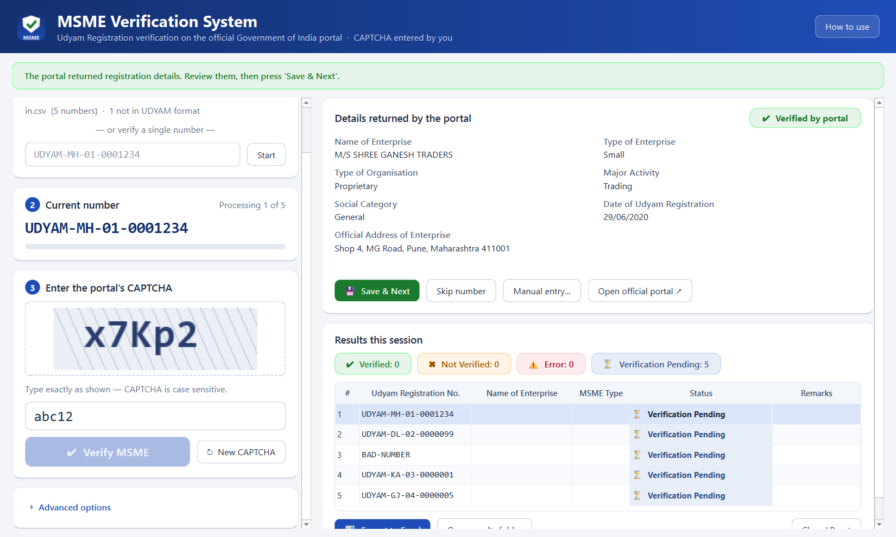

# MSME Verification System

**AICA Level 2 Project – CA Sakshi**

A Windows desktop application that verifies Udyam (MSME) Registration Numbers, one at a time
or in bulk from a CSV, on the **official Government of India portal**
[udyamregistration.gov.in](https://udyamregistration.gov.in). It reads the enterprise details
the portal returns, including whether the enterprise is **Micro, Small or Medium**, and saves them
to a CSV. It can also export a formatted Excel report.


*The screenshot uses made-up sample data and a mock CAPTCHA.*

## Why it is useful

Auditors, accountants and finance teams often need to confirm a vendor's MSME status, for example
for MSME payment-timeline (Section 43B(h)) checks or vendor onboarding. Checking each number
by hand on the portal is slow. This tool keeps the official portal as the only source of truth,
but handles the repetitive steps: loading each number, reading the result, recording it and
building the report.

## Features

- **Bulk or single checks:** load a CSV that has a `udyam_number` column, or type one number.
- **Official portal only:** you type each CAPTCHA yourself. The app never solves or bypasses
  CAPTCHAs, never logs in, sends one request at a time, and waits at least 4 seconds between lookups.
- **Details read from the portal:**
  - name of enterprise
  - **type of enterprise (Micro / Small / Medium)**, taken from the latest classification year
  - type of organisation
  - major activity
  - social category
  - date of registration
  - official address
- **Clear, colour-coded statuses:**

  | Status | Meaning |
  |---|---|
  | ✔ **Verified** | The portal returned the registration details |
  | ✖ **Not Verified** | The portal says the number does not exist, or the format is invalid |
  | ⚠ **Error** | A technical failure such as no internet or the portal being down. Nothing is saved |
  | ⏳ **Verification Pending** | Not yet checked, or skipped |

  A record is **never** marked Verified unless the portal actually returned its details.
- **Progress is never lost:** every result is appended at once to
  `Downloads\udyam_extractedresults.csv`.
- **Excel export:** colour-coded results, plus a Summary sheet with counts by status and by
  Micro / Small / Medium.
- **Manual-entry fallback:** if the portal's page layout changes, verify in the browser and
  record the result by hand.
- **Desktop app:** a modern PySide6 interface with a menu bar, a responsive layout and a busy
  indicator. It can be packaged as a single Windows `.exe`.

## Project structure

| File | Purpose |
|---|---|
| `msme_app.py` | The PySide6 desktop interface |
| `udyam_core.py` | The verification engine: portal requests, HTML parsing, outcome rules and CSV results |
| `excel_export.py` | Excel report |
| `make_icon.py` | Draws the application icon |
| `msme_app.spec`, `version_info.txt`, `build_exe.bat` | Packaging into a Windows `.exe` with PyInstaller |
| `run_from_source.bat` | Runs the app without building |
| `requirements.txt` | Python libraries |
| `sample/udyam_numbers_sample.csv` | Input format example |
| `app/MSME_Verification_System.exe` | Ready-to-run Windows app (no Python needed) |

## Quick start (no Python needed)

Download `app/MSME_Verification_System.exe` and double-click it. If Windows shows
"Windows protected your PC", click *More info → Run anyway* (the app is not code-signed).
An internet connection is required.

## Run from source

You need Windows 10/11, Python 3.10 or newer (3.12 or 3.13 recommended), and an **internet connection**.
The tool does not work offline.

```bash
pip install -r requirements.txt
python msme_app.py
```
No licence key or login is needed.

## Build the Windows .exe

Double-click **`build_exe.bat`**. It will:
1. create a build environment in `%LOCALAPPDATA%\MSMEVerificationSystem`;
2. install the libraries;
3. draw the icon;
4. run PyInstaller.

The result is `dist\MSME_Verification_System.exe`, a single file of about 24.9 MB. It runs on PCs
without Python and opens no command-prompt window. To get a faster-starting folder build instead,
set `ONEFILE = False` in `msme_app.spec`.

## How to use

1. Click **Load CSV file...** (or **File → Save CSV template**), or type a single number and press **Start**.
2. Type the CAPTCHA exactly as shown (it is case sensitive) and press **Verify MSME**.
3. Review the details, then press **Save & Next**. If the CAPTCHA was wrong, a new one loads automatically.
4. When you are done, click **Export to Excel**.

## Security and limitations

- **Portal changes:** the tool depends on the public portal's page layout. If the layout changes,
  automatic reading may stop. Use **Open official portal** and **Manual entry** until the parser is updated.
- **Not an official tool:** it is not affiliated with or endorsed by the Ministry of MSME. Always
  rely on the official portal or certificate for legal purposes.
- **Data stays local:** no data leaves your PC except the requests to the official portal.
  Results files may contain client data, so do not commit them to GitHub (`.gitignore` blocks them).

## Troubleshooting

| Problem | Fix |
|---|---|
| `No module named PySide6` | Run `pip install -r requirements.txt` |
| "Windows protected your PC" when opening the .exe | The .exe is unsigned. Click *More info → Run anyway* |
| Antivirus quarantines the .exe | A common false alarm for PyInstaller one-file builds. Use the folder build (`ONEFILE = False`) |
| The app closes at once or shows "Failed to execute script" | Set `console=True` in `msme_app.spec`, rebuild, and run from a command prompt to see the error |
| "Cannot save row" | The results CSV is open in Excel. Close it and press Retry |
| Type of Enterprise is blank | The portal may label it differently. Check Advanced → *View last portal response* |
