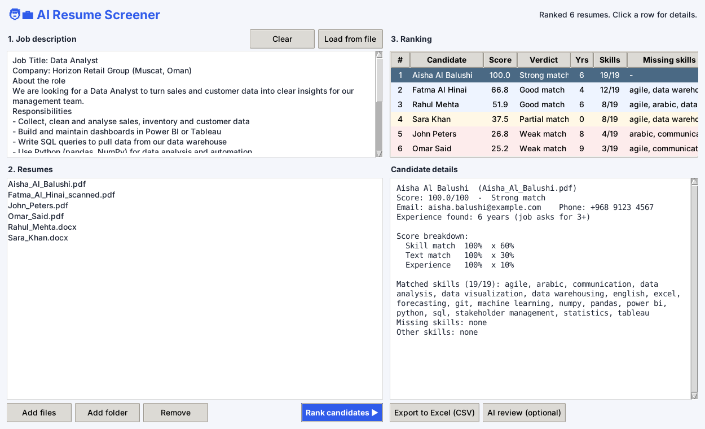

# AI Resume Screener (AICA Level 2)

- **Submitted by:** Sunny Thakkar, AICA Level 2, Batch 127
- **Project type:** Desktop application (Python, Tkinter): skill extraction, TF-IDF text matching and explainable scoring
- **Presentation:** [presentation/AI_Resume_Screener_Presentation.pdf](presentation/AI_Resume_Screener_Presentation.pdf) (PowerPoint version in the same folder)
- **Problem statement:** [PROBLEM_STATEMENT.md](PROBLEM_STATEMENT.md)

A desktop app for recruiters: add a pile of resumes, paste a job description,
click **Rank candidates**. The app scores every resume out of 100 and shows
which of the job's skills each candidate has and which are missing.
Works offline, needs no API key, and reads **PDF, Word (.docx) and scanned PDFs** (built-in OCR).

## Files
| File | What it is |
|---|---|
| `resume_screener.py` | The whole app (one file) |
| `requirements.txt` | Libraries: pypdf, python-docx, rapidocr_onnxruntime (OCR), pypdfium2 |
| `english_words.txt.gz` | Word list used to fix OCR words that run together (keep it next to the .py) |
| `build_exe.bat` | **Double-click to build `Resume_Screener.exe`** |
| `run_app.bat` | Double-click to run the app with Python, without building |
| `sample_job_description.txt` | Sample job: Data Analyst |
| `sample_resumes/` | 6 sample resumes: 3 PDF, 2 Word, 1 scanned PDF |
| `PROBLEM_STATEMENT.md` | Problem statement for the report |
| `presentation/` | Project presentation (PDF and PowerPoint) |

## Make the EXE (recommended)
1. Install **Python 3.12** from https://www.python.org/downloads/ .
   On the first installer screen tick **"Add python.exe to PATH"**.
2. Unzip everything into one folder.
3. Double-click **`build_exe.bat`** (needs internet the first time, about 5 minutes).
4. When it says DONE, `Resume_Screener.exe` is in the same folder. It runs
   on any Windows PC, no Python needed (about 150 MB because the OCR engine is inside).

Windows Defender may warn about a new unsigned EXE: click "More info", then "Run anyway".

## Use it
1. **Job description**: paste it, or click *Load from file* (TXT, PDF or DOCX).
2. **Resumes**: *Add files* or *Add folder* (PDF, DOCX, TXT).
3. Click **Rank candidates**. Click any row to see the score breakdown,
   matched skills, missing skills, email, phone and years of experience.
4. *Export to Excel (CSV)* saves the ranking. *AI review (optional)* writes
   strengths, gaps and interview questions for one candidate with a free
   Gemini (https://aistudio.google.com/apikey) or Groq (https://console.groq.com/keys) key.

**Quick demo:** `python resume_screener.py --demo` (or `Resume_Screener.exe --demo`
with `sample_resumes` and the sample job next to it) opens the app with the samples already ranked.

Command line: `python resume_screener.py sample_job_description.txt sample_resumes`

## How the score works
| Part | Weight | How |
|---|---|---|
| Skill match | 60% | Share of the job's skills found in the resume (about 115 skills with other names, e.g. "ML" = machine learning, "PowerBI" = Power BI) |
| Text match | 30% | TF-IDF + cosine similarity between the job and the resume text |
| Experience | 10% | Years found in the resume vs. "3+ years" asked in the job |

70+ Strong match, 50+ Good, 30+ Partial, below 30 Weak.

Result on the samples: Aisha 100 (Strong), Fatma 67 (Good, scanned), Rahul 52 (Good),
Sara 38 (Partial, fresher), John 27 (developer, Weak), Omar 25 (sales, Weak).

## Limits
- Skills come from a fixed list inside the code (`SKILLS_TEXT`); add a line to support a new skill.
- Years of experience is an estimate from "N years" and date ranges.
- OCR is for printed English. The score helps shortlist; a person makes the final decision.
- Use Python 3.10 to 3.13 (3.12 recommended).

## Credits
OCR: RapidOCR (PaddleOCR models, Apache-2.0). Word list: wordninja project (MIT).
The sample resumes are made up.
