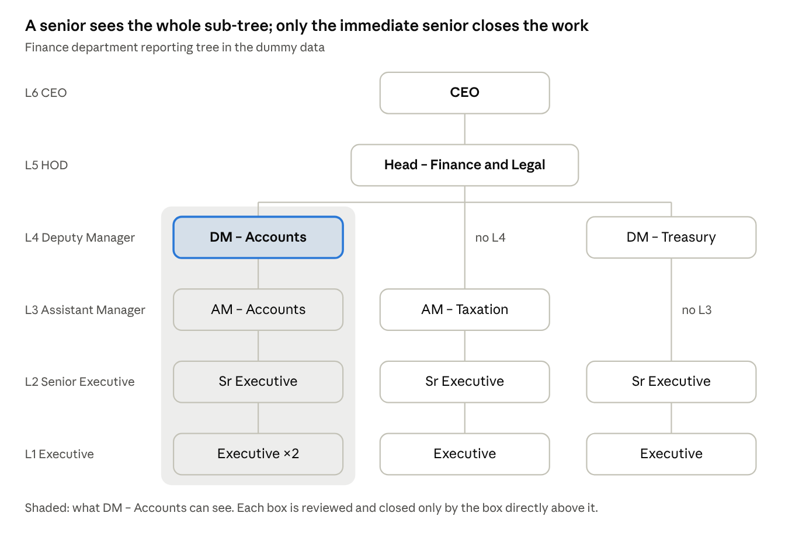
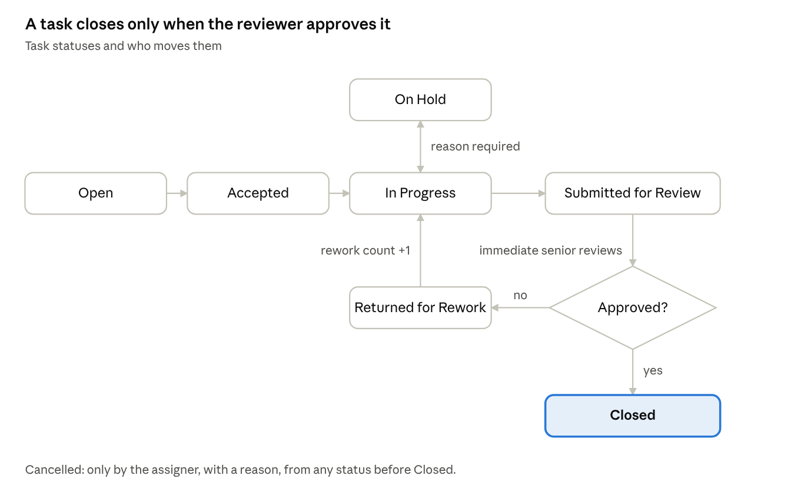
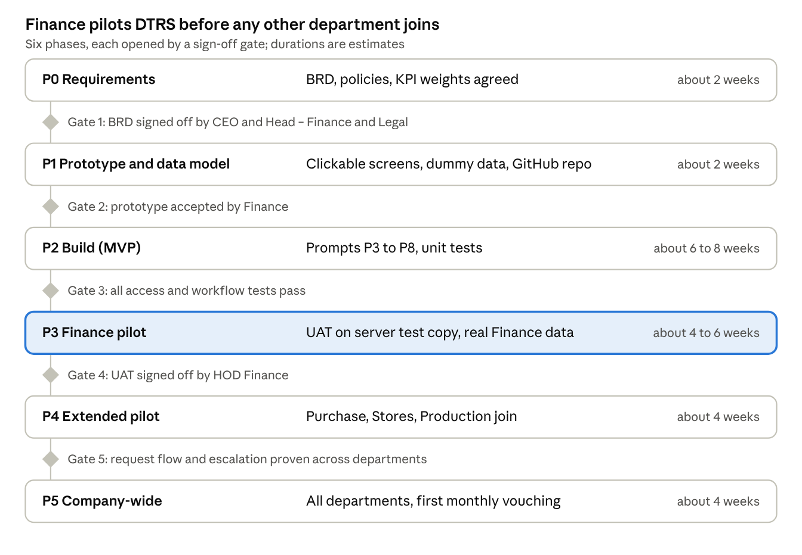

# BRD – Department Task & Review System (DTRS)

Version 0.1 draft · 22-Oct-2026 · Prepared by Pearl (Head – Finance & Legal)

## 1. Document control

This BRD defines version 1.0 of the Department Task & Review System (DTRS). DTRS is a web application that tracks tasks inside a department, requests between departments, and management review of department performance. All names and data are fictitious so that the document can also be submitted for the ICAI AI Level 2 course on GitHub. For internal rollout, the company name and masters are replaced with actual ones.

| Item | Detail |
| --- | --- |
| Document | Business Requirement Document (BRD), v0.1 draft |
| Company (fictitious) | Sample Manufacturing Industries Pvt Ltd (SMIPL) |
| Business owner | Head – Finance & Legal |
| Approvers | CEO, Head – Finance & Legal |
| Technical owner | In-house IT |
| Related project | Finance Operations app (payment planner, month close), kept separate; integration later |

Sections 4–6 fix the structure and access. Sections 7–12 fix the working rules and policies. Sections 13–18 cover configuration, screens, technology, rollout and build prompts.

## 2. Business context and objectives

Today, tasks are tracked in separate Excel sheets for each department. Follow-up between departments happens by phone and email. Management has no single, objective view of how each department delivers.

**Problems to solve**

- No single record of who owns a task, its due date and its current status
- Overdue days are worked out by hand, and completed tasks are moved to separate sheets
- Requests between departments get lost, and no one is accountable for response time
- Reviews by seniors are informal and leave no evidence
- Management assesses department performance without consistent data

**Objectives (measurable)**

1. Every task has one owner, one reviewer, a due date and a live status.
2. Every request between departments has a committed target date and a closure confirmed by the requester.
3. Each senior reviews the work of their direct juniors in the system, with the review recorded.
4. Department scorecards are generated automatically each month, then reviewed and signed off ("vouched") by management.
5. All changes are recorded in an audit trail that cannot be edited.

## 3. Scope

**In scope (v1.0)**

- Organisation masters: plants, departments, sections, designations, reporting lines
- Tasks: assigned, self-initiated, recurring and management directives, with review by the immediate senior
- Requests between departments, with acceptance, target commitment and closure confirmation
- Reminders and escalation by email and in-app alerts
- Dashboards for the individual, the senior, the HOD and management, with monthly scorecards
- Monthly management review and sign-off (vouching)
- Admin console for configuration; IT console for user and technical management
- Excel and PDF export; audit trail

**Out of scope (v1.0)**

- Payment planner and month-end close (separate Finance Operations project)
- Payroll, appraisal workflow and attendance (DTRS only provides inputs)
- SAP integration, mobile app and WhatsApp alerts (possible later)

**Assumptions**

- About 100 named users and about 30 using it at the same time, on the company network or VPN
- Hosted on the company Windows Server and maintained by in-house IT
- English interface, dates shown as DD-MMM-YYYY, working week configurable (default Monday–Saturday)

## 4. Organisation structure

The dummy organisation has 100 users in 15 units: the Management office plus 14 departments. Each department has 3 to 5 levels below the CEO. Sections (sub-groups) are optional; for example, Finance has Accounts, Taxation and Treasury.

**Standard designation levels**

| Level | Designation | Typical role in DTRS |
| --- | --- | --- |
| L6 | CEO (and Head – Finance & Legal for company-wide view) | Management viewer; reviews HODs; vouches department scorecards |
| L5 | Department Head (HOD) | Owns the department; reviews L4 or L3; responds to requests from other departments |
| L4 | Deputy Manager | Section lead; reviews L3 |
| L3 | Assistant Manager | Team lead; reviews L2 |
| L2 | Senior Executive | Doer and first-level reviewer of L1 |
| L1 | Executive (1–2 per team) | Doer |

A department need not have every level. If a level is missing, the junior reports to the next senior level that exists. For example, in Stores an Executive reports to a Senior Executive, who reports directly to the HOD.

**Departments in the dummy data**

| Code | Department | Sections | Levels used | Users |
| --- | --- | --- | --- | --- |
| MGT | Management office | – | L6, L3, L1 | 3 |
| FIN | Finance & Accounts | Accounts, Taxation, Treasury & Finance | L5–L1 | 12 |
| HRA | HR & Admin | HR, Admin | L5–L1 | 7 |
| PUR | Purchase | – | L5, L3–L1 | 6 |
| STR | Stores | – | L5, L2, L1 | 6 |
| LOG | Logistics | – | L5, L3–L1 | 5 |
| PRD | Production | Plant 1, Plant 2 | L5–L1 | 16 |
| QAD | Quality | – | L5–L1 | 8 |
| MNT | Maintenance | Mechanical, Electrical | L5–L1 | 9 |
| SAM | Sales & Marketing | South, North | L5–L1 | 10 |
| PRJ | Projects & Engineering | – | L5, L3–L1 | 5 |
| ITD | Information Technology | – | L5, L2, L1 | 3 |
| LEG | Legal & Secretarial | – | L5, L3, L1 | 3 |
| EHS | Environment, Health & Safety | – | L5, L2, L1 | 4 |
| IAD | Internal Audit | – | L5, L2, L1 | 3 |

The full user list with reporting lines is in the Excel file **DTRS\_Dummy\_Org\_Data.xlsx**, in the Task Management App folder.

## 5. User roles and access rights

Access comes from two things: the person's position in the reporting tree (what they can see) and their system role (what they can do). A person can hold more than one role. For example, the Head – Finance & Legal is HOD of Finance and also a Management Viewer.

| System role | Who holds it | Purpose |
| --- | --- | --- |
| Employee | Everyone | Works on own tasks, raises requests |
| Reviewer | Anyone with at least one reportee | Reviews and closes juniors' tasks |
| HOD | One per department | Full view and control of own department |
| Management Viewer | CEO; Head – Finance & Legal | Company-wide view, review and vouching |
| Functional Admin | DTRS Administrator (MIS) | Maintains masters, hierarchy, rules and templates |
| IT Admin | IT department | User accounts, login, backup, server; no business data |
| Auditor (read-only) | Head – Internal Audit | Read-only access to tasks and audit trail, for audit purposes |

**Access matrix** (Y = allowed, O = own scope only, – = not allowed)

| Capability | Employee | Reviewer | HOD | Mgmt Viewer | Functional Admin | IT Admin | Auditor |
| --- | --- | --- | --- | --- | --- | --- | --- |
| View own tasks | Y | Y | Y | Y | Y | Y | Y |
| View reportees' tasks (whole sub-tree) | – | O | Dept | All | – | – | All (read) |
| Create and assign tasks | To self; to a peer or one level up (same dept) | To sub-tree; to a peer or one level up (same dept) | Within dept | To HODs | – | – | – |
| Review, return or close a junior's task | – | Direct reportees | Dept | HOD tasks | – | – | – |
| Approve a due-date extension | – | Direct reportees | Dept | HOD tasks | – | – | – |
| Raise a request to another department | Y | Y | Y | Y | – | – | – |
| Accept and assign an incoming request | – | If made SPOC | Y | – | – | – | – |
| Department dashboard and scorecard | – | Own team | Own dept | All depts | – | – | All (read) |
| Monthly review comment (HOD self-review) | – | – | Y | – | – | – | – |
| Vouch / sign off scorecard | – | – | – | Y | – | – | – |
| Maintain masters, hierarchy, rules, templates | – | – | – | Approves key changes | Y (maker) | – | – |
| Create, deactivate and unlock user logins | – | – | – | – | Request | Y | – |
| Backup, restore, server settings | – | – | – | – | – | Y | – |
| View audit trail | – | – | Own dept | All | Config changes | Technical logs | All |

Three controls apply throughout:

- **Segregation of duties:** no one reviews or closes their own task.
- **Maker-checker:** the Functional Admin makes configuration changes. Changes to KPI weights, escalation days or roles take effect only after a Management Viewer approves them.
- **IT access:** IT Admin cannot see task content or scores. If IT ever needs database-level access, it is logged.

## 6. Hierarchy and visibility rules

Visibility runs down the reporting tree, like an upside-down tree. A senior sees their entire sub-tree. Only the immediate senior reviews and closes a junior's work. The Finance example below shows this.



Taxation has no Deputy Manager, so the AM – Taxation reports directly to the HOD. Treasury has no Assistant Manager, so its Senior Executive reports to the DM.

**Rules**

1. **Reporting line:** every user has exactly one "reports to" person. The tree is built only from this field, which the Functional Admin maintains.
2. **Visibility:** a user sees their own tasks plus every task in their sub-tree (direct and indirect reportees). Peers do not see each other's tasks unless added as a collaborator.
3. **Review authority:** only the immediate senior reviews, returns or closes a junior's task. Higher seniors can view and comment, but not close.
4. **HOD boundary:** an HOD sees only their own department. They see another department's data only for requests where their department is the requester or the receiver.
5. **Company-wide view:** only the Management Viewers (CEO and Head – Finance & Legal) see all departments.
6. **Confidential tasks:** a task flagged confidential (for example legal, disciplinary or salary matters) is visible only to the assignee, the assigner, the HOD and the Management Viewers. Its title is masked for everyone else in the sub-tree.
7. **Leave delegation:** a reviewer can name a substitute for a date range. The substitute's actions are recorded as "on behalf of".
8. **Changes in reporting line:** when someone moves or leaves, their open tasks and reviews pass to the new senior. Closed history keeps the original reviewer, and the change is recorded in the audit trail.
9. **Missing level:** if a reviewer's position is vacant, review rights pass automatically to the next senior up the line.

## 7. Task lifecycle and review workflow

A task is complete only when the reviewer closes it, not when the doer marks it done. This review step is what makes the scorecard reliable.

**Task types**

| Type | Raised by | Reviewer |
| --- | --- | --- |
| Assigned | Senior to junior | Assigner |
| Self-initiated | Doer | Immediate senior |
| Recurring | System, from a template | Reviewer named in the template |
| Request from another department | Another department | Requester confirms closure |
| Management directive | CEO or Head – Finance & Legal | Directive issuer; flagged on all dashboards |

**Who can raise an item to whom.** Every user from L1 to L4 can raise an item to:

- anyone in their own sub-tree (downward)
- a peer at the same level in their department
- someone exactly one level above them in their department

They cannot raise one to anyone more senior than that. Raising work to another department goes through a request (section 8). The receiver of a peer or upward item accepts or declines it with a reason.

**Raise as a Task or a Request.**

- **Task:** work to be done. Its reviewer is the assigner when the work goes downward, the doer's immediate senior when it goes to a peer or upward, and the immediate senior for one's own work.
- **Request:** asks for data, a confirmation or an approval. The doer sends a response, and the requester confirms closure or reopens it. There is no senior review.

**Category (mandatory dropdown).** Each task or request carries one company-wide category, which drives the default form, the proposed turnaround and the reports by category. The Functional Admin maintains the list and can add sub-categories for each department, for example Reconciliation → Bank, Vendor, GST 2B, Inter-company. The turnaround times below are proposals for management approval.

| Code | Category | Typical examples | Default form | Proposed turnaround |
| --- | --- | --- | --- | --- |
| DR | Data / information request | Sales data by branch, GRN copies, payroll inputs | Request | 2 working days |
| CF | Confirmation / verification | Balance confirmation, stock count confirmation, bank details check | Request | 2 working days |
| AP | Approval / sign-off | Payment approval, rate approval, budget sign-off | Request | 1 working day |
| MD | Master data creation / change | New vendor, customer or material code in SAP; bank detail change | Request | 1 working day |
| DS | Data compilation / sorting / cleansing | Cleaning the vendor list, sorting invoices by age, consolidating plant data | Task | 3 working days |
| RC | Reconciliation | Bank, vendor, GST 2B, inter-company, TDS | Task | 5 working days |
| RP | Report / MIS preparation | Monthly P&L, ageing report, production report | Task | As per report calendar |
| TX | Transaction processing | Payment release, invoice booking, journal entries | Task | 2 working days |
| DC | Document drafting / review | Agreements, Board notes, letters, job descriptions | Task | 5 working days |
| CO | Statutory compliance / filing | GST, TDS, PF, ESI, ROC returns | Task | Before the statutory due date |
| AU | Audit query / observation closure | Internal or statutory audit queries | Task | 7 working days |
| IS | Issue / complaint resolution | Customer complaint, breakdown, system issue | Task | 3 working days |
| FU | Follow-up / coordination | Chasing documents, vendor or bank follow-up | Task | 2 working days |
| PI | Process improvement / project | Automation, SOP revision, capex project | Task | As agreed |
| OT | Other | Anything not covered above, with a description | Task | As agreed |

**Statuses:** Open → Accepted → In Progress → Submitted for Review → Closed. There is also Returned for Rework (back to In Progress), On Hold (reason required) and Cancelled (only by the assigner, with a reason).



Every return for rework is counted and feeds the first-time-right measure (K3) in section 11.

**Mandatory reasons.** These actions cannot be saved without a written reason of at least 10 characters:

- declining a task, a peer or next-level item, or a request
- putting an item on hold
- returning it for rework, or reopening a request
- rejecting a due-date change
- declining a request from another department

The reason is stored in the item's history and shown on the item. It is also sent with the alert to the other party (the requester, reviewer or doer), so they know what to do next.

**Task fields**

- **Core:** Task ID, title, description, type, category, department and section, priority, doer, reviewer, collaborators
- **Dates:** raised on (date and time, captured by the system, not editable), raised by, start date, original due date, revised due date
- **Progress:** % complete, status and a status note
- **Links:** attachments, sub-tasks, "blocked by" link (to a request or another task), confidential flag
- **System-calculated:** days overdue, completion date, on-time flag, number of reworks

**Priority and default response times** (configurable by the Functional Admin)

| Priority | Meaning | Must be accepted within |
| --- | --- | --- |
| Critical | Statutory, safety or customer-impacting | Same working day |
| High | Affects month-end, cash or production | 1 working day |
| Medium | Normal work | 2 working days |
| Low | Improvement or housekeeping | 3 working days |

**Due-date discipline**

- The original due date never changes.
- An extension is a request to the reviewer, raised before the due date, with a reason.
- Approved extensions set a revised due date. Both dates are kept and shown.
- An extension asked for after the due date has passed is still recorded, but the task counts as late.

**Due-date revision trail.** Line items show only two dates: the original due date and the current due date. A task whose date has moved also shows a "revised ×n" marker. For requests between departments, the three dates are need-by, original commitment and current commitment. Each revision is kept in the item's history, not as extra columns:

| Captured per revision | Filled by |
| --- | --- |
| Revision number; previous date → new date | System, from the new date chosen |
| Requested by, requested on, before or after the due date | System |
| Reason (dropdown) and short note | Doer |
| Approved by and approved on | System, on approval |

- **Reasons (dropdown):** waiting on another department; waiting on an external party (bank, vendor, government, auditor); data or documents not received; scope changed; priority changed by a senior; staff on leave or not available; system or IT issue; other.
- **Who approves:** the counterparty approves revisions 1 and 2. That is the reviewer for a task and the requester for a request. Revision 3 onward also needs the HOD.
- **Reports:** % of items revised, average days of slippage from the original date, and top reasons, each by department and category.

## 8. Requests between departments

A request is complete only when the requesting department confirms closure. The receiving department is measured on how quickly it accepts the request and whether it meets its committed date.

1. **Raise:** the requester picks the receiving department, a category, the need-by date, priority and attachments; the system records the raised-on date and time. The request goes to the receiving HOD or the department's designated single point of contact (SPOC).
2. **Accept or decline:** within the acceptance time for its priority (section 7), the receiver either:
   - accepts, assigns a doer and commits a target date, or
   - declines with a reason (for example, not our scope, or information missing).
3. **Negotiate:** if the committed date is later than the need-by date, the requester accepts it or escalates to their own HOD.
4. **Execute:** the request works as a normal task inside the receiving department, including review by the immediate senior.
5. **Confirm closure:** the requester confirms that the work meets the need, or reopens it with a reason. If there is no response within 3 working days, it closes automatically as "closed – not confirmed".
6. **Dispute:** an unresolved disagreement goes to both HODs, then to the Management Viewers.

If a task in the requesting department is delayed because of an open request, the doer links it as "blocked by" that request. With HOD approval, the delay counts against the receiving department, not the doer.

## 9. Recurring tasks and report calendar

The system creates each period's recurring tasks automatically from templates, so routine reports and compliances do not need to be re-entered.

**Template fields:**

- **What:** title, department and section, category, priority, doer, reviewer, checklist, evidence required (yes/no)
- **When:** frequency (daily, weekly, fortnightly, monthly, quarterly, half-yearly, annual), due rule, lead days, start and end dates

**Due rules supported**

- A fixed calendar day, for example the 7th of each month
- The Nth working day, for example the 4th working day for monthly financials
- A weekday, for example every Monday
- An offset from period end, for example 15 days after quarter end
- If a due date falls on a holiday, it moves to the previous working day (configurable). Holidays come from the plant-wise holiday calendar.

**Example templates in the dummy data**

| Department | Recurring task | Frequency | Due rule |
| --- | --- | --- | --- |
| FIN | Monthly P&L and Balance Sheet to management | Monthly | 4th working day |
| FIN | Debtors and creditors ageing review | Weekly | Monday |
| HRA | Payroll inputs to Finance | Monthly | 25th |
| PRD | Daily production and downtime report | Daily | Same day |
| QAD | Customer complaint closure review | Weekly | Friday |
| MNT | Preventive maintenance schedule compliance | Monthly | 3rd working day |
| PUR | Open PO and pending GRN review | Fortnightly | 1st and 16th |
| STR | Non-moving inventory report | Monthly | 5th working day |
| EHS | Plant safety inspection | Monthly | Last working day |
| LEG | Statutory compliance certificate to Board | Quarterly | 15 days after quarter end |

Statutory due dates (GST, TDS, PF, ESI, ROC and so on) are entered by the Functional Admin. They are verified against the current notifications each year, because the government can change them. A missed statutory task is flagged red on the management dashboard, whatever the department's score.

## 10. Escalation and notification policy

Overdue items move up the reporting line one level at a time, so management sees only what the lower levels have not resolved. Days are working days, and the Functional Admin can configure them (maker-checker).

| Trigger | Normal priority goes to | Critical priority goes to |
| --- | --- | --- |
| 2 days before due | Doer (reminder) | Doer (reminder, 3 days before) |
| On due date | Doer | Doer + reviewer |
| 1 day overdue | Reviewer (immediate senior) | HOD |
| 3 days overdue | HOD | Management Viewers |
| 7 days overdue | Management Viewers | Management Viewers (daily until closed) |
| Request not accepted within its acceptance time | Receiving HOD | Receiving HOD + Management Viewers |
| Review pending more than 2 days after submission | Reviewer's own senior | HOD |

**Notification channels**

- In-app bell for every event
- Email for assignments, returns, escalations and requests
- A daily 9:00 AM digest to each user (my tasks due today, overdue, reviews pending)
- A Monday summary to each HOD
- A monthly scorecard pack to the Management Viewers

Users cannot switch off escalation emails. They can switch off informational emails.

## 11. KPI and performance scoring policy

Each department and each individual gets a monthly score out of 100, built from five weighted measures. The weights below are a proposal for management approval. Once approved, they change only through maker-checker.

| # | Measure | Formula (for the month) | Weight |
| --- | --- | --- | --- |
| K1 | On-time completion | Tasks closed on or before the applicable due date ÷ tasks closed | 40 |
| K2 | Overdue control | 1 − (open tasks overdue at month end ÷ open tasks at month end) | 20 |
| K3 | First-time right | Tasks closed without a "returned for rework" ÷ tasks closed | 15 |
| K4 | Responsiveness to other departments | Average of (requests accepted within their acceptance time %) and (requests closed by committed date %) | 15 |
| K5 | Recurring and compliance adherence | Recurring tasks closed on time ÷ recurring tasks due | 10 |

```latex
\text{Score} = \sum_{k=1}^{5} w_k \times K_k \quad \text{where } \sum w_k = 100
```

Each task is weighted by priority: Critical 3, High 2, Medium 1, Low 1. One late critical task therefore counts as much as three late medium tasks.

| Score | Band | Colour |
| --- | --- | --- |
| 90–100 | Excellent | Green |
| 75–89 | Good | Light green |
| 60–74 | Needs attention | Amber |
| Below 60 | Critical | Red |

**Fairness rules**

- **What "on time" means:** a due date is the revised date only if the extension was approved before the original due date.
- **Exclusions:** cancelled tasks are excluded. Delays caused by another department ("blocked by", approved by the HOD) are excluded from the doer's score.
- **Small numbers:** fewer than 10 closed tasks in a month is shown as "insufficient data", not as a score.
- **Statutory misses:** a missed statutory due date is reported separately as a red flag. The weighted score does not dilute it.
- **Use of the score:** it is an input to appraisal, not the only basis. The HOD's and management's remarks sit beside it.
- **Individual scores:** they use the same measures (K4 only for HODs and SPOCs). Each person sees their own score, their seniors see their team's scores, and they are never shown to peers.

## 12. Management review and vouching

Each month's scorecard is frozen, explained by the HOD, and signed off by management by the 10th working day. Once signed off it is locked and becomes the record for performance discussions.

1. **Working day 1 – freeze:** the system takes a snapshot of the previous month's data and computes K1–K5 for every department and person. Later edits to that month's tasks do not change the snapshot.
2. **By working day 5 – HOD self-review:** each HOD adds remarks on the scorecard: achievements, reasons for delays, help needed from other departments, and corrective actions with owners and dates. The corrective actions become tasks automatically.
3. **By working day 10 – management review:** a Management Viewer reviews each department and records one of the options below. A Management Viewer who is also an HOD never vouches their own department; the CEO vouches it.
   - **Vouched:** the score is accepted as is.
   - **Vouched with remarks:** the score is accepted, with remarks added.
   - **Adjusted:** the score is overridden. A reason is mandatory, and both the system score and the adjusted score are kept.
4. **Lock:** the signed-off scorecard becomes read-only and is available as a PDF.
5. **Quarterly:** the system rolls up three months per department and individual, with trends, for appraisal and Board reporting.

The management cockpit shows all departments side by side and highlights red flags:

- statutory misses
- critical tasks more than 7 days overdue
- disputed requests

From any department's figure, management can drill down to the individual tasks behind it.

## 13. Admin configuration and IT role

The Functional Admin configures the business rules without any coding. IT Admin only keeps the system running and secure. The two roles are kept separate on purpose.

| Area | Functional Admin can configure | Checker (approval needed) |
| --- | --- | --- |
| Organisation | Plants, departments, sections, designations and levels | – |
| People | Employee master, reporting line, department SPOC, leave delegation | – |
| Roles | Grant or remove HOD, Management Viewer, Auditor or Admin roles | Management Viewer |
| Task rules | Categories, priorities, acceptance times, confidential categories | – |
| Escalation | Days and recipients for each step | Management Viewer |
| KPI | Measures on or off, weights, bands, minimum task count | Management Viewer |
| Calendar | Weekly off days (default: Sunday, so a 6-day week), plant-wise holiday list, Excel upload or sync from the company calendar. All due dates, overdue days, turnaround and escalation are counted in working days from it, and a due date cannot fall on a non-working day. | – |
| Recurring | Templates, due rules, doer and reviewer | HOD of that department |
| Communication | Email templates, digest time | – |
| Bulk upload | Employees, reporting lines and templates from Excel, using the same columns as DTRS\_Dummy\_Org\_Data.xlsx | – |

**IT Admin's limited role:**

- create and deactivate logins, link them to Windows (Active Directory) accounts, unlock accounts
- manage the server, SSL certificate, email (SMTP) settings, backup and restore, and technical logs

IT Admin has no access to task screens, dashboards or scores. Every admin action is recorded in the audit trail with the old value, the new value, who made it and when.

## 14. User interface and screens

Each user lands on a home screen that matches their role and shows what needs action today. Every common action is within 3 clicks. The clickable prototype shows these screens with the dummy data.

| # | Screen | Main users | Key contents |
| --- | --- | --- | --- |
| 1 | Login | All | Windows (AD) login; company logo |
| 2 | My Work (home) | All | Due today, overdue, upcoming 7 days, reviews waiting for me, my requests; quick-add task |
| 3 | Task list | All | Line items show raised on and by, doer, reviewer, category, priority, due date and status; a filter dropdown under each column heading (department for management, category, doer, reviewer, priority, due, status); list or board (Kanban) view; export |
| 4 | Task detail | All | Header with status and dates; activity timeline; comments with @mention; attachments; sub-tasks; review buttons |
| 5 | My Team | Reviewers, HOD | Reporting tree with each person's open, overdue and score counts; click a person to see their tasks |
| 6 | Requests | All | Inbox (to my department) and outbox (raised by us), with acceptance and closure actions; filter dropdowns under the column headings (category, department, priority, status); decline reason shown on the line |
| 7 | Recurring calendar | HOD, doers | Month calendar of recurring and statutory items, colour-coded by status |
| 8 | Department dashboard | HOD | KPI tiles K1–K5, trend over 6 months, overdue ageing, top delays, monthly self-review form |
| 9 | Management cockpit | CEO, Head – F&L | All departments ranked by score, red flags, vouching action; plus a Department Summary (open, overdue, critical overdue, awaiting review and revised items for each department) that drills down to the tasks |
| 10 | Reports | HOD, Management | Standard reports to Excel or PDF: task register, overdue ageing, request SLA, scorecard |
| 11 | Admin console | Functional Admin | Masters, hierarchy editor, rules, templates, approvals queue |
| 12 | IT console | IT Admin | Users, AD link, backup status, system health |

**My Dashboard (every level, L1 to L6).** Each user sees their own statistics for the month, counted in working days:

- items assigned, closed (and how many on time), open and overdue
- on-time and first-time-right percentages
- items they raised that are still open with others, and items with revised due dates
- breakdowns by status, category and priority
- their individual measures K1, K2, K3 and K5. The indicative score is used for review only from 10 closed items, and K4 applies only to HODs and SPOCs.

Anyone with juniors also sees a team section for everyone below them, with the same counts for each person. Peers never see each other's figures. The CEO's team view is the Department Summary and the Cockpit.

**Menu order.** The left menu is grouped, and each user sees only the screens their role allows. After login the user lands on My Dashboard.

| Group | Screens, in order |
| --- | --- |
| Overview | My Dashboard (landing page) → Team Dashboard → Department Dashboard |
| Management | Department Summary → Management Cockpit |
| Work | My Work → Team Work → All Tasks → Inter-department Requests |
| Administration | Admin Console, IT Console |

**Design standards**

- **Consistent status colours:** green = closed or on time, amber = due within 2 days, red = overdue, grey = on hold.
- **Layout:** left navigation, clean tables, responsive so that it works on a phone browser, light and dark themes.
- **Formats:** DD-MMM-YYYY dates, Indian number format, and search on every list.

## 15. Non-functional requirements

The rules on access, audit and data protection are as binding as the functional rules. The server enforces them, not just the screen.

| Area | Requirement |
| --- | --- |
| Users and load | 100 named users, about 30 at a time; designed to grow to 300 |
| Speed | Pages open within 2 seconds on the office network |
| Availability | Working hours on working days; planned maintenance after hours |
| Login | Windows (AD) single sign-on; local password fallback with minimum 10 characters; lock after 5 failed attempts; 30-minute idle timeout |
| Access control | Role and reporting-tree checks applied on the server for every request and every export |
| Audit trail | Records every create, edit, status change, review, extension, admin change and login; append-only, cannot be edited by any role |
| Attachments | Up to 10 MB each; PDF, Office files and images only; stored on the server, not emailed |
| Encryption | HTTPS inside the network; database backups encrypted |
| Backup | Daily full database and attachment backup, kept on a separate drive; restore tested quarterly |
| Retention | Closed tasks and scorecards kept for the period in the company's record retention policy (to be fixed by Legal) |
| Data protection | Employee personal data limited to name, employee code, designation, department, email and reporting line. Employees are informed of the purpose. Scores are visible only per the access matrix. Legal to confirm the Digital Personal Data Protection Act, 2023 obligations before go-live. |

## 16. Technology and deployment

DTRS will be a Python/Django web application with a PostgreSQL database, on the company Windows Server, opened in a browser. Nothing is installed on users' PCs.

| Layer | Choice | Reason |
| --- | --- | --- |
| Language and framework | Python 3.12, Django 5.2 (long-term support release) | Built-in login, permissions, admin and security; widely documented |
| Screens | Django templates, Bootstrap 5, HTMX, Chart.js | No separate front-end build; fast to change; works on phones |
| Database | PostgreSQL (current supported version) | Free, reliable, has a Windows installer; Microsoft SQL Server is the alternative if already licensed |
| Web server | Waitress (Python) behind IIS as reverse proxy with HTTPS | Standard way to run Django on Windows Server |
| Background jobs | Windows Task Scheduler running Django commands: recurring task generation (daily), reminders and escalation (hourly), monthly freeze | Simple; no extra software |
| Login | django-auth-ldap linked to Active Directory | Staff use their Windows password |
| Email | Company SMTP or Microsoft 365 | Notifications and digests |
| Exports | openpyxl (Excel), WeasyPrint or ReportLab (PDF) | Excel and PDF reports |
| Source control | GitHub (private repository) | Version history, issues, course submission |

**Environments**

- Development on the laptop with the dummy data
- A test copy on the server for user acceptance testing (UAT) by the Finance pilot
- Production on the server with real data

Code moves to the server only from GitHub release tags.

## 17. Rollout plan and UAT

The rollout has six phases. Each phase starts only after the previous one passes its sign-off gate. Durations are estimates and depend on the speed of review and of IT setup.



**User acceptance tests (UAT) for the Finance pilot**

- [ ] An Executive sees only own tasks; a Senior Executive sees own plus reportees'; HOD Finance sees all of Finance and nothing of Purchase
- [ ] A reviewer cannot close their own task; a skip-level senior can comment but cannot close
- [ ] Extension asked before the due date: the task counts as on time against the revised date. Asked after the due date: it counts as late
- [ ] Recurring monthly task on the "4th working day" lands correctly when a holiday falls in the first 4 days
- [ ] Escalation emails go to the right person at 1, 3 and 7 days overdue
- [ ] Request from Finance to Purchase: accept, commit a date, close, and confirm by Finance; it auto-closes after 3 days without confirmation
- [ ] Confidential task title is masked for others in the sub-tree
- [ ] Monthly freeze, HOD remarks, management vouching and lock all work; an adjusted score keeps both values
- [ ] Functional Admin's change to KPI weights does not apply until a Management Viewer approves it
- [ ] IT Admin cannot open any task or dashboard
- [ ] The audit trail shows every action in the tests above

## 18. Build prompts and GitHub plan (ICAI Level 2)

The build is done with Claude in 9 prompts, one for each build stage. Each prompt is saved in the repository with its output, so the course submission shows how AI was used at each stage.

| # | Stage | Prompt to give Claude (attach this BRD each time) |
| --- | --- | --- |
| P1 | Requirements | "Act as a business analyst for an Indian manufacturing company. Using the attached BRD, list any gaps, conflicts or untestable rules, and propose resolutions." |
| P2 | Data model | "Design the Django data model for DTRS per sections 4–13: Plant, Department, Section, Level, Employee (reports\_to), Role, Task, TaskEvent, Request, RecurringTemplate, Holiday, KPIConfig, Scorecard, AuditLog. Give an ER diagram and model code." |
| P3 | Project setup | "Create a Django 5.2 project 'dtrs' with apps org, tasks, requests, recurring, kpi, review, audit, adminconsole. Add PostgreSQL settings via environment variables, Bootstrap 5 base layout and a load\_dummy\_data command that reads DTRS\_Dummy\_Org\_Data.xlsx." |
| P4 | Hierarchy and access | "Implement the reporting tree and the access matrix in section 5 and the visibility rules in section 6 as server-side checks. Write unit tests for every row of the matrix." |
| P5 | Task lifecycle | "Build the task screens and status workflow in section 7, including extensions, rework count and the audit trail." |
| P6 | Requests, recurring tasks and escalation | "Implement sections 8–10: request flow, recurring generator with working-day rules and holiday calendar, and escalation commands for Windows Task Scheduler." |
| P7 | KPI and review | "Implement section 11 scoring and the section 12 freeze, self-review, vouching and lock. Add tests with worked examples." |
| P8 | Dashboards | "Build the screens in section 14: My Work, My Team tree, HOD dashboard, management cockpit, with Chart.js and Excel/PDF export." |
| P9 | Deployment | "Write a step-by-step guide to deploy on Windows Server with PostgreSQL, Waitress, IIS reverse proxy with HTTPS, AD login, SMTP and scheduled backups." |

**Proposed repository layout**

```
dtrs/
├── README.md            project summary, screenshots, how to run
├── docs/                BRD (exported), data model, deployment guide, UAT results
├── prompts/             P1–P9 prompts and Claude's responses
├── prototype/           clickable HTML prototype
├── data/                DTRS_Dummy_Org_Data.xlsx
├── dtrs/                Django project and apps
└── tests/               unit tests for access, workflow, KPI
```

Only fictitious data goes to GitHub. Real employee data and the server's passwords stay off GitHub; they are kept in a `.env` file that is excluded from the repository.

## 19. Open points and decisions needed

The draft can move to sign-off once management decides the first four points below. The rest can be settled during the build.

- [ ] Approve KPI measures and weights (40/20/15/15/10) and the score bands (section 11)
- [ ] Approve escalation days (1/3/7) and acceptance times by priority (sections 7 and 10)
- [ ] Confirm the Management Viewers: CEO and Head – Finance & Legal only, or also Directors
- [ ] Confirm the confidential task categories (legal, disciplinary, salary, others?)
- [ ] Confirm the working week (Monday–Saturday assumed) and the plant-wise holiday list
- [ ] IT to confirm Windows Server version, Active Directory availability, SQL Server licence, SMTP details and VPN access for plants
- [ ] Legal to fix the record retention period and the employee notice under the DPDP Act, 2023
- [ ] Choose a product name: DTRS is a working title
